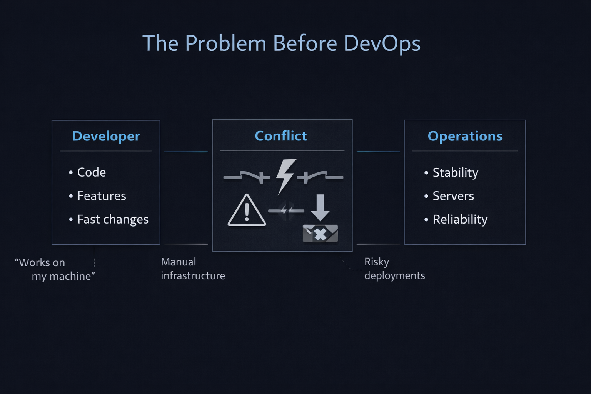
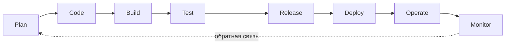
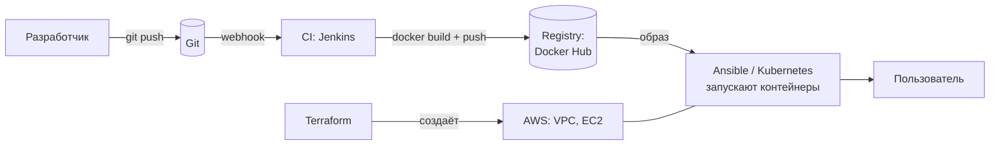
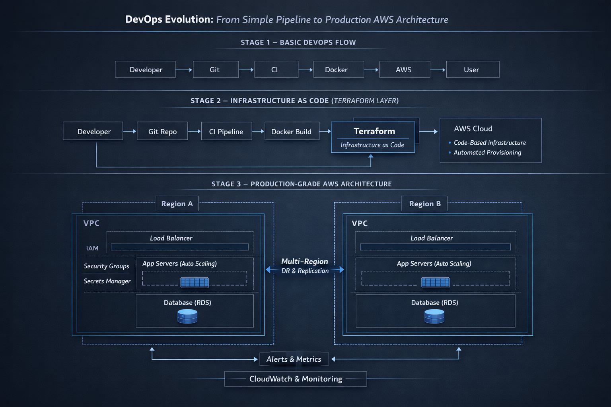
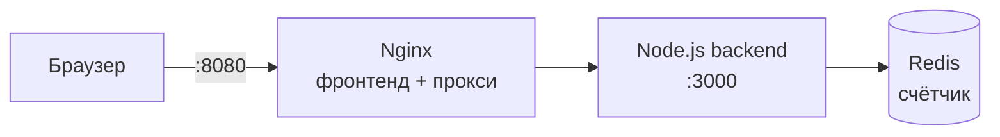

# 01 · Что такое DevOps

!!! abstract "В этой главе"
    **Что вы узнаете:** какую проблему решает DevOps, из чего он состоит (культура, автоматизация, обратная связь), что такое CI, CD и Infrastructure as Code, как выглядит путь изменения от строчки кода до пользователя и где в этом пути каждый инструмент пособия.

    **Что нужно до начала:** [глава 00](../00-setup/README.md) — установлен Git, скачано пособие.

    **Практики в AWS нет.** Эта глава строит общую картину, к которой вы будете возвращаться весь курс.

## Зачем это нужно

Что сложнее: написать код или сделать так, чтобы он **стабильно работал у тысяч пользователей**?

Новички обычно отвечают «написать код». На практике код — только начало. Его нужно собрать, проверить, доставить на серверы, настроить эти серверы, следить, чтобы всё работало, и откатить, если сломалось. Причём делать это десятки раз в день, не роняя продакшен.

DevOps — это ответ на вопрос **«как часто и безопасно менять работающую систему»**. Не набор инструментов и не должность, а подход к инженерии изменений. Инструменты (Terraform, Docker, Kubernetes) — это способы реализовать этот подход.

## Концепция

### Проблема до DevOps



Раньше было два мира:

| Разработка (Dev) | Эксплуатация (Ops) |
|---|---|
| Хочет выпускать фичи **быстро** | Хочет, чтобы всё работало **стабильно** |
| Меряет успех количеством изменений | Меряет успех отсутствием аварий |
| «У меня на машине работает» | «Это ваш код сломал сервер» |

Каждое изменение — потенциальная авария, поэтому Ops сопротивляется изменениям. Dev копит изменения, релизы становятся редкими и огромными, и каждый релиз — стресс на всю ночь.

Это **не конфликт людей, а конфликт целей**. Обе стороны правы. Проблема в том, что между ними нет системы, которая делает изменения безопасными.

Типичные симптомы:

- **«Works on my machine»** — окружения разработчика, тестового и боевого сервера отличаются.
- **Ручная инфраструктура** — серверы настроены руками, никто не помнит как. Сервер упал — повторить его нельзя.
- **Рискованные деплои** — выкладка по инструкции из 40 шагов через SSH, ошибка в любом шаге ломает продакшен.

### Что такое DevOps

**DevOps = культура + автоматизация + непрерывное улучшение.**

1. **Культура: общая ответственность.** Нет «это не моя зона». Разработчики думают о том, как код будет работать в продакшене, эксплуатация участвует в проектировании. Общие метрики, общий результат.
2. **Автоматизация: снижение риска.** Всё, что повторяется, делается кодом и машиной: сборка, тесты, создание серверов, деплой. Автоматизация нужна не ради удобства, а ради **предсказуемости**: скрипт выполняет шаги одинаково каждый раз.
3. **Обратная связь: непрерывное улучшение.** Мониторинг и метрики показывают, как изменения влияют на систему. Ошибки разбираются, процесс улучшается.

Простой тест: **если релиз — это стресс, система построена неправильно.** Хороший релиз скучный: нажали кнопку (или сделали `git push`), через 10 минут изменения у пользователей, и никто не нервничает.

### Ключевые практики

**CI — Continuous Integration (непрерывная интеграция).** Каждое изменение кода автоматически собирается и проверяется тестами сразу после `git push`. Ошибка находится через минуты, а не через месяц при большом релизе. Инструменты: Jenkins (главы 11–12), GitHub Actions, GitLab CI.

**CD — Continuous Delivery / Deployment (непрерывная доставка / развёртывание).** Собранное и проверенное изменение автоматически доставляется в окружение. *Delivery* — готово к выкладке, финальная кнопка за человеком. *Deployment* — выкладывается в продакшен полностью автоматически.

**IaC — Infrastructure as Code (инфраструктура как код).** Серверы, сети, права доступа описываются в файлах, которые лежат в Git. Вы не кликаете в консоли, а **описываете желаемое состояние**, и инструмент приводит к нему реальность. Инструменты: Terraform (главы 06–08), Ansible (главы 13–14).

Пример IaC на Terraform. Синтаксис разберём в главе 06, сейчас просто прочитайте сверху вниз:

```hcl
# Провайдер: с каким облаком работаем
provider "aws" {
  region = "us-west-2"
}

# VPC: изолированная сеть
resource "aws_vpc" "main" {
  cidr_block = "10.0.0.0/16"
}

# Subnet: подсеть внутри VPC
resource "aws_subnet" "public" {
  vpc_id     = aws_vpc.main.id
  cidr_block = "10.0.1.0/24"
}

# Security Group: firewall, пускает только HTTP
resource "aws_security_group" "web" {
  vpc_id = aws_vpc.main.id
  ingress {
    from_port   = 80
    to_port     = 80
    protocol    = "tcp"
    cidr_blocks = ["0.0.0.0/0"]
  }
}

# EC2: виртуальный сервер
resource "aws_instance" "web" {
  ami                    = "ami-xxxxxxxx"  # образ ОС; в главе 06 научимся находить его автоматически
  instance_type          = "t3.micro"
  subnet_id              = aws_subnet.public.id
  vpc_security_group_ids = [aws_security_group.web.id]
}
```

Этот файл — **полное описание** инфраструктуры. Его можно прочитать на код-ревью, отследить изменения в Git, а через полгода воссоздать ту же инфраструктуру одной командой.

### Жизненный цикл изменения



Это знаменитая «бесконечная петля» DevOps. Каждый этап отвечает на свой вопрос:

| Этап | Вопрос | Инструменты в пособии |
|------|--------|-----------------------|
| Code | Где хранится код и кто что менял? | Git, GitHub |
| Build | Как превратить код в то, что можно запустить? | Docker (09) |
| Test | Не сломали ли мы что-то? | Jenkins pipeline (11–12) |
| Release / Deploy | Как доставить изменение на серверы? | Jenkins, Ansible (14), Kubernetes (15–18) |
| Operate | На чём всё работает? | AWS (02–05), Terraform (06–08), Docker Compose (10) |
| Monitor | Работает ли? Насколько быстро? | Prometheus, Grafana (вне этого пособия) |

### Путь изменения от разработчика до пользователя



Где Git — **источник правды**: всё, что работает в продакшене, описано в репозитории. CI — **автоматический исполнитель**. Docker — **упаковка**, одинаковая везде. Terraform — **фундамент**, на котором всё запущено.

Так эта цепочка эволюционирует от простой к production-архитектуре:



К концу пособия вы построите первые два уровня этой схемы своими руками. Третий уровень (несколько регионов, автомасштабирование, базы данных) — то, куда растут реальные системы, и о нём полезно знать уже сейчас.

### Безопасность — часть системы, а не надстройка

Несколько принципов, которые будут встречаться в каждой главе:

- **Least privilege (минимальные привилегии).** Каждый пользователь, сервис и сервер получает доступ только к тому, что ему нужно. Не больше. IAM в главах 04–05.
- **Сеть — граница.** Базы данных живут в приватных подсетях без доступа из интернета, наружу открыто только необходимое. VPC в главе 02.
- **Секреты не в Git.** Пароли и ключи хранятся в специальных хранилищах: AWS Secrets Manager, Parameter Store, HashiCorp Vault, Kubernetes Secrets (глава 17).

!!! example "Плохо / Хорошо: IAM-политика"

    === "❌ Плохо"

        ```json
        {
          "Effect": "Allow",
          "Action": "*",
          "Resource": "*"
        }
        ```
        Доступ ко **всему**. Если сервер с такими правами взломают, атакующий получит весь аккаунт: удалит базы, запустит майнеры, прочитает данные клиентов.

    === "✅ Хорошо"

        ```json
        {
          "Effect": "Allow",
          "Action": ["s3:GetObject"],
          "Resource": "arn:aws:s3:::my-app-assets/*"
        }
        ```
        Только чтение файлов из одного бакета. Взлом сервера даёт атакующему ровно это и ничего больше. Это называется **уменьшить радиус поражения** (blast radius).

!!! quote "Реальный кейс"
    Небольшая компания держала весь продукт на одном сервере, настроенном вручную три года назад. Мониторинга не было. Ночью закончилось место на диске, сервис упал. Узнали утром от клиентов. Восстановить сервер «как было» не смогли: инженер, который его настраивал, давно ушёл, а инструкций не осталось. Два дня простоя.

    Ни одна из проблем не была «про DevOps-инструменты». Это проблемы **архитектуры и процесса**: нет описания инфраструктуры (IaC), нет мониторинга, нет второго сервера. DevOps — это способ такие проблемы не допускать.

## Практика: осмотрите учебный проект

Через всё пособие проходит одно приложение — счётчик посещений. Откройте папку пособия в VS Code:

```bash
cd devops-handbook
code .
```

Осмотрите структуру:

```text
devops-handbook/
├── app/                      ← код приложения (готов, его не меняем)
│   ├── backend/              ← Node.js API: /health, /info, /api/hits, /metrics
│   └── frontend/             ← HTML-страница + конфиг Nginx
├── project/                  ← эталонная инфраструктура, которую вы построите
│   ├── terraform/            ← главы 06–08
│   ├── docker-compose.yml    ← глава 10
│   ├── Jenkinsfile           ← главы 11–12
│   ├── ansible/              ← главы 13–14
│   └── k8s/                  ← главы 15–18
└── docs/                     ← текст пособия
```

Архитектура приложения:



Обратите внимание на разделение: `app/` — это работа разработчиков, `project/` — работа DevOps-инженера. Вы не пишете код приложения, вы делаете так, чтобы он собирался, доставлялся и работал.

!!! success "✅ Проверь себя"
    Откройте `project/README.md` и найдите в таблице, в какой главе появится каждый файл. Сопоставьте их с этапами жизненного цикла из таблицы выше: какой файл отвечает за Build, какой за Deploy, какой за Operate?

## Вопросы для самопроверки

<details markdown="1">
<summary>1. Если разработчик выпускает изменения каждый день, а эксплуатация боится каждого релиза, кто прав?</summary>

Оба. Бизнесу нужны и скорость, и стабильность. Проблема не в людях, а в отсутствии системы, которая делает изменения безопасными: автоматических тестов, воспроизводимых окружений, быстрого отката. Когда такая система есть, частые релизы становятся **безопаснее** редких: каждое изменение маленькое, его легко проверить и откатить.
</details>

<details markdown="1">
<summary>2. Можно ли называть процесс DevOps, если деплой делается вручную через SSH по инструкции?</summary>

Нет, это ручная эксплуатация. Каждый ручной шаг — место для ошибки и источник различий между серверами. В DevOps-процессе деплой воспроизводим: одни и те же шаги, выполненные машиной, с тем же результатом. Ручной SSH остаётся для диагностики, но не для изменений.
</details>

<details markdown="1">
<summary>3. Вы удалили сервер, но у вас есть Terraform-код, который его описывает. Получится ли такой же сервер?</summary>

Да, в этом смысл IaC. `terraform apply` создаст инфраструктуру по описанию. Оговорка: **данные** внутри сервера (база, загруженные файлы) не являются кодом и сами не восстановятся, для них нужны бэкапы. IaC восстанавливает инфраструктуру, а не данные.
</details>

<details markdown="1">
<summary>4. Если Docker-образ везде одинаковый, может ли «works on my machine» всё ещё случиться?</summary>

Да, хотя и реже. Образ одинаковый, но **окружение** вокруг него может отличаться: переменные окружения, доступ к базе, сеть, объём памяти, архитектура процессора (образ под `amd64` на Mac с `arm64`). Docker убирает различия внутри контейнера, а различия снаружи убирают IaC и одинаковая конфигурация окружений.
</details>

<details markdown="1">
<summary>5. Должна ли база данных находиться в публичной подсети?</summary>

Нет. База нужна только приложению, пользователи к ней напрямую не ходят. Если она в публичной подсети, она доступна (или может стать доступной из-за одной ошибки в firewall) всему интернету, где боты постоянно ищут открытые базы. Правильно: база в **приватной** подсети, доступ только от серверов приложения. Подробности в главе 02.
</details>

## Итоги

- [x] DevOps — это подход к безопасным частым изменениям: культура, автоматизация, обратная связь
- [x] CI проверяет каждое изменение, CD доставляет его, IaC описывает инфраструктуру кодом
- [x] Жизненный цикл: Plan → Code → Build → Test → Release → Deploy → Operate → Monitor
- [x] Знаете, какой инструмент пособия отвечает за какой этап
- [x] Least privilege, приватные сети и секреты вне Git — базовые принципы безопасности

**Что дальше.** В [главе 02](../02-aws-vpc-ec2/README.md) — первое знакомство с AWS: регионы, сети VPC, виртуальные серверы EC2. Вы запустите свой первый сервер и подключитесь к нему по SSH.

- 📋 [Шпаргалка по терминам](commands.md)
- 🏋️ [Задания к главе](exercises.md)
