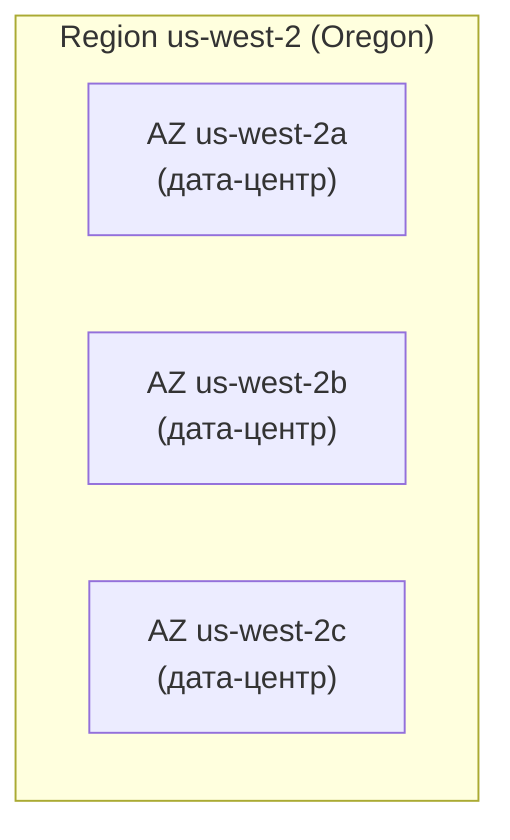
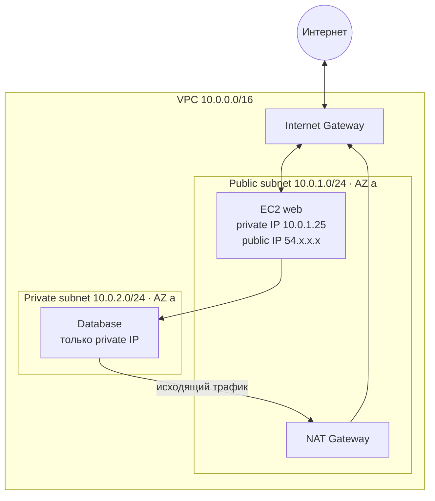
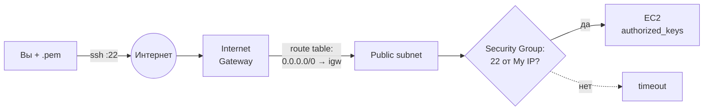

# 02 · AWS: регионы, VPC и первый сервер EC2

!!! abstract "В этой главе"
    **Что вы узнаете:** как устроена глобальная инфраструктура AWS (регионы и зоны доступности), что такое VPC, подсети, Internet Gateway, таблица маршрутов и Security Group, как запустить виртуальный сервер EC2 и подключиться к нему по SSH.

    **Что нужно до начала:**

    - [Глава 00](../00-setup/README.md): аккаунт AWS с MFA, бюджет $10, регион `us-west-2`.
    - [Глава 01](../01-devops-intro/README.md): общая картина DevOps.
    - Терминал с `ssh`: встроен в Windows 10/11, macOS и Linux.

    **Стоимость:** `t3.micro` входит в Free Tier. Если не на Free plan — около $0.01 в час плюс публичный IPv4 $0.005 в час. Удалите ресурсы в конце главы.

## Зачем это нужно

Приложению нужен компьютер, на котором оно работает. Раньше компания покупала серверы, ставила их в стойку и ждала поставки неделями. В облаке вы получаете виртуальный сервер за минуту и платите только пока он работает.

Но «просто сервер» не бывает. Серверу нужна **сеть** (где он находится, какие у него адреса), **доступ** (кто может к нему подключиться) и **ключи** (как доказать, что вы — это вы). Эта глава строит ментальную модель сети AWS. Без неё каждая следующая ошибка «не могу подключиться» будет загадкой.

## Концепция

### Регионы и зоны доступности



- **Region (регион)** — географическая область с группой дата-центров: `us-west-2` (Oregon), `us-east-1` (Virginia), `eu-central-1` (Frankfurt). Регионы изолированы друг от друга. **Ресурс, созданный в одном регионе, не виден в другом.**
- **Availability Zone, AZ (зона доступности)** — один или несколько физически отдельных дата-центров внутри региона, со своим питанием, охлаждением и сетью. В регионе их обычно 3 и больше. Если сгорит одна AZ, остальные продолжат работать.

Как выбирают регион: близость к пользователям (задержка), цена (отличается по регионам), наличие нужных сервисов, требования закона к хранению данных. Для учёбы правило одно: **выберите один регион и всегда работайте в нём.**

### VPC — ваша сеть в облаке

**VPC (Virtual Private Cloud)** — изолированная виртуальная сеть внутри AWS. Её можно сравнить с собственным огороженным районом в огромном городе AWS:

| Аналогия | В AWS |
|----------|-------|
| Район с забором | **VPC** — граница изоляции |
| Границы района на карте | **CIDR** — диапазон IP-адресов VPC |
| Улицы внутри района | **Subnet** — подсети |
| Ворота на выезд из района | **Internet Gateway** |
| Дорожные указатели | **Route Table** — куда направлять трафик |
| Охранник у двери дома | **Security Group** — кого пускать к серверу |

Любой EC2 живёт внутри VPC. Сервер вне VPC существовать не может. В каждом регионе вашего аккаунта AWS уже создал **default VPC**: в ней есть публичные подсети во всех AZ и Internet Gateway, поэтому сервер в ней сразу доступен из интернета. Для учёбы она подходит. В продакшене обычно создают свою VPC (это сделаете с Terraform).

### CIDR: как записываются диапазоны адресов

IPv4-адрес — это 4 числа от 0 до 255, всего 32 бита: `10.0.1.25`. **CIDR** записывает диапазон адресов как `адрес/число`: число показывает, сколько первых бит **фиксировано** (это адрес сети), остальные биты свободны (это адреса хостов).

| CIDR | Фиксировано | Свободных бит | Адресов | Пример диапазона |
|------|-------------|---------------|---------|------------------|
| `10.0.0.0/16` | первые 2 числа | 16 | 65 536 | `10.0.0.0` – `10.0.255.255` |
| `10.0.1.0/24` | первые 3 числа | 8 | 256 | `10.0.1.0` – `10.0.1.255` |
| `203.0.113.10/32` | все 4 числа | 0 | 1 | только `203.0.113.10` |
| `0.0.0.0/0` | ничего | 32 | все | весь интернет |

Чем **больше** число после `/`, тем **меньше** сеть. Формула: адресов = 2^(32 − число).

Обычно VPC делают `/16`, подсети — `/24`. В каждой подсети AWS резервирует 5 адресов (первые четыре и последний) под свои нужды, так что в `/24` доступно 251 адрес.

Внутри VPC используют **приватные** диапазоны, которые не маршрутизируются в интернете: `10.0.0.0/8`, `172.16.0.0/12`, `192.168.0.0/16`. Основной CIDR VPC после создания не изменить (можно только добавить дополнительный), так что берите с запасом.

### Подсети: публичные и приватные



**Subnet (подсеть)** — часть адресного пространства VPC. Каждая подсеть находится **ровно в одной AZ**. Для отказоустойчивости создают подсети минимум в двух AZ.

Что делает подсеть **публичной**? Не название и не галочка, а **маршрут в её таблице маршрутов**:

| Route table публичной подсети | | Route table приватной подсети | |
|---|---|---|---|
| **Destination** | **Target** | **Destination** | **Target** |
| `10.0.0.0/16` | `local` | `10.0.0.0/16` | `local` |
| `0.0.0.0/0` | `igw-xxxx` | `0.0.0.0/0` | `nat-xxxx` (или маршрута нет вовсе) |

Строка `local` означает: адреса внутри VPC доступны напрямую. Строка `0.0.0.0/0 → igw` означает: всё остальное — в интернет через Internet Gateway.

- **Internet Gateway (IGW)** — шлюз между VPC и интернетом. Один на VPC. Без него VPC полностью изолирована, даже если у сервера есть публичный IP.
- **Public IP** — адрес, по которому сервер доступен из интернета. Внутри сервер о нём не знает: IGW транслирует публичный адрес в приватный. Без публичного IP сервер в интернете не виден, даже если подсеть публичная.
- **NAT Gateway** — позволяет серверам приватной подсети **ходить** в интернет (скачать обновления), но не пускает подключения **снаружи**. Стоит около $32 в месяц даже в простое, поэтому в учебных задачах его создают и сразу удаляют.

Типовая production-схема: в публичных подсетях только балансировщик нагрузки (и, может быть, bastion-хост для SSH), приложения и базы данных — в приватных.

### Security Group и Network ACL

**Security Group (SG)** — виртуальный firewall, прикреплённый к сетевому интерфейсу сервера.

- **По умолчанию всё входящее запрещено.** Вы добавляете разрешающие правила: протокол, порт, источник.
- **Stateful:** если входящее подключение разрешено, ответ на него проходит автоматически, отдельное правило для исходящего не нужно.
- Исходящий трафик по умолчанию разрешён весь.
- Запрещающих правил нет, только разрешающие.

Пример правил для веб-сервера:

| Тип | Порт | Источник | Зачем |
|-----|------|----------|-------|
| SSH | 22 | `203.0.113.10/32` (My IP) | Подключаться можете только вы |
| HTTP | 80 | `0.0.0.0/0` | Сайт открыт всем |

**Network ACL (NACL)** — второй, необязательный firewall на уровне **подсети**. Он **stateless**: правила для ответного трафика нужно писать отдельно; поддерживает запрещающие правила. В default VPC NACL пропускает всё. В 90% задач хватает Security Groups. NACL используют, например, чтобы заблокировать целый диапазон адресов для всей подсети.

| | Security Group | Network ACL |
|---|---|---|
| Уровень | Сетевой интерфейс (сервер) | Подсеть |
| Состояние | Stateful | Stateless |
| Правила | Только Allow | Allow и Deny |
| По умолчанию | Входящее запрещено | В default VPC всё разрешено |

!!! example "Плохо / Хорошо: доступ по SSH"

    === "❌ Плохо"

        | Тип | Порт | Источник |
        |-----|------|----------|
        | SSH | 22 | `0.0.0.0/0` |

        Подключаться к порту 22 может весь интернет. Боты начинают перебирать логины через несколько минут после запуска сервера. Одна уязвимость в SSH или слабая настройка — и сервер чужой.

    === "✅ Хорошо"

        | Тип | Порт | Источник |
        |-----|------|----------|
        | SSH | 22 | `My IP` (`203.0.113.10/32`) |

        Подключиться можете только вы. Если ваш IP сменился (другой Wi-Fi, переподключение роутера), обновите правило: в консоли снова выберите **My IP**.

### Key Pair — вход без пароля

На серверах EC2 вход по паролю отключён. Вместо него используется пара ключей:

- **Public key** хранится в AWS и при запуске записывается на сервер в `~/.ssh/authorized_keys`.
- **Private key** (файл `.pem`) хранится только у вас.

При подключении SSH доказывает серверу, что у вас есть приватный ключ, не передавая сам ключ. Потеряли `.pem` — подключиться не получится: AWS не хранит копию. Утёк `.pem` — подключиться может кто угодно (если ему открыт порт 22).

### Полная цепочка подключения



Если любое звено отсутствует, подключения не будет. Эта схема — главный инструмент диагностики: идите по ней слева направо.

!!! quote "Реальный кейс"
    Разработчик на проекте попросил «временно» открыть SSH для `0.0.0.0/0`, чтобы подключиться из командировки. Правило забыли удалить. Через полгода на сервере обнаружили майнер: пароль одного технического пользователя оказался словарным, а вход по паролю кто-то когда-то включил «для удобства». Два «временных» решения сложились в инцидент. Правило с тех пор простое: SSH только с конкретных IP, вход только по ключам.

## Практика: сервер в консоли AWS

Сейчас вы создадите всё вручную в консоли, чтобы увидеть каждую деталь. В главе 03 то же самое сделаете командами AWS CLI, в главе 06 — кодом Terraform.

!!! warning "Перед началом"
    Убедитесь, что справа сверху в консоли выбран регион **US West (Oregon) us-west-2**.

### Шаг 1. Осмотреть default VPC

1. Консоль → **VPC** → **Your VPCs**. Найдите VPC с `Default VPC = Yes`, её CIDR — `172.31.0.0/16`.
2. **Subnets** — по одной подсети `/20` в каждой AZ региона.
3. **Route tables** → таблица default VPC → вкладка **Routes**. Найдите две строки: `172.31.0.0/16 → local` и `0.0.0.0/0 → igw-...`.
4. **Internet gateways** — один IGW в статусе `Attached` к default VPC.

!!! success "✅ Проверь себя"
    Объясните своими словами, **почему** подсети default VPC публичные. Ответ: в их таблице маршрутов есть маршрут `0.0.0.0/0` на Internet Gateway.

### Шаг 2. Создать Key Pair

1. Консоль → **EC2** → слева **Network & Security → Key Pairs** → **Create key pair**.
2. *Name*: `devops-lab-key`; *Key pair type*: **ED25519**; *Private key file format*: **.pem**.
3. **Create key pair** — браузер скачает `devops-lab-key.pem`.

Переместите файл в папку `.ssh` в домашней директории и ограничьте права:

=== "macOS / Linux"

    ```bash
    mkdir -p ~/.ssh
    mv ~/Downloads/devops-lab-key.pem ~/.ssh/
    chmod 400 ~/.ssh/devops-lab-key.pem    # читать может только владелец, иначе ssh откажется
    ```

=== "Windows (PowerShell)"

    ```powershell
    New-Item -ItemType Directory -Force "$HOME\.ssh" | Out-Null
    Move-Item "$HOME\Downloads\devops-lab-key.pem" "$HOME\.ssh\"
    # убрать унаследованные права и оставить доступ только себе
    icacls "$HOME\.ssh\devops-lab-key.pem" /inheritance:r /grant:r "$($env:USERNAME):(R)"
    ```

!!! danger "Ключ — это пароль"
    Не кладите `.pem` в репозиторий, облачные папки, мессенджеры. `.gitignore` пособия уже исключает `*.pem`, но лучше, чтобы ключ вообще не лежал рядом с кодом.

### Шаг 3. Создать Security Group

1. **EC2 → Network & Security → Security Groups → Create security group**.
2. *Name*: `devops-lab-sg`; *Description*: `SSH from my IP, HTTP from anywhere`; *VPC*: default.
3. **Inbound rules → Add rule**:
    - *Type* **SSH**, *Source* **My IP** — консоль сама подставит ваш адрес с `/32`;
    - *Type* **HTTP**, *Source* **Anywhere-IPv4** (`0.0.0.0/0`) — пригодится в задании.
4. *Outbound rules* оставьте как есть (All traffic) → **Create security group**.

!!! success "✅ Проверь себя"
    Во вкладке **Inbound rules** две строки. У SSH источник заканчивается на `/32`, а **не** `0.0.0.0/0`.

### Шаг 4. Запустить EC2

**EC2 → Instances → Launch instances**:

| Поле | Значение | Почему |
|------|----------|--------|
| *Name* | `devops-lab-ec2` | Тег `Name` для удобства |
| *AMI* | **Amazon Linux 2023** (x86_64) | Образ ОС. Пользователь для входа — `ec2-user` |
| *Instance type* | **t3.micro** | 2 vCPU, 1 ГБ RAM, входит в Free Tier |
| *Key pair* | `devops-lab-key` | Без ключа не войти по SSH |
| *Network settings* → **Edit** | VPC: default; Subnet: *No preference*; *Auto-assign public IP*: **Enable** | Публичный IP нужен для подключения из интернета |
| *Firewall* | **Select existing** → `devops-lab-sg` | Наша SG вместо автоматической `launch-wizard-1` |
| *Storage* | по умолчанию (8 ГБ gp3) | — |

Нажмите **Launch instance** → **View all instances**.

!!! success "✅ Проверь себя"
    Через 1–2 минуты у инстанса `Instance state` = **Running**, `Status check` = **3/3 checks passed**. В нижней панели (*Details*) есть **Public IPv4 address**.

### Шаг 5. Подключиться по SSH

Скопируйте Public IPv4 address инстанса и подключитесь:

```bash
ssh -i ~/.ssh/devops-lab-key.pem ec2-user@<PUBLIC_IP>
```

При первом подключении SSH спросит, доверяете ли вы этому серверу (`Are you sure you want to continue connecting`). Введите `yes`: отпечаток сервера запишется в `~/.ssh/known_hosts`.

Вы на сервере. Осмотритесь:

```bash
whoami                    # → ec2-user
hostname                  # → ip-172-31-xx-xx.us-west-2.compute.internal (приватный адрес!)
cat /etc/os-release | head -2   # → Amazon Linux 2023
ip -4 addr show | grep inet     # → только приватный IP 172.31.x.x
curl -s https://checkip.amazonaws.com   # → публичный IP: так вас видит интернет
```

Обратите внимание: сервер **не знает** своего публичного IP, в сетевых интерфейсах только приватный адрес из подсети. Публичный адрес живёт на Internet Gateway, который транслирует его в приватный.

!!! success "✅ Проверь себя"
    `whoami` → `ec2-user`, `ip addr` показывает адрес из `172.31.0.0/16`, а `checkip` возвращает тот же IP, по которому вы подключились.

Выйти с сервера: `exit`.

!!! tip "Подключение прямо из браузера"
    Если SSH не работает, кнопка **Connect → EC2 Instance Connect** в консоли откроет терминал в браузере. Он ходит к серверу с адресов AWS, поэтому при SSH только с My IP может не подключиться. Это хорошая проверка: Security Group действительно не пускает чужих.

### Шаг 6. Сломать и починить (диагностика)

Самый полезный навык — понимать, **что** сломалось, по симптому. Проведите два эксперимента.

**Эксперимент 1 — Security Group.** В `devops-lab-sg` удалите правило SSH и попробуйте подключиться:

```bash
ssh -i ~/.ssh/devops-lab-key.pem ec2-user@<PUBLIC_IP>
# → ssh: connect to host ... port 22: Connection timed out   (через ~30–60 секунд)
```

`Timed out` означает, что пакеты молча отбрасываются по дороге: сеть или firewall. Верните правило (SSH, My IP) — подключение снова работает, перезапуск сервера не нужен.

**Эксперимент 2 — неверный пользователь.**

```bash
ssh -i ~/.ssh/devops-lab-key.pem ubuntu@<PUBLIC_IP>
# → ubuntu@...: Permission denied (publickey).
```

`Permission denied` означает, что сеть в порядке и сервер ответил, но не принял ключ или пользователя. У Amazon Linux пользователь `ec2-user`, у Ubuntu — `ubuntu`.

| Симптом | Где искать |
|---------|-----------|
| `Connection timed out` | Security Group, нет публичного IP, нет маршрута на IGW, не тот IP |
| `Connection refused` | Сеть есть, но на порту никто не слушает (сервис не запущен) |
| `Permission denied (publickey)` | Не тот ключ или не тот пользователь |
| `UNPROTECTED PRIVATE KEY FILE` | Слишком открытые права на `.pem` (см. шаг 2) |

## Вопросы для самопроверки

<details markdown="1">
<summary>1. Что делает подсеть публичной?</summary>

Маршрут `0.0.0.0/0 → Internet Gateway` в таблице маршрутов, привязанной к этой подсети. Не название, не настройка «public» и не наличие публичных IP у серверов. Чтобы конкретный сервер был доступен из интернета, нужно ещё два условия: публичный IP у сервера и разрешающее правило в Security Group.
</details>

<details markdown="1">
<summary>2. Если отсоединить Internet Gateway от VPC, что произойдёт с EC2 в публичной подсети?</summary>

Сервер продолжит работать, но станет недоступен из интернета, и сам не сможет выйти в интернет. Маршрут `0.0.0.0/0` будет указывать на несуществующий шлюз (статус `blackhole`). Внутри VPC серверы по-прежнему видят друг друга через маршрут `local`.
</details>

<details markdown="1">
<summary>3. Сколько адресов в <code>/24</code>, и сколько из них можно использовать в AWS?</summary>

2^(32−24) = 256 адресов. AWS резервирует 5 в каждой подсети: адрес сети, роутер VPC, DNS, один на будущее и широковещательный. Доступно 251.
</details>

<details markdown="1">
<summary>4. Чем Security Group отличается от Network ACL?</summary>

SG работает на уровне сервера (сетевого интерфейса), stateful (ответы пропускаются автоматически), умеет только разрешать. NACL работает на уровне подсети, stateless (правила для ответов пишутся отдельно), умеет разрешать и запрещать, правила проверяются по номерам по порядку. На практике основная защита — Security Groups, NACL — дополнительный грубый фильтр.
</details>

<details markdown="1">
<summary>5. Вы потеряли <code>.pem</code>-файл. Сервер работает. Что делать?</summary>

AWS копию приватного ключа не хранит. Варианты:

- **EC2 Instance Connect** или **Session Manager** (если настроены) — войти без ключа и добавить новый публичный ключ в `~/.ssh/authorized_keys`;
- остановить инстанс, отсоединить его диск, подключить к другому серверу и прописать новый ключ;
- если сервер описан кодом (Terraform, User Data), просто пересоздать его с новым ключом. Это ещё один аргумент за IaC.
</details>

<details markdown="1">
<summary>6. Должна ли база данных находиться в публичной подсети?</summary>

Нет. К базе обращается только приложение, пользователям прямой доступ не нужен. В публичной подсети одна ошибка в Security Group (например, порт 5432 на `0.0.0.0/0`) открывает базу всему интернету. Базу размещают в приватной подсети, а в её SG разрешают доступ **только от Security Group серверов приложения**.
</details>

## Уборка

!!! success "✅ Проверь себя перед удалением"
    **EC2 → Instances**: убедитесь, что выбран именно `devops-lab-ec2` и что регион `us-west-2`. Если вы создавали что-то в других регионах, проверьте **EC2 Global View**.

Удаляйте в таком порядке (Security Group нельзя удалить, пока она прикреплена к инстансу):

1. **Instances** → `devops-lab-ec2` → **Instance state → Terminate (delete) instance** → подтвердить. Дождитесь статуса **Terminated** (1–2 минуты). Корневой диск удалится вместе с инстансом.
2. **Elastic Block Store → Volumes**: дисков в статусе `available` быть не должно. Если есть лишний — **Delete volume**.
3. **Security Groups** → `devops-lab-sg` → **Delete security groups**. Если появилась `launch-wizard-1`, удалите и её. Default SG удалить нельзя, это нормально.
4. **Key Pairs** → `devops-lab-key` → **Delete**. Затем удалите файл у себя: `rm ~/.ssh/devops-lab-key.pem` (Windows: `Remove-Item $HOME\.ssh\devops-lab-key.pem`).

!!! success "✅ Проверь себя"
    - **Instances** → `devops-lab-ec2` в статусе `Terminated` (через час исчезнет из списка).
    - **Volumes**, **Security Groups** (кроме `default`), **Key Pairs** — без ваших учебных ресурсов.
    - **Elastic IPs** — пусто (в этой главе вы их не создавали, но это частый источник скрытых расходов).

Default VPC, её подсети и IGW не удаляйте: они бесплатны и пригодятся дальше.

## Итоги

- [x] Регион — изолированная география, AZ — отдельный дата-центр в регионе
- [x] VPC — ваша изолированная сеть, CIDR — её диапазон адресов
- [x] Подсеть публичная, если в её route table есть `0.0.0.0/0 → IGW`
- [x] Security Group — stateful firewall на сервере; SSH только с вашего IP
- [x] Запустили EC2, подключились по SSH по ключу, диагностировали ошибки по симптомам
- [x] Удалили инстанс, Security Group и Key Pair

**Что дальше.** Кликать в консоли наглядно, но медленно и неповторяемо. В [главе 03](../03-aws-cli-ec2/README.md) вы сделаете то же самое командами AWS CLI и разберётесь в жизненном цикле EC2: stop, start, reboot, terminate.

- 📋 [Шпаргалка](commands.md)
- 🏋️ [Задания к главе](exercises.md)
