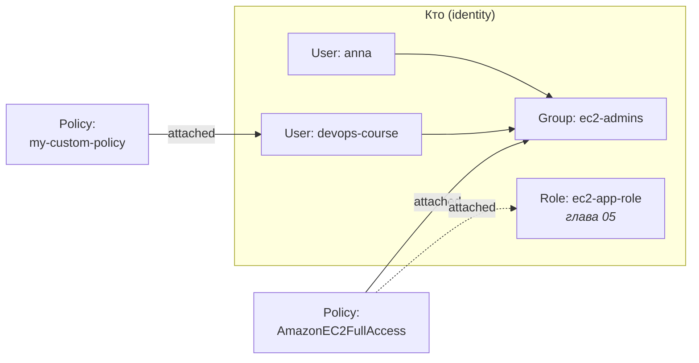
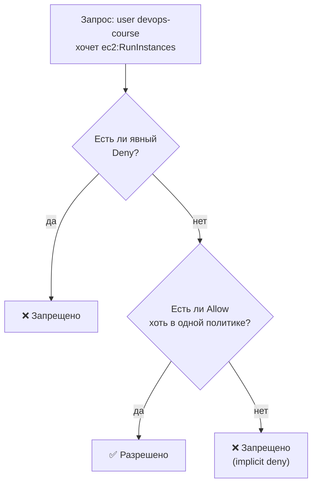
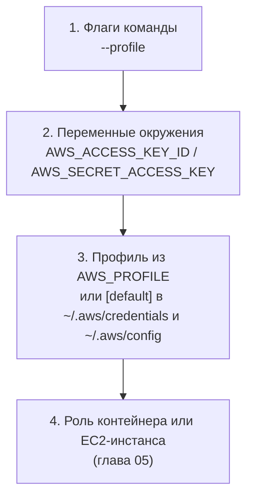

# 04 · IAM: пользователи, группы и политики

!!! abstract "В этой главе"
    **Что вы узнаете:** как AWS решает, разрешить ли действие; что такое IAM user, group и policy; как читать и писать policy JSON; как работают managed и inline политики, явный запрет и условия; в каком порядке CLI ищет учётные данные; почему least privilege — не формальность.

    **Что нужно до начала:**

    - [Глава 03](../03-aws-cli-ec2/README.md): настроен профиль `devops-course` с политикой `AmazonEC2FullAccess`.

    **Стоимость:** $0. IAM бесплатен, Security Groups тоже.

## Зачем это нужно

Любая автоматизация в AWS работает **от чьего-то имени**: вы в терминале, Terraform, Jenkins, приложение на сервере. И для каждого из них IAM решает, что можно, а что нельзя.

Ошибки в IAM бывают двух видов, и обе дорогие:

- **Слишком мало прав** — «ничего не работает»: `AccessDenied` посреди деплоя.
- **Слишком много прав** — «всё работает», пока ключ не утёк или сервер не взломали. Тогда атакующий получает всё, что было разрешено.

Задача DevOps-инженера — найти середину: ровно те права, которые нужны. Это и есть **least privilege**.

## Концепция

### Кто есть кто в IAM



| Объект | Что это | Аналогия |
|--------|---------|----------|
| **User** | Конкретный человек или программа с постоянными учётными данными (пароль для консоли и/или access key) | Сотрудник с пропуском |
| **Group** | Набор пользователей. Права, выданные группе, получают все её участники | Отдел: «все бухгалтеры имеют доступ к 1С» |
| **Policy** | JSON-документ с правилами: какие действия над какими ресурсами разрешены или запрещены | Должностная инструкция |
| **Role** | Набор прав, который **временно принимают** пользователи, сервисы или серверы. Нет постоянных ключей | Временный гостевой пропуск. Подробно в главе 05 |

Правила хорошего тона:

- **Права выдаются группам, а не пользователям.** Новый сотрудник — добавить в группу. Ушёл — удалить из группы. Поменялись обязанности отдела — поменять политику группы, а не 20 пользователей.
- **Один человек — один пользователь.** Общие пользователи («admin на всех») делают невозможным понять, кто что сделал.
- **У группы нет своих учётных данных**, войти «как группа» нельзя. Группы не вкладываются друг в друга.

### Анатомия политики

```json
{
  "Version": "2012-10-17",
  "Statement": [
    {
      "Sid": "ReadOneBucket",
      "Effect": "Allow",
      "Action": ["s3:GetObject", "s3:ListBucket"],
      "Resource": [
        "arn:aws:s3:::my-app-assets",
        "arn:aws:s3:::my-app-assets/*"
      ],
      "Condition": {
        "IpAddress": { "aws:SourceIp": "203.0.113.0/24" }
      }
    }
  ]
}
```

| Поле | Что значит |
|------|-----------|
| `Version` | Версия языка политик. Всегда `"2012-10-17"`: это не дата вашей политики, а версия синтаксиса |
| `Statement` | Список правил |
| `Sid` | Необязательное имя правила для людей |
| `Effect` | `Allow` или `Deny` |
| `Action` | Действия в формате `сервис:Операция`: `s3:GetObject`, `ec2:RunInstances`. Можно со звёздочкой: `ec2:Describe*` |
| `Resource` | К каким ресурсам применяется, в формате ARN. `"*"` — ко всем |
| `Condition` | Необязательные условия: IP, регион, теги, наличие MFA, время |

**ARN (Amazon Resource Name)** — уникальное имя любого ресурса AWS:

```text
arn:aws:iam::123456789012:user/devops-course
arn:aws:ec2:us-west-2:123456789012:instance/i-0abc123def4567890
arn:aws:s3:::my-app-assets/images/logo.png
│   │   │   │         │            │
│   │   │   регион    аккаунт      ресурс
│   │   сервис        (у S3 и IAM некоторые части пустые)
│   раздел (aws)
префикс
```

!!! tip "Почему в примере два ARN для S3"
    `s3:ListBucket` — действие над **бакетом** (`arn:aws:s3:::my-app-assets`), а `s3:GetObject` — над **объектами** внутри (`arn:aws:s3:::my-app-assets/*`). Указать только один из них — частая причина `AccessDenied`.

### Как AWS принимает решение



Три правила, которые нужно запомнить:

1. **По умолчанию запрещено всё** (implicit deny). Новый пользователь без политик не может ничего, даже посмотреть список своих серверов.
2. **Allow в любой политике разрешает** — политики пользователя и всех его групп складываются.
3. **Явный `Deny` побеждает любой `Allow`.** Это позволяет ставить «ограждения»: например, разрешить всё в EC2, но запретить работу вне `us-west-2`.

В организациях с несколькими аккаунтами поверх этого действуют ещё SCP (Service Control Policies) и permission boundaries, но принцип тот же: явный запрет сильнее.

### Managed и inline политики

| Тип | Кто создаёт | Где живёт | Когда использовать |
|-----|------------|-----------|--------------------|
| **AWS managed** | AWS | Отдельный объект, можно прикрепить к многим | Быстрый старт, типовые роли: `AmazonEC2ReadOnlyAccess`, `ReadOnlyAccess` |
| **Customer managed** | Вы | Отдельный объект, версионируется | Основной вариант: точные права под ваши задачи |
| **Inline** | Вы | Встроена в одного user/group/role, удаляется вместе с ним | Редко: строгая связь «политика только для этого объекта» |

AWS managed политики удобны, но часто шире, чем нужно. Например, `AmazonEC2FullAccess` даёт не только EC2, но и права на балансировщики, автомасштабирование и CloudWatch. А `AmazonS3ReadOnlyAccess` разрешает `s3:Get*` и `s3:List*` — то есть чтение **всех** бакетов аккаунта, а не одного.

!!! example "Плохо / Хорошо"

    === "❌ Плохо"

        ```json
        {
          "Effect": "Allow",
          "Action": "*",
          "Resource": "*"
        }
        ```
        «Дам админа, потом разберусь». Потом не разбираются никогда. Утечка такого ключа — это потеря аккаунта.

    === "✅ Хорошо"

        ```json
        {
          "Effect": "Allow",
          "Action": ["s3:GetObject"],
          "Resource": "arn:aws:s3:::my-bucket/*"
        }
        ```
        Только чтение объектов из одного бакета. Утечка такого ключа — неприятность, а не катастрофа.

### Откуда CLI берёт учётные данные

Профиль — это **локальная настройка** на вашем компьютере, а не объект в AWS. AWS видит только ключ, которым подписан запрос. CLI ищет учётные данные по цепочке, первый найденный источник побеждает:



Отсюда типичная ловушка: в окне терминала остались переменные `AWS_ACCESS_KEY_ID` от другого проекта, и они **молча перекрывают** `AWS_PROFILE`. `aws configure list` покажет в колонке `Type`, откуда взяты ключи: `env`, `shared-credentials-file` или `iam-role`.

Terraform (глава 06) использует ту же цепочку. Неверный профиль — значит, ресурсы будут созданы не тем пользователем, не в том аккаунте или не в том регионе.

### Безопасность учётных записей

- **MFA для всех, кто входит в консоль.** Для root — обязательно (глава 00), для IAM-пользователей с консольным доступом — тоже.
- **Access keys только там, где без них никак**, и регулярная ротация: создать новый ключ → переключить → деактивировать старый → удалить.
- **Не работайте под root.** Для ежедневной работы в консоли нужен отдельный администратор с MFA.
- **IAM Identity Center** (бывший AWS SSO) — рекомендуемый AWS способ входа людей: единый логин, временные ключи для CLI (`aws configure sso`), нет постоянных access keys на ноутбуке. Для одного учебного аккаунта IAM-пользователей достаточно, но в компаниях вы встретите именно Identity Center.

!!! quote "Реальный кейс"
    На одном проекте CI-системе выдали `AdministratorAccess`, «чтобы pipeline не падал на правах». Через год токен CI утёк через логи сборки, в которых по ошибке печатались переменные окружения. Атакующий создал себе IAM-пользователя с правами админа и несколько недель тихо читал данные из S3. Когда разбирались, оказалось, что CI нужны были права только на два сервиса: ECR и один бакет S3. С правильными правами ущерб ограничился бы чтением артефактов сборки.

## Практика

Вы наведёте порядок в доступе к своему аккаунту: заведёте администратора вместо root, переведёте права `devops-course` на группу, создадите пользователя только для чтения и напишете свою политику с условием.

### Шаг 1. Администратор вместо root

1. Войдите в консоль как root → **IAM** → **Users** → **Create user**.
2. *User name*: `admin`. Отметьте **Provide user access to the AWS Management Console** → **I want to create an IAM user** → задайте пароль, снимите галочку смены пароля при первом входе (или оставьте — на ваш выбор).
3. **Attach policies directly** → **AdministratorAccess** → **Create user**.
4. Откройте пользователя `admin` → **Security credentials** → **Assign MFA device** → настройте приложение-аутентификатор.
5. На главной странице **IAM** (Dashboard) найдите **Sign-in URL for IAM users**: `https://123456789012.signin.aws.amazon.com/console`. Сохраните его в закладки.
6. Выйдите из root и войдите по этой ссылке как `admin`.

!!! success "✅ Проверь себя"
    Справа сверху в консоли написано `admin @ 1234-5678-9012`, а не имя аккаунта root. При входе запрашивается код MFA. Дальше в главе (и во всём пособии) работайте в консоли как `admin`.

!!! info "Почему у admin нет access keys"
    `admin` — для консоли, `devops-course` — для CLI с ограниченными правами. Если утечёт ключ CLI, атакующий не получит прав администратора.

### Шаг 2. Права через группу

Сейчас политика прикреплена к `devops-course` напрямую. Переделайте на группу:

1. **IAM → User groups → Create group**. *Name*: `ec2-admins`. Добавьте пользователя `devops-course`, прикрепите политику **AmazonEC2FullAccess** → **Create user group**.
2. **IAM → Users → devops-course → Permissions** → у политики `AmazonEC2FullAccess` с типом *Attached directly* нажмите **Remove**.

В списке *Permissions policies* у пользователя останется та же политика, но с пометкой *Group ec2-admins*.

!!! success "✅ Проверь себя"
    ```bash
    export AWS_PROFILE=devops-course        # PowerShell: $env:AWS_PROFILE = "devops-course"
    aws sts get-caller-identity --query Arn --output text
    # → arn:aws:iam::123456789012:user/devops-course
    aws ec2 describe-vpcs --query 'Vpcs[].VpcId' --output text
    # → vpc-... (права работают через группу)
    ```

### Шаг 3. Пользователь только для чтения

Создайте второго пользователя, чтобы своими глазами увидеть `UnauthorizedOperation`.

1. **User groups → Create group** `ec2-readonly` с политикой **AmazonEC2ReadOnlyAccess**.
2. **Users → Create user** `devops-readonly`, без доступа к консоли, добавить в группу `ec2-readonly`.
3. **devops-readonly → Security credentials → Create access key** → *CLI* → скопируйте ключи.

```bash
aws configure --profile devops-readonly     # ← ключи нового пользователя, us-west-2, json
aws sts get-caller-identity --profile devops-readonly
```

Чтение работает, изменение — нет:

```bash
aws ec2 describe-security-groups --profile devops-readonly \
  --query 'SecurityGroups[].GroupName' --output text
# → default ...

aws ec2 create-security-group --profile devops-readonly \
  --group-name ro-test --description "should fail"
# → An error occurred (UnauthorizedOperation) when calling the CreateSecurityGroup operation:
#   You are not authorized to perform this operation. Encoded authorization failure message: 4kQx...
```

EC2 не пишет причину открытым текстом, а **кодирует** её: подробности отказа могут раскрыть внутреннее устройство политик. Расшифровать сообщение может пользователь с правом `sts:DecodeAuthorizationMessage`. У `admin` оно есть, и удобнее всего сделать это в **CloudShell** — терминале прямо в консоли, который работает с правами того, кто вошёл:

1. В консоли (вы вошли как `admin`) нажмите значок **CloudShell** `>_` в верхней панели.
2. Выполните, подставив закодированную строку целиком:

    ```bash
    aws sts decode-authorization-message --encoded-message '4kQx...' \
      --query DecodedMessage --output text | jq '{allowed, explicitDeny, action: .context.action, who: .context.principal.arn}'
    ```

    ```json
    {
      "allowed": false,
      "explicitDeny": false,
      "action": "ec2:CreateSecurityGroup",
      "who": "arn:aws:iam::123456789012:user/devops-readonly"
    }
    ```

!!! success "✅ Проверь себя"
    `describe-security-groups` возвращает список, `create-security-group` падает с `UnauthorizedOperation`. Расшифровка говорит **кто** (`user/devops-readonly`), **что** (`ec2:CreateSecurityGroup`) и **почему**: `explicitDeny: false` — запрещающего правила нет, просто ни одна политика не разрешает. Это implicit deny из схемы выше.

    Многие другие сервисы (S3, IAM) пишут причину сразу открытым текстом: `... is not authorized to perform: s3:PutObject ... because no identity-based policy allows ...`.

### Шаг 4. Своя политика с условием

Разрешите `devops-readonly` создавать и удалять Security Groups, но **только в регионе `us-west-2`**.

1. **IAM → Policies → Create policy** → переключатель **JSON** → вставьте:

    ```json
    {
      "Version": "2012-10-17",
      "Statement": [
        {
          "Sid": "ManageSecurityGroupsInOregonOnly",
          "Effect": "Allow",
          "Action": [
            "ec2:CreateSecurityGroup",
            "ec2:DeleteSecurityGroup",
            "ec2:CreateTags"
          ],
          "Resource": "*",
          "Condition": {
            "StringEquals": { "aws:RequestedRegion": "us-west-2" }
          }
        }
      ]
    }
    ```

2. **Next** → *Policy name*: `sg-manage-us-west-2` → **Create policy**.
3. **User groups → ec2-readonly → Permissions → Add permissions → Attach policies** → `sg-manage-us-west-2`.

Проверьте (изменения IAM применяются за несколько секунд):

```bash
# Oregon — разрешено
aws ec2 create-security-group --profile devops-readonly --region us-west-2 \
  --group-name ro-test --description "allowed in us-west-2" --query GroupId --output text
# → sg-0...

# Virginia — запрещено условием
aws ec2 create-security-group --profile devops-readonly --region us-east-1 \
  --group-name ro-test --description "denied in us-east-1"
# → UnauthorizedOperation

# Убрать за собой
aws ec2 delete-security-group --profile devops-readonly --region us-west-2 --group-name ro-test
```

!!! success "✅ Проверь себя"
    В `us-west-2` группа создалась и удалилась, в `us-east-1` — `UnauthorizedOperation`. Одна и та же политика, разный результат — работает `Condition`.

!!! tip "Policy Simulator"
    Проверять политики можно без реальных вызовов: **IAM → Users → пользователь → Permissions → Simulate** (или [policysim.aws.amazon.com](https://policysim.aws.amazon.com)). Выбираете сервис и действие — симулятор отвечает `allowed` или `denied` и показывает, какая политика сработала.

### Шаг 5. Ограждение явным Deny

Добавьте в ту же группу inline-политику, которая **запрещает** удалять Security Groups вообще, и убедитесь, что Deny сильнее Allow из шага 4.

1. **User groups → ec2-readonly → Permissions → Add permissions → Create inline policy** → **JSON**:

    ```json
    {
      "Version": "2012-10-17",
      "Statement": [
        {
          "Effect": "Deny",
          "Action": "ec2:DeleteSecurityGroup",
          "Resource": "*"
        }
      ]
    }
    ```

2. *Policy name*: `deny-sg-delete` → **Create policy**.

```bash
aws ec2 create-security-group --profile devops-readonly \
  --group-name ro-test --description "deny test" --query GroupId --output text
# → sg-0... (создание всё ещё разрешено)

aws ec2 delete-security-group --profile devops-readonly --group-name ro-test
# → UnauthorizedOperation ... Encoded authorization failure message: ...

aws ec2 delete-security-group --profile devops-course --group-name ro-test
# → удалено: у devops-course нет запрета
```

!!! success "✅ Проверь себя"
    Расшифруйте сообщение об ошибке в CloudShell, как в шаге 3. Теперь там **`"explicitDeny": true`**. Allow из `sg-manage-us-west-2` никуда не делся, но явный Deny его перекрыл.

### Шаг 6. Уборка

!!! success "✅ Проверь себя перед удалением"
    ```bash
    aws ec2 describe-security-groups --profile devops-course \
      --filters "Name=group-name,Values=ro-test" --query 'SecurityGroups[].GroupId' --output text
    # → пусто (иначе удалите группу ro-test профилем devops-course)
    ```
    В консоли убедитесь, что удаляете `devops-readonly` и `ec2-readonly`, а **не** `devops-course`, `ec2-admins` или `admin`.

1. **Users → devops-readonly → Security credentials** → access key → **Deactivate** → **Delete**. Затем удалите самого пользователя (**Delete**).
2. **User groups → ec2-readonly → Delete** (inline-политика `deny-sg-delete` удалится вместе с группой).
3. **Policies** → фильтр *Customer managed* → `sg-manage-us-west-2` → **Delete**.
4. Удалите локальный профиль: в `~/.aws/credentials` и `~/.aws/config` сотрите секции `[devops-readonly]` и `[profile devops-readonly]`.

!!! success "✅ Проверь себя"
    - **IAM → Users**: `admin`, `devops-course`. **User groups**: `ec2-admins`.
    - `aws configure list-profiles` → нет `devops-readonly`.
    - `aws sts get-caller-identity --profile devops-course` по-прежнему работает.

## Вопросы для самопроверки

<details markdown="1">
<summary>1. Новому пользователю не прикрепили ни одной политики. Что он может сделать в AWS?</summary>

Ничего, даже посмотреть список серверов или узнать свои права. По умолчанию всё запрещено (implicit deny). Работает только `sts get-caller-identity`: она отвечает «кто я» и не требует прав.
</details>

<details markdown="1">
<summary>2. Пользователь в группе с <code>AmazonEC2FullAccess</code>, а напрямую к нему прикреплена политика с <code>Deny ec2:TerminateInstances</code>. Сможет он удалить инстанс?</summary>

Нет. Политики пользователя и групп объединяются, а явный Deny сильнее любого Allow, откуда бы он ни пришёл. Это стандартный способ «вычесть» опасное действие из широкой managed-политики.
</details>

<details markdown="1">
<summary>3. Чем профиль AWS CLI отличается от IAM-пользователя?</summary>

IAM-пользователь — объект в AWS, у которого есть права. Профиль — запись в `~/.aws/` на вашем компьютере: какие ключи и какой регион использовать. В одном профиле могут быть ключи любого пользователя любого аккаунта, AWS о профилях ничего не знает. Поэтому `aws sts get-caller-identity` — единственный надёжный способ узнать, от чьего имени вы работаете.
</details>

<details markdown="1">
<summary>4. Почему права лучше выдавать группам, а не пользователям?</summary>

Права обычно следуют из роли человека в команде, а не из самого человека. С группами:

- новый сотрудник получает правильные права одним действием — добавлением в группу;
- изменение прав для всей команды — одна правка политики группы;
- аудит проще: видно, какие наборы прав существуют, а не 50 уникальных комбинаций.
</details>

<details markdown="1">
<summary>5. <code>AmazonS3ReadOnlyAccess</code> — это «безопасная» политика? Она же только на чтение.</summary>

Она разрешает `s3:Get*` и `s3:List*` на **все** бакеты аккаунта. Если в каком-то бакете лежат бэкапы базы с персональными данными, ключи или Terraform state (глава 07) с паролями, пользователь с этой политикой всё это прочитает. «Только чтение» не значит «безопасно»: утечка данных — это тоже инцидент. Безопаснее ограничить `Resource` конкретными бакетами.
</details>

## Итоги

- [x] User — кто, Group — набор пользователей, Policy — что можно, Role — временные права (дальше)
- [x] Policy: `Effect` + `Action` + `Resource` + необязательный `Condition`
- [x] По умолчанию всё запрещено; Allow разрешает; явный Deny сильнее всего
- [x] Права выдаются группам; customer managed политики точнее AWS managed
- [x] Профиль — локальная настройка; CLI ищет учётные данные по цепочке; `aws configure list` показывает источник
- [x] Работаете в консоли как `admin` с MFA, а не как root

**Что дальше.** У `devops-course` по-прежнему **постоянный** ключ, который лежит в файле. А что если приложению на EC2 тоже нужен доступ к AWS — класть ключ на сервер? Нет. В [главе 05](../05-iam-roles/README.md) — роли и временные учётные данные.

- 📋 [Шпаргалка](commands.md)
- 🏋️ [Задания к главе](exercises.md)
