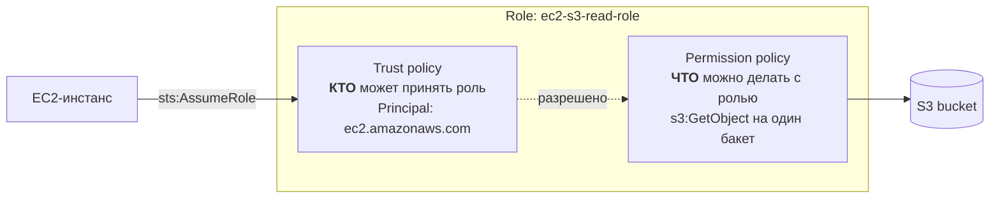
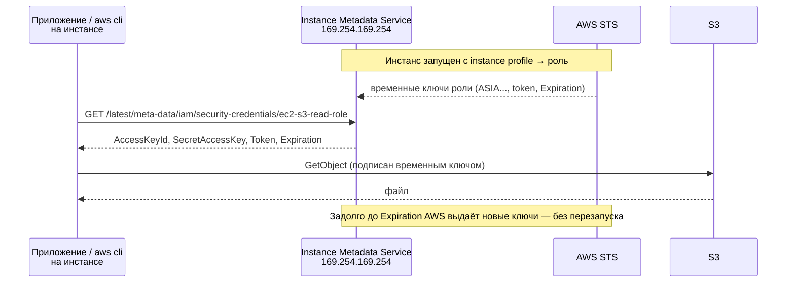

# 05 · IAM: роли, instance profile и временные учётные данные

!!! abstract "В этой главе"
    **Что вы узнаете:** чем роль отличается от пользователя, из чего она состоит (trust policy + permission policy), как EC2-инстанс получает права через instance profile, откуда берутся временные учётные данные и почему их всё равно можно украсть, как защищает IMDSv2.

    **Что нужно до начала:**

    - [Глава 04](../04-iam-users-policies/README.md): вы работаете в консоли как `admin`, понимаете структуру политик.
    - [Глава 02](../02-aws-vpc-ec2/README.md): умеете запустить EC2 и подключиться по SSH.

    **Стоимость:** EC2 `t3.micro` на время практики и несколько байт в S3 — центы. Удалите ресурсы в конце.

## Зачем это нужно

Приложению на сервере нужен доступ к AWS: читать файлы из S3, писать логи, брать секреты. Самое очевидное решение — создать IAM-пользователя, сгенерировать ключ и положить его на сервер в `~/.aws/credentials` или в переменные окружения.

Так делать нельзя:

- **Ключ живёт годами.** Его скопируют в образ, в бэкап, в репозиторий с конфигами, в чат «скинь доступы».
- **Его трудно менять.** Ротация ключа на десяти серверах — отдельный проект, поэтому её не делают.
- **Утечка незаметна.** Скопированный ключ работает с любого компьютера в мире, пока его не отзовут.

**Роль** решает это иначе: у сервера вообще нет постоянного ключа. AWS сам выдаёт ему **временные** учётные данные и сам их обновляет.

## Концепция

### User и Role

| | IAM User | IAM Role |
|---|---|---|
| Кто использует | Конкретный человек или внешняя программа | Сервис AWS (EC2, Lambda), пользователь другого аккаунта, человек через SSO, CI-система |
| Учётные данные | Постоянные: пароль, access key `AKIA...` | Временные: access key `ASIA...` + secret + **session token** |
| Срок жизни | Пока не удалят | От 15 минут до 12 часов, для EC2 — несколько часов с автоматическим обновлением |
| Где хранятся | У владельца (`~/.aws/credentials`) | Нигде постоянно: выдаются по запросу через STS |
| Аналогия | Именной пропуск сотрудника | Гостевой пропуск, который выдают на входе по списку и забирают вечером |

### Из чего состоит роль



У роли **две** политики, и обе обязательны:

**Trust policy (политика доверия)** — кто может «надеть» роль:

```json
{
  "Version": "2012-10-17",
  "Statement": [
    {
      "Effect": "Allow",
      "Principal": { "Service": "ec2.amazonaws.com" },
      "Action": "sts:AssumeRole"
    }
  ]
}
```

`Principal: ec2.amazonaws.com` — роль может принять сервис EC2 (от имени инстанса). Если там будет `lambda.amazonaws.com`, роль сможет надеть только Lambda, а EC2 — нет. Вместо сервиса там может стоять конкретный пользователь, другой аккаунт или внешний провайдер (например, GitHub Actions).

**Permission policy (политика прав)** — обычная политика из главы 04: что можно делать, когда роль надета.

### Как EC2 получает права



- **Instance profile** — «контейнер» для роли, который прикрепляется к инстансу. EC2 не умеет прикреплять роль напрямую, только через profile. Когда вы создаёте роль для EC2 в консоли, instance profile с тем же именем **создаётся автоматически**. В CLI и Terraform его создают отдельно (`aws_iam_instance_profile`).
- **IMDS (Instance Metadata Service)** — служебный адрес `169.254.169.254`, доступный только изнутри инстанса. Там инстанс узнаёт о себе: ID, регион, IP и **временные ключи роли**.
- AWS CLI и SDK находят эти ключи сами: это последний пункт цепочки поиска учётных данных из главы 04. Никакой настройки на сервере не нужно.

### Временные — не значит безопасные

Временные ключи истекают через несколько часов, но **инстанс получает новые постоянно**. Значит:

- если атакующий получил выполнение команд на сервере, он может читать IMDS сколько угодно и получать свежие ключи роли;
- украденные ключи работают с любого компьютера, пока не истекут.

Роль не делает взлом сервера безопасным. Она даёт три вещи: на диске нет постоянного секрета, украденные ключи **сами истекают**, а права можно мгновенно поменять в одном месте. Остальное — задача least privilege: у роли должно быть ровно столько прав, сколько нужно приложению.

**IMDSv2** защищает от популярной атаки SSRF, когда уязвимое веб-приложение можно заставить сделать HTTP-запрос на произвольный адрес, например на `169.254.169.254`. В IMDSv2 сначала нужно получить токен запросом `PUT` с особым заголовком, и только с этим токеном IMDS отдаст данные. Через типичную SSRF-уязвимость такой `PUT` не сделать. На новых AMI Amazon Linux 2023 IMDSv2 включён обязательным по умолчанию. Для старых инстансов его стоит включить явно.

!!! example "Плохо / Хорошо"

    === "❌ Плохо"

        ```bash
        # На сервере, в ~/.aws/credentials или в .env приложения
        aws_access_key_id = AKIA................
        aws_secret_access_key = ........................................
        ```
        Ключ человека или «технического пользователя» с постоянными правами. Попадёт в бэкап, AMI, Docker-образ, репозиторий.

    === "✅ Хорошо"

        ```text
        EC2 → instance profile → роль ec2-s3-read-role
        Permission policy: s3:GetObject на arn:aws:s3:::roles-lab-123456789012/*
        Metadata: IMDSv2 required
        ```
        На диске секретов нет. Права узкие. Ключи обновляются сами.

### Роли для людей и CI

Роли нужны не только серверам:

- **Человек** принимает роль на время задачи: `aws sts assume-role` или профиль с `role_arn` в `~/.aws/config`. Так работает доступ в продакшен-аккаунт: постоянных прав там ни у кого нет, есть роль с MFA.
- **IAM Identity Center** под капотом тоже выдаёт людям роли.
- **CI-системы** (GitHub Actions, GitLab) через OIDC получают временные ключи роли на время одной сборки. Постоянный access key в настройках CI больше не нужен.

## Практика

Вы создадите бакет с файлом, роль, которая умеет читать только этот бакет, запустите EC2 с этой ролью и проверите, что работает, а что нет.

Пользователю `devops-course` для этого не хватает прав (у него нет IAM, S3 и `iam:PassRole`), поэтому вся практика — в консоли под `admin` и в CloudShell.

### Шаг 1. Бакет с файлом

Откройте **CloudShell** (значок `>_` в верхней панели консоли). CloudShell работает с правами `admin` и в выбранном регионе — проверьте, что это `us-west-2`.

```bash
ACCOUNT_ID=$(aws sts get-caller-identity --query Account --output text)
BUCKET=roles-lab-$ACCOUNT_ID          # имя бакета уникально во всём мире, поэтому добавляем Account ID
echo $BUCKET

aws s3 mb s3://$BUCKET --region us-west-2
echo "Hello from IAM roles!" | aws s3 cp - s3://$BUCKET/hello.txt
aws s3 ls s3://$BUCKET
```

!!! success "✅ Проверь себя"
    `aws s3 ls s3://$BUCKET` показывает `hello.txt`. Имя бакета запишите: оно понадобится дальше.

### Шаг 2. Политика только для этого бакета

**IAM → Policies → Create policy → JSON**. Замените `123456789012` на свой Account ID:

```json
{
  "Version": "2012-10-17",
  "Statement": [
    {
      "Sid": "ListOneBucket",
      "Effect": "Allow",
      "Action": "s3:ListBucket",
      "Resource": "arn:aws:s3:::roles-lab-123456789012"
    },
    {
      "Sid": "ReadObjects",
      "Effect": "Allow",
      "Action": "s3:GetObject",
      "Resource": "arn:aws:s3:::roles-lab-123456789012/*"
    }
  ]
}
```

*Policy name*: `s3-read-roles-lab` → **Create policy**.

### Шаг 3. Роль для EC2

1. **IAM → Roles → Create role**.
2. *Trusted entity type*: **AWS service**; *Use case*: **EC2** → **Next**.
3. Отметьте политику `s3-read-roles-lab` → **Next**.
4. *Role name*: `ec2-s3-read-role` → **Create role**.
5. Откройте роль → вкладка **Trust relationships**: там `"Service": "ec2.amazonaws.com"`.

!!! success "✅ Проверь себя"
    В карточке роли вверху есть строка **Instance profile ARN** — `arn:aws:iam::123456789012:instance-profile/ec2-s3-read-role`. Консоль создала instance profile автоматически.

### Шаг 4. EC2 с ролью

Запустите инстанс как в главе 02 (**EC2 → Launch instances**): Amazon Linux 2023, `t3.micro`, новый Key Pair `roles-lab-key`, новая Security Group `roles-lab-sg` с SSH только от **My IP**. Дополнительно:

- Раскройте **Advanced details**.
- *IAM instance profile*: **ec2-s3-read-role**.
- *Metadata version*: **V2 only (token required)** (для AL2023 обычно уже стоит по умолчанию).

**Launch instance**. Не забудьте `chmod 400` (или `icacls` на Windows) для скачанного ключа.

!!! success "✅ Проверь себя"
    **EC2 → Instances → ваш инстанс → Security** — поле **IAM Role** = `ec2-s3-read-role`.

### Шаг 5. Кто я на сервере

```bash
ssh -i ~/.ssh/roles-lab-key.pem ec2-user@<PUBLIC_IP>
```

AWS CLI на Amazon Linux 2023 уже установлен. `aws configure` **не выполняйте**:

```bash
aws sts get-caller-identity
```

```json
{
    "UserId": "AROA4EXAMPLEEXAMPLE:i-0abc123def4567890",
    "Account": "123456789012",
    "Arn": "arn:aws:sts::123456789012:assumed-role/ec2-s3-read-role/i-0abc123def4567890"
}
```

!!! success "✅ Проверь себя"
    - `Arn` содержит **`assumed-role/ec2-s3-read-role`** — вы работаете не как пользователь, а как роль.
    - `UserId` начинается с **`AROA`** (так AWS помечает роли; у пользователей — `AIDA`), после двоеточия — имя сессии, здесь ID инстанса.
    - `ls ~/.aws` → `No such file or directory`: на диске нет ни одного ключа.

### Шаг 6. Что можно и что нельзя

```bash
BUCKET=roles-lab-123456789012     # ← ваше имя бакета

aws s3 ls s3://$BUCKET            # ✅ ListBucket разрешён
aws s3 cp s3://$BUCKET/hello.txt - # ✅ GetObject → Hello from IAM roles!

echo "hack" | aws s3 cp - s3://$BUCKET/hack.txt
# ❌ An error occurred (AccessDenied) when calling the PutObject operation:
#    User: arn:aws:sts::123456789012:assumed-role/ec2-s3-read-role/i-0abc...
#    is not authorized to perform: s3:PutObject on resource: "arn:aws:s3:::roles-lab-.../hack.txt"
#    because no identity-based policy allows the s3:PutObject action

aws s3 ls
# ❌ AccessDenied ... s3:ListAllMyBuckets — список всех бакетов тоже не разрешён

aws ec2 describe-instances --region us-west-2
# ❌ UnauthorizedOperation — к EC2 прав нет вовсе
```

!!! success "✅ Проверь себя"
    Работают ровно два действия: список одного бакета и чтение файла. Всё остальное — `AccessDenied` или `UnauthorizedOperation`. Если сервер взломают, атакующий получит только `hello.txt`.

### Шаг 7. Заглянуть в IMDS

Посмотрите, откуда CLI берёт ключи:

```bash
# Без токена IMDSv2 ничего не отдаёт
curl -s -o /dev/null -w "%{http_code}\n" http://169.254.169.254/latest/meta-data/
# → 401

# Получить токен (живёт до 6 часов) и запросить данные с ним
TOKEN=$(curl -s -X PUT http://169.254.169.254/latest/api/token \
  -H "X-aws-ec2-metadata-token-ttl-seconds: 21600")

curl -s -H "X-aws-ec2-metadata-token: $TOKEN" \
  http://169.254.169.254/latest/meta-data/iam/security-credentials/
# → ec2-s3-read-role

curl -s -H "X-aws-ec2-metadata-token: $TOKEN" \
  http://169.254.169.254/latest/meta-data/iam/security-credentials/ec2-s3-read-role
```

```json
{
  "Code" : "Success",
  "LastUpdated" : "2026-10-28T10:05:12Z",
  "Type" : "AWS-HMAC",
  "AccessKeyId" : "ASIA4EXAMPLEEXAMPLE",
  "SecretAccessKey" : "...",
  "Token" : "IQoJb3JpZ2luX2VjE...",
  "Expiration" : "2026-10-28T16:31:40Z"
}
```

!!! success "✅ Проверь себя"
    - Без токена — `401`: это IMDSv2 в действии.
    - `AccessKeyId` начинается с **`ASIA`** — так помечены временные ключи (постоянные начинаются с `AKIA`).
    - Есть `Token` и `Expiration`. Ключи истекут через несколько часов, но инстанс получит новые раньше этого срока, без вашего участия.

    Обратите внимание: вы только что **прочитали секретные ключи роли** одной командой `curl`. То же самое сможет сделать любой, кто получит доступ к серверу. Поэтому роль должна быть узкой.

### Шаг 8. Изменить права без перезапуска

Права роли можно менять на работающем сервере.

1. В консоли: **IAM → Policies → s3-read-roles-lab → Edit → JSON**. Во второй statement добавьте `"s3:PutObject"`:

    ```json
    "Action": ["s3:GetObject", "s3:PutObject"],
    ```

2. **Next → Save changes**.
3. Через 10–20 секунд на сервере повторите:

    ```bash
    echo "written by role" | aws s3 cp - s3://$BUCKET/from-ec2.txt   # ✅ теперь работает
    aws s3 ls s3://$BUCKET
    ```

!!! success "✅ Проверь себя"
    Запись прошла без перезапуска инстанса и без смены ключей. Права проверяются при **каждом** запросе, а не при выдаче ключей. Так же быстро права можно и отобрать — например, при подозрении на взлом.

Выйдите с сервера: `exit`.

!!! quote "Реальный кейс"
    Веб-приложение на EC2 умело загружать картинки по URL. Атакующий подставил URL `http://169.254.169.254/latest/meta-data/iam/security-credentials/` и получил в ответ имя роли, а следующим запросом — её ключи. У роли были права на чтение всех бакетов аккаунта, «чтобы приложение могло работать с картинками». Атакующий скачал бэкапы клиентской базы. Похожая атака стала причиной одной из самых известных утечек данных в облаке. Её бы остановили две вещи: IMDSv2 (SSRF-запрос получил бы `401`) и роль, ограниченная одним бакетом с картинками.

## Вопросы для самопроверки

<details markdown="1">
<summary>1. Почему нельзя просто положить ключи IAM-пользователя на сервер?</summary>

Постоянный ключ живёт годами и расползается по копиям: бэкапы, AMI, Docker-образы, репозитории. Его трудно менять, а украденный экземпляр работает откуда угодно, пока его не отзовут. Роль не оставляет на диске постоянного секрета, ключи выдаются на часы и обновляются сами, а права меняются в одном месте.
</details>

<details markdown="1">
<summary>2. Зачем роли две политики? Что будет, если в trust policy указать <code>lambda.amazonaws.com</code>, а роль прикрепить к EC2?</summary>

Trust policy отвечает **кто** может принять роль, permission policy — **что** с ней можно делать. Если в trust policy только Lambda, EC2 не сможет принять роль: на инстансе не будет учётных данных, и `aws sts get-caller-identity` ответит `Unable to locate credentials`. Консоль, кстати, не даст выбрать такую роль для инстанса.
</details>

<details markdown="1">
<summary>3. Что такое instance profile и почему в консоли вы его не создавали?</summary>

Instance profile — объект, который связывает роль с EC2-инстансом: к инстансу прикрепляется именно он. Когда в консоли создаётся роль с trusted entity EC2, консоль сама создаёт instance profile с тем же именем. В CLI и Terraform его нужно создать явно (`aws iam create-instance-profile` + `add-role-to-instance-profile`, или ресурс `aws_iam_instance_profile`), иначе роль нельзя будет прикрепить к инстансу.
</details>

<details markdown="1">
<summary>4. Временные ключи роли истекают через несколько часов. Значит, если сервер взломан, атакующему хватит только этих часов?</summary>

Нет. Пока атакующий имеет доступ к серверу, он может запрашивать у IMDS всё новые ключи. Срок жизни ограничивает только ключи, **унесённые с сервера**. Защита — узкие права роли, IMDSv2 против SSRF, мониторинг (CloudTrail покажет вызовы с ключами роли из необычных мест) и возможность мгновенно отобрать права, изменив политику.
</details>

<details markdown="1">
<summary>5. По каким признакам в выводе <code>get-caller-identity</code> и в ключах отличить роль от пользователя?</summary>

- `Arn`: `assumed-role/<имя роли>/<сессия>` против `user/<имя>`.
- `UserId`: префикс `AROA` (роль) против `AIDA` (пользователь).
- Access key: `ASIA` (временный, нужен ещё session token) против `AKIA` (постоянный).
</details>

## Уборка

!!! success "✅ Проверь себя перед удалением"
    **EC2 → Instances**: выбран инстанс с Key Pair `roles-lab-key` в `us-west-2`. В CloudShell: `echo $BUCKET` — имя начинается с `roles-lab-`.

1. **EC2 → Instances** → инстанс → **Terminate**. Дождитесь `Terminated`.
2. **Security Groups** → `roles-lab-sg` → **Delete**. **Key Pairs** → `roles-lab-key` → **Delete**, удалите локальный `.pem`.
3. В CloudShell удалите бакет вместе с содержимым:

    ```bash
    aws s3 rb s3://$BUCKET --force      # --force сначала удаляет все объекты
    ```

4. **IAM → Roles** → `ec2-s3-read-role` → **Delete** (instance profile удалится вместе с ролью).
5. **IAM → Policies** → `s3-read-roles-lab` → **Delete**.

!!! success "✅ Проверь себя"
    ```bash
    aws s3 ls | grep roles-lab                                   # → пусто
    aws iam get-role --role-name ec2-s3-read-role                # → NoSuchEntity
    aws iam list-instance-profiles --query 'InstanceProfiles[].InstanceProfileName'   # → нет ec2-s3-read-role
    ```
    И в консоли EC2 инстанс `Terminated`, учебных SG и Key Pair нет.

## Итоги

- [x] Роль — набор прав без постоянных ключей; её «надевают» сервисы, люди и CI
- [x] Trust policy — кто может принять роль, permission policy — что можно делать
- [x] EC2 получает роль через instance profile; ключи лежат в IMDS и обновляются сами
- [x] Временные ключи (`ASIA`) не спасают от взломанного сервера — нужны узкие права и IMDSv2
- [x] Права роли меняются на лету, без перезапуска

**Что дальше.** Вы создали десятки ресурсов руками и командами и каждый раз аккуратно их удаляли. Пора поручить это инструменту, который сам помнит, что создал. В [главе 06](../06-terraform-intro/README.md) — Terraform.

- 📋 [Шпаргалка](commands.md)
- 🏋️ [Задания к главе](exercises.md)
