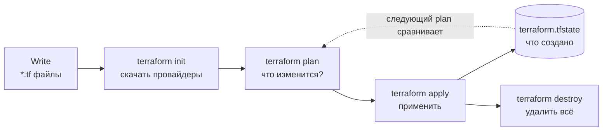
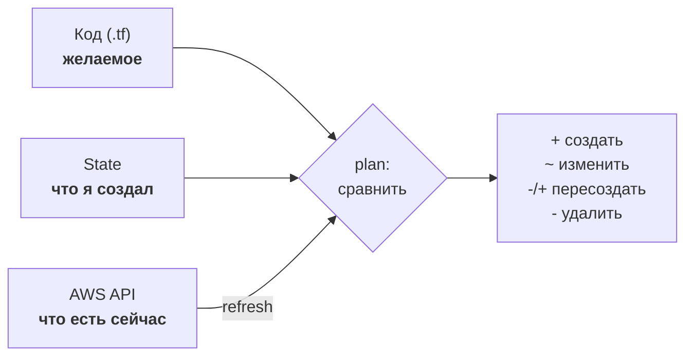

# 06 · Terraform: инфраструктура как код

!!! abstract "В этой главе"
    **Что вы узнаете:** чем декларативный подход отличается от скриптов, как устроен цикл `init → plan → apply → destroy`, из каких блоков состоит код Terraform, что такое state и lock-файл, как работают переменные, outputs и data sources, как Terraform замечает ручные изменения (drift).

    **Что нужно до начала:**

    - [Глава 03](../03-aws-cli-ec2/README.md): вы создавали Key Pair, Security Group и EC2 командами CLI.
    - [Глава 04](../04-iam-users-policies/README.md): работает профиль `devops-course` (права на EC2).
    - Установлен Terraform **1.11+** ([глава 00](../00-setup/README.md)).

    **Проверено на:** Terraform 1.14, провайдер `hashicorp/aws` 6.x.

    **Стоимость:** EC2 `t3.micro` на время практики — центы. В конце — `terraform destroy`.

## Зачем это нужно

Вспомните скрипт из главы 03. Чтобы создать сервер, вы:

- вручную следили за **порядком**: сначала Key Pair и Security Group, потом инстанс;
- сохраняли ID в переменные, чтобы потом их удалить;
- при повторном запуске получали ошибки `Duplicate` — или, хуже, второй сервер;
- при удалении снова следили за порядком и ждали `instance-terminated`.

Скрипт описывает **как** что-то сделать: последовательность команд. Terraform описывает **что** должно существовать, а как к этому прийти — порядок, ожидания, удаление — вычисляет сам.

```text
Скрипт (императивно):               Terraform (декларативно):
  создай Key Pair                     должны существовать:
  создай Security Group                 Key Pair "tf-lab-key"
  добавь правило 22                     Security Group "tf-lab-sg" с правилом 22
  подожди…                              EC2 t3.micro с этими Key Pair и SG
  создай EC2 с ID из шагов 1 и 2
```

Запустите Terraform второй раз — он увидит, что всё уже есть, и **ничего не сделает**. Это называется **идемпотентность**: сколько раз ни применяй, результат один.

## Концепция

### Цикл работы



| Команда | Что делает | Меняет AWS? |
|---------|-----------|-------------|
| `terraform init` | Скачивает провайдеры и модули, настраивает хранилище state | нет |
| `terraform fmt` | Выравнивает код по стандарту | нет |
| `terraform validate` | Проверяет синтаксис и ссылки | нет |
| `terraform plan` | Сравнивает код, state и реальность; показывает разницу | **нет** |
| `terraform apply` | Показывает план, спрашивает `yes`, применяет | **да** |
| `terraform destroy` | Удаляет всё, что есть в state | **да** |

### Как Terraform принимает решение



**State** (`terraform.tfstate`) — JSON-файл, в котором Terraform помнит, какие ресурсы он создал и как они связаны с кодом: «ресурс `aws_instance.web` — это инстанс `i-0abc...`». Без state Terraform не знает, что `i-0abc...` — его, и попытается создать всё заново.

Важные свойства state:

- в нём могут быть **секреты** (пароли баз, ключи) открытым текстом — его нельзя коммитить;
- его **нельзя редактировать руками** — только командами `terraform state ...`;
- локальный файл легко потерять и нельзя разделить с командой. Это решается в главе 07.

### Блоки HCL

Код Terraform пишется на языке **HCL**. Всё состоит из блоков вида `тип "метка" "метка" { аргумент = значение }`:

| Блок | Назначение | Пример |
|------|-----------|--------|
| `terraform` | Настройки самого Terraform: версии, backend | `required_version = ">= 1.11"` |
| `provider` | Подключение к платформе | `provider "aws" { region = "us-west-2" }` |
| `resource` | Объект, который Terraform **создаёт и управляет** им | `resource "aws_instance" "web" {...}` |
| `data` | Объект, который Terraform **только читает** | `data "aws_ami" "al2023" {...}` |
| `variable` | Входной параметр | `variable "ssh_cidr" {...}` |
| `output` | Значение, которое выводится после apply | `output "public_ip" {...}` |
| `locals` | Вычисляемые значения внутри кода | `locals { name = "tf-lab" }` |

Ресурс записывается как `resource "<ТИП>" "<ИМЯ>"`. Тип (`aws_instance`) берётся из документации провайдера, имя (`web`) вы придумываете сами. Обращение к атрибуту: `aws_instance.web.public_ip`, к data source — `data.aws_ami.al2023.id`, к переменной — `var.ssh_cidr`.

### Зависимости — без вашей помощи

```hcl
resource "aws_instance" "web" {
  key_name               = aws_key_pair.lab.key_name          # ← ссылка
  vpc_security_group_ids = [aws_security_group.lab.id]        # ← ссылка
}
```

По ссылкам Terraform строит **граф зависимостей**: инстанс зависит от Key Pair и SG, значит, они создаются первыми, а удаляются последними. Независимые ресурсы создаются параллельно. Вручную отслеживать порядок, как в скрипте главы 03, больше не нужно.

### Провайдеры и версии

**Провайдер** — плагин, который переводит блоки HCL в вызовы API конкретной платформы: `hashicorp/aws`, `hashicorp/google`, `hashicorp/kubernetes` и тысячи других в [Terraform Registry](https://registry.terraform.io). `terraform init` скачивает их в папку `.terraform/`.

Версии фиксируются в двух местах:

- `required_providers` в коде — **допустимый диапазон**: `version = "~> 6.0"` значит «6.любая, но не 7»;
- **`.terraform.lock.hcl`** — **точная** версия и контрольные суммы, выбранные при `init`. Этот файл **коммитят**: тогда у всей команды и в CI одна и та же версия провайдера.

!!! warning "Lock-файл ≠ блокировка state"
    `.terraform.lock.hcl` — это фиксация версий провайдеров, аналог `package-lock.json`. Блокировка state (state lock), которая защищает от двух одновременных `apply`, — совсем другая вещь, о ней в главе 07. Путают их постоянно.

!!! example "Плохо / Хорошо: `.gitignore` для Terraform"

    === "❌ Плохо"

        ```gitignore
        .terraform/
        .terraform.lock.hcl     # «служебный файл, не нужен»
        ```
        У коллеги через месяц `init` скачает провайдер новее, и `plan` внезапно покажет изменения, которых никто не делал.

    === "✅ Хорошо"

        ```gitignore
        .terraform/             # кеш провайдеров — большой, восстанавливается init
        *.tfstate
        *.tfstate.*             # state и его бэкапы — секреты
        terraform.tfvars        # ваши значения переменных
        crash.log
        # .terraform.lock.hcl — НЕ игнорируем, коммитим
        ```

### Terraform, HCP Terraform и OpenTofu

- **Terraform** (HashiCorp, с 2025 года — часть IBM) — CLI, который вы используете. С 2023 года распространяется под лицензией BSL: использовать бесплатно можно, нельзя строить на нём конкурирующий коммерческий сервис.
- **HCP Terraform** (бывший Terraform Cloud) — облачный сервис HashiCorp: хранит state, запускает `plan/apply` удалённо, даёт ревью планов командой. Бесплатный тариф есть, для пособия не нужен.
- **OpenTofu** — открытый форк Terraform под лицензией MPL в Linux Foundation, появился после смены лицензии. Команда `tofu` почти полностью совместима с `terraform`. Всё, что вы изучите здесь, к нему применимо.

## Практика

Вы опишете кодом то, что в главе 03 делали скриптом: Key Pair, Security Group с SSH только для вас и EC2.

### Шаг 0. SSH-ключ и профиль

На этот раз приватный ключ будет создан **у вас** и никогда не покинет компьютер. В AWS отправится только публичная часть.

```bash
ssh-keygen -t ed25519 -f ~/.ssh/id_ed25519 -C "devops-course"   # если ключа ещё нет; пароль можно оставить пустым
ls ~/.ssh/id_ed25519*      # → id_ed25519 (приватный) и id_ed25519.pub (публичный)
```

На Windows команда та же в PowerShell; `~` раскроется в `C:\Users\<имя>`.

=== "bash"

    ```bash
    export AWS_PROFILE=devops-course
    aws sts get-caller-identity --query Arn --output text   # → ...:user/devops-course
    ```

=== "PowerShell"

    ```powershell
    $env:AWS_PROFILE = "devops-course"
    aws sts get-caller-identity --query Arn --output text
    ```

### Шаг 1. Папка проекта и версии

Создайте папку `tf-06` где удобно (например, в своём репозитории `devops-homework` из задания главы 00) и откройте её в VS Code. Поставьте расширение **HashiCorp Terraform**: подсветка, автодополнение, подсказки по ресурсам.

`versions.tf`:

```hcl
terraform {
  required_version = ">= 1.11"

  required_providers {
    aws = {
      source  = "hashicorp/aws"
      version = "~> 6.0"
    }
  }
}
```

```bash
terraform init
```

```text
Initializing provider plugins...
- Finding hashicorp/aws versions matching "~> 6.0"...
- Installing hashicorp/aws v6.71.0...
- Installed hashicorp/aws v6.71.0 (signed by HashiCorp)
Terraform has created a lock file .terraform.lock.hcl ...
Terraform has been successfully initialized!
```

!!! success "✅ Проверь себя"
    В папке появились `.terraform/` (скачанный провайдер, сотни мегабайт) и `.terraform.lock.hcl` с точной версией. `terraform version` показывает и версию Terraform, и версию провайдера.

### Шаг 2. Переменные

`variables.tf`:

```hcl
variable "aws_profile" {
  description = "AWS CLI profile"
  type        = string
  default     = "devops-course"
}

variable "region" {
  description = "AWS region"
  type        = string
  default     = "us-west-2"
}

variable "ssh_cidr" {
  description = "Who may connect via SSH, e.g. 203.0.113.10/32"
  type        = string

  validation {
    condition     = can(cidrhost(var.ssh_cidr, 0)) && var.ssh_cidr != "0.0.0.0/0"
    error_message = "ssh_cidr must be a valid CIDR and must not be 0.0.0.0/0."
  }
}

variable "instance_type" {
  description = "EC2 instance type"
  type        = string
  default     = "t3.micro"
}
```

- Переменная **с** `default` — необязательная, **без** — обязательная: Terraform спросит значение или упадёт.
- `validation` проверяет значение до того, как что-то будет создано. Здесь — защита от SSH для всего интернета прямо в коде.

Значения задаются в `terraform.tfvars` (подхватывается автоматически):

=== "bash"

    ```bash
    echo "ssh_cidr = \"$(curl -s https://checkip.amazonaws.com)/32\"" > terraform.tfvars
    cat terraform.tfvars          # → ssh_cidr = "203.0.113.10/32"
    ```

=== "PowerShell"

    ```powershell
    $ip = (curl.exe -s https://checkip.amazonaws.com).Trim()
    Set-Content -Path terraform.tfvars -Value "ssh_cidr = `"$ip/32`"" -Encoding ascii
    Get-Content terraform.tfvars
    ```

И сразу `.gitignore` из блока «Хорошо» выше: `terraform.tfvars` содержит ваш IP.

### Шаг 3. Ресурсы

`main.tf`:

```hcl
provider "aws" {
  region  = var.region
  profile = var.aws_profile

  default_tags { # теги для всех ресурсов
    tags = {
      Project   = "tf-lab"
      ManagedBy = "terraform"
    }
  }
}

# Читаем: последний Amazon Linux 2023 от Amazon (как describe-images в главе 03)
data "aws_ami" "al2023" {
  most_recent = true
  owners      = ["amazon"]

  filter {
    name   = "name"
    values = ["al2023-ami-2023.*-x86_64"]
  }
}

# Публичная часть вашего ключа
resource "aws_key_pair" "lab" {
  key_name   = "tf-lab-key"
  public_key = file(pathexpand("~/.ssh/id_ed25519.pub"))
}

resource "aws_security_group" "lab" {
  name        = "tf-lab-sg"
  description = "SSH from my IP"
}

resource "aws_vpc_security_group_ingress_rule" "ssh" {
  security_group_id = aws_security_group.lab.id
  cidr_ipv4         = var.ssh_cidr
  ip_protocol       = "tcp"
  from_port         = 22
  to_port           = 22
}

resource "aws_vpc_security_group_egress_rule" "all" {
  security_group_id = aws_security_group.lab.id
  cidr_ipv4         = "0.0.0.0/0"
  ip_protocol       = "-1" # все протоколы
}

resource "aws_instance" "web" {
  ami                    = data.aws_ami.al2023.id
  instance_type          = var.instance_type
  key_name               = aws_key_pair.lab.key_name
  vpc_security_group_ids = [aws_security_group.lab.id]

  metadata_options {
    http_tokens = "required"          # IMDSv2 (глава 05)
  }

  tags = {
    Name = "tf-lab-web"
  }
}
```

Обратите внимание:

- `data "aws_ami"` заменил целую команду `describe-images` с `--query`;
- правила Security Group — отдельные ресурсы `aws_vpc_security_group_ingress_rule` / `..._egress_rule`. Так их рекомендует документация провайдера: каждое правило можно менять, не трогая остальные. Исходящее правило нужно описать явно: Terraform, в отличие от консоли, не добавляет его сам;
- ни одного ID вручную — только ссылки.

`outputs.tf`:

```hcl
output "public_ip" {
  description = "Public IP of the instance"
  value       = aws_instance.web.public_ip
}

output "ssh_command" {
  value = "ssh -i ~/.ssh/id_ed25519 ec2-user@${aws_instance.web.public_ip}"
}
```

`${...}` внутри строки — интерполяция: подстановка значения.

### Шаг 4. Проверить и прочитать план

```bash
terraform fmt          # выровнять код; выводит имена исправленных файлов
terraform validate     # → Success! The configuration is valid.
terraform plan
```

```text
data.aws_ami.al2023: Reading...
data.aws_ami.al2023: Read complete after 1s [id=ami-0a1b2c3d4e5f67890]

Terraform will perform the following actions:

  # aws_instance.web will be created
  + resource "aws_instance" "web" {
      + ami                    = "ami-0a1b2c3d4e5f67890"
      + instance_type          = "t3.micro"
      + key_name               = "tf-lab-key"
      + public_ip              = (known after apply)
      ...
    }

  # aws_key_pair.lab will be created
  ...
  # aws_security_group.lab will be created
  ...

Plan: 5 to add, 0 to change, 0 to destroy.

Changes to Outputs:
  + public_ip   = (known after apply)
  + ssh_command = (known after apply)
```

| Символ | Значение |
|--------|----------|
| `+` | будет создан |
| `~` | будет изменён на месте (update in-place) |
| `-/+` | будет **удалён и создан заново** (replace) |
| `-` | будет удалён |
| `(known after apply)` | значение станет известно только после создания |

!!! success "✅ Проверь себя"
    `Plan: 5 to add, 0 to change, 0 to destroy`. В AWS при этом ничего не появилось: `plan` только показывает.

### Шаг 5. Применить

```bash
terraform apply
```

Terraform ещё раз покажет план и спросит `Enter a value:`. Введите `yes`.

```text
aws_key_pair.lab: Creating...
aws_security_group.lab: Creating...
aws_key_pair.lab: Creation complete after 1s [id=tf-lab-key]
aws_security_group.lab: Creation complete after 2s [id=sg-0abc...]
aws_vpc_security_group_ingress_rule.ssh: Creating...
aws_vpc_security_group_egress_rule.all: Creating...
aws_instance.web: Creating...
aws_instance.web: Still creating... [10s elapsed]
aws_instance.web: Creation complete after 13s [id=i-0abc123def4567890]

Apply complete! Resources: 5 added, 0 changed, 0 destroyed.

Outputs:

public_ip = "54.x.x.x"
ssh_command = "ssh -i ~/.ssh/id_ed25519 ec2-user@54.x.x.x"
```

Key Pair и Security Group создались параллельно, инстанс — после них. Порядок Terraform вычислил по ссылкам.

!!! success "✅ Проверь себя"
    ```bash
    aws ec2 describe-instances --filters "Name=tag:Name,Values=tf-lab-web" \
      --query 'Reservations[].Instances[].{State:State.Name,Tags:Tags}' --output json
    ```
    Инстанс в состоянии `running`, у него есть теги `Name`, `Project=tf-lab` и `ManagedBy=terraform` (последние два пришли из `default_tags`). Тот же инстанс виден в консоли **EC2 → Instances**.

    Подключитесь командой из output (дайте инстансу минуту загрузиться):

    ```bash
    ssh -i ~/.ssh/id_ed25519 ec2-user@$(terraform output -raw public_ip)
    ```

### Шаг 6. Идемпотентность

```bash
terraform plan
```

```text
No changes. Your infrastructure matches the configuration.
```

Запустите `apply` сколько угодно раз — Terraform не создаст второй сервер. Сравните со скриптом из главы 03.

### Шаг 7. Изменения: на месте и с пересозданием

**Изменение на месте.** Добавьте в `tags` инстанса строку `Owner = "your-name"` и выполните `terraform plan`:

```text
  # aws_instance.web will be updated in-place
  ~ resource "aws_instance" "web" {
        id   = "i-0abc123def4567890"
      ~ tags = {
          + "Owner" = "your-name"
            # (1 unchanged element hidden)
        }
    }

Plan: 0 to add, 1 to change, 0 to destroy.
```

Тег можно поменять у работающего сервера, поэтому `~`. Примените: `terraform apply`.

**Пересоздание.** Некоторые изменения нельзя сделать на месте, например сменить AMI. А иногда сервер нужно пересоздать принудительно, ничего не меняя в коде:

```bash
terraform apply -replace="aws_instance.web"
```

```text
  # aws_instance.web will be replaced, as requested
-/+ resource "aws_instance" "web" {
      ~ id        = "i-0abc123def4567890" -> (known after apply)
      ~ public_ip = "54.x.x.x" -> (known after apply)
      ...
Plan: 1 to add, 0 to change, 1 to destroy.
```

Введите `yes`. У нового инстанса другой ID и другой публичный IP.

!!! warning "Читайте `-/+` внимательно"
    Пересоздание означает, что **всё на диске старого сервера пропадёт**. Перед каждым `apply` ищите в плане `-/+` и `destroy` и спрашивайте себя, ожидали ли вы этого. Раньше для пересоздания использовали `terraform taint`. Команда устарела, используйте `-replace`.

### Шаг 8. Drift — ручные изменения

В консоли **EC2 → Instances → tf-lab-web → Tags → Manage tags** поменяйте значение `Owner` на `someone-else` и сохраните. Затем:

```bash
terraform plan
```

```text
  # aws_instance.web will be updated in-place
  ~ resource "aws_instance" "web" {
      ~ tags = {
          ~ "Owner" = "someone-else" -> "your-name"
```

Terraform заметил расхождение между кодом и реальностью (**drift**) и предлагает вернуть всё как в коде. `terraform apply` → `yes`.

!!! quote "Реальный кейс"
    Во время ночной аварии инженер «быстро» открыл порт базы данных в Security Group через консоль, чтобы подключиться для диагностики, и забыл закрыть. Через неделю коллега сделал `terraform apply` по совсем другой задаче. Terraform увидел drift и молча закрыл порт, потому что в коде его не было. Сломалась интеграция партнёра, которая успела начать через этот порт работать. Два вывода: **всё меняется только через код**, а план перед `apply` читается целиком, а не только «моя часть».

### Шаг 9. Заглянуть в state

```bash
terraform state list
```

```text
data.aws_ami.al2023
aws_instance.web
aws_key_pair.lab
aws_security_group.lab
aws_vpc_security_group_egress_rule.all
aws_vpc_security_group_ingress_rule.ssh
```

```bash
terraform state show aws_instance.web     # все атрибуты инстанса из state
```

Откройте `terraform.tfstate` в редакторе и посмотрите, но **не редактируйте**. Найдите там ID инстанса и публичный IP.

### Шаг 10. Уборка

!!! success "✅ Проверь себя перед удалением"
    ```bash
    aws sts get-caller-identity --query Arn --output text   # нужный аккаунт и пользователь
    terraform plan -destroy                                  # что будет удалено — без удаления
    ```
    В плане `Plan: 0 to add, 0 to change, 5 to destroy` и только ресурсы `tf-lab-*`.

```bash
terraform destroy
```

Введите `yes`. Terraform удалит всё в обратном порядке: сначала инстанс, потом правила, SG и Key Pair.

!!! success "✅ Проверь себя"
    ```bash
    terraform state list          # → пусто
    aws ec2 describe-instances --filters "Name=tag:Name,Values=tf-lab-web" \
      --query 'Reservations[].Instances[].State.Name' --output text    # → terminated
    aws ec2 describe-key-pairs --query 'KeyPairs[].KeyName' --output text   # → нет tf-lab-key
    ```

Код в папке `tf-06` **не удаляйте**: в главе 07 вы перенесёте его state в S3.

## Вопросы для самопроверки

<details markdown="1">
<summary>1. Чем <code>terraform plan</code> отличается от <code>terraform apply</code>? Можно ли потратить деньги, запустив <code>plan</code>?</summary>

`plan` только читает: код, state и текущее состояние AWS — и показывает разницу. Ничего не создаёт и не меняет, денег не стоит. `apply` строит такой же план и после подтверждения выполняет его.
</details>

<details markdown="1">
<summary>2. Что будет, если удалить <code>terraform.tfstate</code>, а ресурсы в AWS оставить?</summary>

Terraform «забудет», что создавал их. Следующий `plan` предложит создать всё заново. Часть ресурсов создать не получится (имена Key Pair и SG заняты), а инстанс создастся **второй**. Старые ресурсы останутся в AWS без управления, и удалять их придётся вручную. Поэтому state берегут, а в команде хранят удалённо (глава 07). Вернуть существующий ресурс под управление можно блоком `import`.
</details>

<details markdown="1">
<summary>3. Нужна информация о существующей VPC, которую создал другой отдел. Это <code>resource</code> или <code>data</code>?</summary>

`data "aws_vpc"`. Data source читает существующий объект, но не управляет им: `destroy` его не удалит, изменения кода его не поменяют. `resource` означает «этот объект мой, я его создаю и удаляю».
</details>

<details markdown="1">
<summary>4. Зачем коммитить <code>.terraform.lock.hcl</code>, и почему нельзя коммитить <code>.terraform/</code> и <code>terraform.tfstate</code>?</summary>

Lock-файл фиксирует точные версии провайдеров и их хеши. Все в команде и CI работают с одинаковым провайдером, а подменённый бинарник не пройдёт проверку хеша.

`.terraform/` — кеш скачанных провайдеров: сотни мегабайт, зависит от ОС, восстанавливается `terraform init`. `terraform.tfstate` — состояние с ID ресурсов и, возможно, секретами открытым текстом. В git ему не место.
</details>

<details markdown="1">
<summary>5. В плане вы видите <code>-/+ resource "aws_instance" "web"</code>. Что это значит для данных на сервере?</summary>

Инстанс будет удалён и создан заново: новый ID, новый IP, чистый диск. Всё, что записали на старый сервер вручную или приложением, пропадёт. Поэтому серверы стараются делать **неизменяемыми** (immutable): вся настройка — в коде и User Data (глава 08), данные — вне сервера (S3, базы данных, отдельные диски).
</details>

## Итоги

- [x] Terraform декларативен: вы описываете **что** должно быть, он вычисляет **как**
- [x] Цикл: `init → fmt/validate → plan → apply → destroy`; `plan` безопасен
- [x] Блоки: `terraform`, `provider`, `resource`, `data`, `variable`, `output`
- [x] Порядок создания вычисляется по ссылкам между ресурсами
- [x] State — память Terraform; не коммитить, не редактировать руками
- [x] `.terraform.lock.hcl` коммитится — это фиксация версий провайдеров, а не блокировка state
- [x] `~` меняет на месте, `-/+` пересоздаёт; drift обнаруживается при `plan`

**Что дальше.** State лежит у вас на ноутбуке: его не разделить с коллегой и легко потерять. В [главе 07](../07-terraform-state-modules/README.md) вы перенесёте его в S3 с блокировкой и научитесь упаковывать код в переиспользуемые модули.

- 📋 [Шпаргалка](commands.md)
- 🏋️ [Задания к главе](exercises.md)
