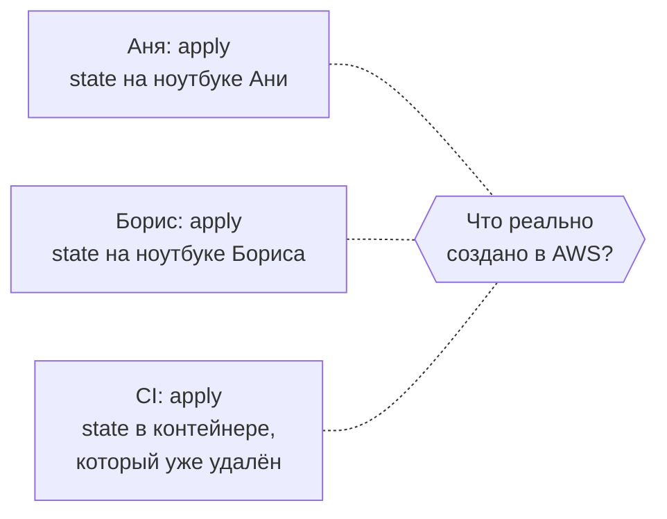
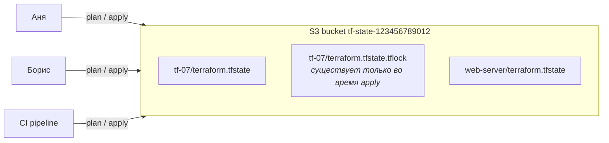
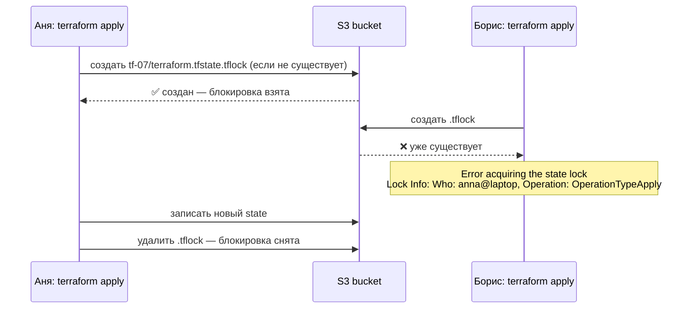
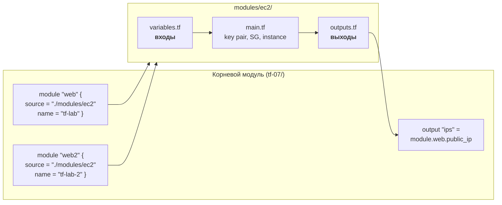

# 07 · Terraform: remote state, блокировка и модули

!!! abstract "В этой главе"
    **Что вы узнаете:** почему локальный state не годится для команды, как хранить state в S3 с версионированием и шифрованием, как работает блокировка state (`use_lockfile`), как перенести существующий state, что такое модуль, как его написать и вызвать несколько раз, как переносить ресурсы в модуль без пересоздания (`moved`).

    **Что нужно до начала:**

    - [Глава 06](../06-terraform-intro/README.md): папка `tf-06` с рабочим кодом.
    - [Глава 04](../04-iam-users-policies/README.md): вход в консоль как `admin`, CloudShell.

    **Стоимость:** S3 для state — доли цента. EC2 `t3.micro` на время практики — центы.

## Зачем это нужно

После главы 06 файл `terraform.tfstate` лежит у вас на ноутбуке. Представьте команду из трёх человек:



- У каждого своя версия правды. Борис не знает, что Аня уже создала сервер, и создаёт второй.
- Ноутбук украли или сломался — Terraform больше не знает о своих ресурсах.
- В git state класть нельзя: там секреты открытым текстом, а два одновременных `apply` превратят его в merge-конфликт в JSON.

Решение — **remote state**: один файл state в общем хранилище с контролем доступа, историей версий и **блокировкой**, которая не даст двум людям менять инфраструктуру одновременно.

## Концепция

### Remote state в S3



Что даёт S3:

| Свойство | Как | Зачем |
|----------|-----|-------|
| Один источник правды | Все читают и пишут один объект | Нет разных версий state |
| История | **Versioning** на бакете | Откатить state после неудачного `apply` |
| Шифрование | По умолчанию SSE-S3, `encrypt = true` | State содержит секреты |
| Контроль доступа | IAM-политики на бакет и ключи | Только Terraform и CI, не все сотрудники |
| Блокировка | Объект `<key>.tflock` (`use_lockfile = true`) | Один `apply` за раз |

Один бакет обычно хранит state многих проектов, разделённых по **`key`** — пути внутри бакета: `network/prod/terraform.tfstate`, `web-server/dev/terraform.tfstate`. Папок в S3 нет, `/` — просто часть имени, но консоль показывает их как дерево.

### Блокировка state



Создание `.tflock` использует условную запись S3 (`If-None-Match`): только один из одновременных запросов может создать файл. Блокировка берётся на `plan` и `apply` и снимается в конце, даже если `apply` упал с ошибкой. Если процесс убили (закрыли ноутбук посреди `apply`), блокировка может остаться. Тогда — `terraform force-unlock <LOCK_ID>`, но **только** если вы уверены, что никто сейчас не делает `apply`.

!!! info "А как же DynamoDB?"
    До Terraform 1.11 блокировку для S3 делали отдельной таблицей DynamoDB (`dynamodb_table = "..."`). Вы встретите это в старых проектах и статьях. Начиная с 1.11 нативная блокировка в S3 (`use_lockfile = true`) — стандартный способ, а DynamoDB-блокировка объявлена устаревшей и будет удалена.

### Курица и яйцо

Бакет для state нужен **до** первого `terraform init`. Создавать его тем же Terraform, state которого будет в нём лежать, неудобно. Обычно бакет создают один раз отдельно: вручную, скриптом или отдельным маленьким Terraform-проектом с локальным state. Здесь — командами в CloudShell.

### Модули

**Модуль** — папка с `.tf` файлами, которую вызывают как функцию: передают входные переменные, получают outputs. Любая папка, где вы запускали Terraform, тоже модуль — **корневой** (root module).



| Часть модуля | Аналогия с функцией |
|--------------|---------------------|
| `variables.tf` | Параметры функции. Без `default` — обязательные |
| `main.tf` | Тело функции |
| `outputs.tf` | Возвращаемые значения. Без output снаружи модуля ничего не видно |
| `module "x" { source = ... }` | Вызов функции |
| `module.x.public_ip` | Результат вызова |

Откуда берутся модули (`source`):

```hcl
module "local"    { source = "./modules/ec2" }                         # локальная папка
module "registry" {
  source  = "terraform-aws-modules/vpc/aws"                           # Terraform Registry
  version = "~> 6.0"                                                   # всегда фиксируйте версию
}
module "git"      { source = "git::https://github.com/org/tf-modules.git//ec2?ref=v1.2.0" }  # git-тег
```

!!! example "Плохо / Хорошо: dev и prod"

    === "❌ Плохо"

        ```text
        project-dev/main.tf    ← 150 строк
        project-prod/main.tf   ← те же 150 строк, скопированные и чуть изменённые
        ```
        Исправили ошибку в dev — забыли в prod. Через полгода окружения расходятся так, что «в dev работало» ничего не значит.

    === "✅ Хорошо"

        ```text
        modules/web-server/    ← логика один раз
        envs/dev/main.tf       ← module "web" { source = "../../modules/web-server", instance_type = "t3.micro" }
        envs/prod/main.tf      ← module "web" { source = "../../modules/web-server", instance_type = "t3.small" }
        ```
        Окружения отличаются **только параметрами**, и у каждого свой state (`key` в backend).

## Практика

### Шаг 1. Бакет для state (CloudShell, admin)

Войдите в консоль как `admin`, откройте **CloudShell** в регионе `us-west-2`:

```bash
ACCOUNT_ID=$(aws sts get-caller-identity --query Account --output text)
BUCKET=tf-state-$ACCOUNT_ID

aws s3api create-bucket --bucket $BUCKET --region us-west-2 \
  --create-bucket-configuration LocationConstraint=us-west-2

aws s3api put-bucket-versioning --bucket $BUCKET \
  --versioning-configuration Status=Enabled

# Проверка: публичный доступ заблокирован, шифрование включено (так по умолчанию для новых бакетов)
aws s3api get-public-access-block --bucket $BUCKET --query PublicAccessBlockConfiguration
aws s3api get-bucket-encryption --bucket $BUCKET \
  --query 'ServerSideEncryptionConfiguration.Rules[0].ApplyServerSideEncryptionByDefault'
echo $BUCKET
```

!!! success "✅ Проверь себя"
    ```bash
    aws s3api get-bucket-versioning --bucket $BUCKET     # → "Status": "Enabled"
    ```
    Все четыре флага Public Access Block — `true`, алгоритм шифрования — `AES256`.

!!! danger "Этот бакет не удаляют после каждой главы"
    В отличие от учебных ресурсов, бакет state живёт, пока живут проекты, чей state в нём лежит. Он понадобится в главе 08. Хранение нескольких файлов state стоит доли цента в месяц.

### Шаг 2. Права для devops-course

Пользователю `devops-course` нужен доступ к этому бакету. В консоли **IAM → Policies → Create policy → JSON** (замените Account ID):

```json
{
  "Version": "2012-10-17",
  "Statement": [
    {
      "Sid": "StateBucketList",
      "Effect": "Allow",
      "Action": ["s3:ListBucket", "s3:ListBucketVersions"],
      "Resource": "arn:aws:s3:::tf-state-123456789012"
    },
    {
      "Sid": "StateObjects",
      "Effect": "Allow",
      "Action": ["s3:GetObject", "s3:PutObject", "s3:DeleteObject"],
      "Resource": "arn:aws:s3:::tf-state-123456789012/*"
    }
  ]
}
```

*Name*: `terraform-state-access` → **Create policy**. Затем **User groups → ec2-admins → Permissions → Add permissions → Attach policies** → `terraform-state-access`.

`s3:DeleteObject` нужен, чтобы снимать блокировку (удалять `.tflock`).

!!! success "✅ Проверь себя"
    На своём компьютере:
    ```bash
    aws s3 ls s3://tf-state-123456789012 --profile devops-course     # → пусто, без ошибки
    aws s3 ls --profile devops-course                                 # → AccessDenied: список всех бакетов не разрешён, и это правильно
    ```

### Шаг 3. Подготовить проект с локальным state

Скопируйте проект из главы 06 и создайте ресурсы **пока с локальным state**:

=== "bash"

    ```bash
    cp -r tf-06 tf-07 && cd tf-07
    rm -rf .terraform terraform.tfstate*
    export AWS_PROFILE=devops-course
    terraform init && terraform apply
    ls terraform.tfstate       # ← state пока локальный
    ```

=== "PowerShell"

    ```powershell
    Copy-Item -Recurse tf-06 tf-07; cd tf-07
    Remove-Item -Recurse -Force .terraform, terraform.tfstate* -ErrorAction SilentlyContinue
    $env:AWS_PROFILE = "devops-course"
    terraform init; terraform apply
    Get-Item terraform.tfstate
    ```

### Шаг 4. Перенести state в S3

Создайте `backend.tf` (Account ID — ваш):

```hcl
terraform {
  backend "s3" {
    bucket       = "tf-state-123456789012"
    key          = "tf-07/terraform.tfstate"
    region       = "us-west-2"
    profile      = "devops-course"
    use_lockfile = true
    encrypt      = true
  }
}
```

!!! note "Почему значения записаны прямо, а не через переменные"
    Блок `backend` настраивается до чтения переменных, поэтому `var.` в нём использовать нельзя. Если не хотите хранить имя бакета в коде, оставьте поле пустым и передайте его при init: `terraform init -backend-config="bucket=tf-state-123456789012"`.

Мигрируйте:

```bash
terraform init -migrate-state
```

```text
Initializing the backend...
Do you want to copy existing state to the new backend?
  Pre-existing state was found while migrating the previous "local" backend to the
  newly configured "s3" backend. No existing state was found in the newly
  configured "s3" backend. Do you want to copy this state to the new "s3"
  backend? Enter "yes" to copy and "no" to start with an empty state.

  Enter a value: yes

Successfully configured the backend "s3"! Terraform will automatically
use this backend unless the backend configuration changes.
```

!!! success "✅ Проверь себя"
    ```bash
    aws s3 ls s3://tf-state-123456789012/tf-07/
    # → 2026-10-28 12:00:00   12345 terraform.tfstate
    terraform state list       # → те же 6 строк, что в главе 06 — теперь читаются из S3
    terraform plan             # → No changes
    ```
    Теперь локальный файл больше не нужен. Удалите его, чтобы не путаться: `rm terraform.tfstate terraform.tfstate.backup`.

### Шаг 5. «Ноутбук потерян»

Убедитесь, что state действительно больше не зависит от вашей папки:

```bash
rm -rf .terraform          # PowerShell: Remove-Item -Recurse -Force .terraform
terraform init             # ← Terraform снова находит backend в S3
terraform plan             # → No changes. Your infrastructure matches the configuration.
```

Код в git + state в S3 = любой участник команды (или CI) может склонировать репозиторий и продолжить работу.

### Шаг 6. Увидеть блокировку

Откройте **два** терминала в папке `tf-07` (в обоих задайте `AWS_PROFILE`).

**Терминал 1:**

```bash
terraform apply
# ← НЕ отвечайте на «Enter a value:» — оставьте вопрос висеть
```

**Терминал 2:**

```bash
aws s3 ls s3://tf-state-123456789012/tf-07/
# → terraform.tfstate
# → terraform.tfstate.tflock          ← блокировка держится, пока идёт apply в терминале 1

terraform plan
```

```text
│ Error: Error acquiring the state lock
│
│ Error message: operation error S3: PutObject, ... PreconditionFailed
│ Lock Info:
│   ID:        2c6a5f3e-...
│   Path:      tf-state-123456789012/tf-07/terraform.tfstate
│   Operation: OperationTypeApply
│   Who:       you@your-laptop
│   Version:   1.14.x
│   Created:   2026-10-28 12:05:00 +0000 UTC
```

В терминале 1 введите `no`. Блокировка снимется, `.tflock` исчезнет, и `terraform plan` во втором терминале пройдёт.

!!! success "✅ Проверь себя"
    Вы видели `.tflock` во время `apply` и ошибку `Error acquiring the state lock` с информацией о том, **кто** держит блокировку. После `no` файла `.tflock` нет.

### Шаг 7. История версий state

```bash
aws s3api list-object-versions --bucket tf-state-123456789012 --prefix tf-07/terraform.tfstate \
  --query 'Versions[].{Version:VersionId,Modified:LastModified,Latest:IsLatest}' --output table
```

Каждый `apply`, изменивший state, создаёт новую версию. Если state повредился, предыдущую версию можно восстановить в консоли S3 (**Show versions**). Это крайняя мера: восстановленный state может не совпасть с реальностью, после восстановления обязательно `terraform plan`.

### Шаг 8. Вынести код в модуль

Создайте папку `modules/ec2` и три файла в ней.

`modules/ec2/variables.tf`:

```hcl
variable "name" {
  description = "Name prefix for key pair, security group and instance"
  type        = string
}

variable "instance_type" {
  description = "EC2 instance type"
  type        = string
  default     = "t3.micro"
}

variable "public_key_path" {
  description = "Path to SSH public key"
  type        = string
  default     = "~/.ssh/id_ed25519.pub"
}

variable "ssh_cidr" {
  description = "CIDR allowed to connect via SSH"
  type        = string
}
```

`modules/ec2/main.tf` — ресурсы из `main.tf` главы 06, но с именем `this` и параметрами вместо констант:

```hcl
data "aws_ami" "al2023" {
  most_recent = true
  owners      = ["amazon"]

  filter {
    name   = "name"
    values = ["al2023-ami-2023.*-x86_64"]
  }
}

resource "aws_key_pair" "this" {
  key_name   = "${var.name}-key"
  public_key = file(pathexpand(var.public_key_path))
}

resource "aws_security_group" "this" {
  name        = "${var.name}-sg"
  description = "SSH from my IP"
}

resource "aws_vpc_security_group_ingress_rule" "ssh" {
  security_group_id = aws_security_group.this.id
  cidr_ipv4         = var.ssh_cidr
  ip_protocol       = "tcp"
  from_port         = 22
  to_port           = 22
}

resource "aws_vpc_security_group_egress_rule" "all" {
  security_group_id = aws_security_group.this.id
  cidr_ipv4         = "0.0.0.0/0"
  ip_protocol       = "-1"
}

resource "aws_instance" "this" {
  ami                    = data.aws_ami.al2023.id
  instance_type          = var.instance_type
  key_name               = aws_key_pair.this.key_name
  vpc_security_group_ids = [aws_security_group.this.id]

  metadata_options {
    http_tokens = "required"
  }

  tags = {
    Name = "${var.name}-web"
  }
}
```

`modules/ec2/outputs.tf`:

```hcl
output "public_ip" {
  description = "Public IP of the instance"
  value       = aws_instance.this.public_ip
}

output "instance_id" {
  description = "EC2 instance ID"
  value       = aws_instance.this.id
}
```

Имя `this` — соглашение для главного ресурса модуля: изнутри «этот инстанс», а снаружи к нему обращаются через `module.<имя>`. В модуле нет блока `provider`: модуль использует провайдер корневого модуля.

Теперь корневой `main.tf` — оставьте только `provider` и вызов модуля:

```hcl
provider "aws" {
  region  = var.region
  profile = var.aws_profile

  default_tags {
    tags = {
      Project   = "tf-lab"
      ManagedBy = "terraform"
    }
  }
}

module "web" {
  source = "./modules/ec2"

  name          = "tf-lab"
  instance_type = var.instance_type
  ssh_cidr      = var.ssh_cidr
}
```

И `outputs.tf`:

```hcl
output "public_ip" {
  value = module.web.public_ip
}

output "ssh_command" {
  value = "ssh -i ~/.ssh/id_ed25519 ec2-user@${module.web.public_ip}"
}
```

```bash
terraform init      # ← обязательно после добавления модуля
terraform plan
```

```text
Plan: 5 to add, 0 to change, 5 to destroy.
```

Terraform считает, что `aws_instance.web` и `module.web.aws_instance.this` — **разные** ресурсы: старый нужно удалить, новый создать. Для учебного сервера не страшно, но в продакшене так теряют базы данных. Не применяйте этот план.

### Шаг 9. Перенос без пересоздания: `moved`

Скажите Terraform, что ресурсы просто переехали. Создайте `moved.tf` в корне:

```hcl
moved {
  from = aws_key_pair.lab
  to   = module.web.aws_key_pair.this
}

moved {
  from = aws_security_group.lab
  to   = module.web.aws_security_group.this
}

moved {
  from = aws_vpc_security_group_ingress_rule.ssh
  to   = module.web.aws_vpc_security_group_ingress_rule.ssh
}

moved {
  from = aws_vpc_security_group_egress_rule.all
  to   = module.web.aws_vpc_security_group_egress_rule.all
}

moved {
  from = aws_instance.web
  to   = module.web.aws_instance.this
}
```

```bash
terraform plan
```

```text
  # aws_instance.web has moved to module.web.aws_instance.this
    resource "aws_instance" "this" {
        id = "i-0abc123def4567890"
        ...
Plan: 0 to add, 0 to change, 0 to destroy.
```

!!! success "✅ Проверь себя"
    `0 to add, 0 to change, 0 to destroy` и строки `has moved to`. Значения совпадают, потому что модуль собирает те же имена: `tf-lab-key`, `tf-lab-sg`, `tf-lab-web`. Примените: `terraform apply` → `yes`. Теперь `terraform state list` показывает адреса вида `module.web.aws_instance.this`.

После `apply` блоки `moved` можно оставить (они документируют историю) или удалить, когда все копии state обновлены.

### Шаг 10. Вызвать модуль второй раз

Добавьте в `main.tf`:

```hcl
module "web2" {
  source = "./modules/ec2"

  name          = "tf-lab-2"
  instance_type = "t3.micro"
  ssh_cidr      = var.ssh_cidr
}
```

и в `outputs.tf`:

```hcl
output "public_ip_2" {
  value = module.web2.public_ip
}
```

```bash
terraform init && terraform apply
```

!!! success "✅ Проверь себя"
    `Plan: 5 to add`, после apply — два output с разными IP. Две строки кода `module` — два полных набора ресурсов (Key Pair, SG, правила, инстанс) с разными именами. Логика написана один раз.

### Шаг 11. Уборка

!!! success "✅ Проверь себя перед удалением"
    ```bash
    terraform plan -destroy | tail -1     # → Plan: 0 to add, 0 to change, 10 to destroy.
    ```

```bash
terraform destroy
```

!!! success "✅ Проверь себя"
    ```bash
    terraform state list                                    # → пусто
    aws ec2 describe-instances --filters "Name=tag:Project,Values=tf-lab" "Name=instance-state-name,Values=running,pending,stopped" \
      --query 'Reservations[].Instances[].InstanceId' --output text   # → пусто
    aws s3 ls s3://tf-state-123456789012/tf-07/              # → terraform.tfstate (пустой state остаётся)
    ```
    Бакет `tf-state-...` и политику `terraform-state-access` **не удаляйте**: они нужны в главе 08.

!!! quote "Реальный кейс"
    В команде было правило «apply только из CI», но state хранился в S3 без блокировки. Ночной pipeline начал `apply`, а дежурный инженер в это же время запустил `apply` с ноутбука, чтобы срочно поднять лимит в Auto Scaling Group. Оба процесса записали свой вариант state, последним записал CI. В state «пропали» три ресурса, созданные инженером. Следующий `apply` попытался создать их снова и упал на конфликте имён. Разбирались два дня, восстанавливая state по версиям S3 и `terraform import`. Одна строка в backend (`use_lockfile = true`, тогда — DynamoDB) превратила бы аварию в сообщение «state locked, подождите».

## Вопросы для самопроверки

<details markdown="1">
<summary>1. Почему state нельзя просто хранить в git, если там уже лежит код?</summary>

Три причины: в state бывают секреты открытым текстом (пароли, ключи), а доступ к репозиторию есть у многих; git не умеет блокировку — два одновременных `apply` создадут конфликт в JSON; state меняется при каждом `apply`, и забытый `git push` означает, что у коллег устаревшая правда о вашей инфраструктуре.
</details>

<details markdown="1">
<summary>2. <code>apply</code> упал посреди работы из-за ошибки AWS. Останется ли state заблокированным навсегда?</summary>

Нет. Terraform снимает блокировку и при ошибке. Блокировка может «зависнуть», только если процесс убит (закрыт терминал, выключился ноутбук, убит CI-агент). Тогда — `terraform force-unlock <ID>` (ID есть в сообщении об ошибке), но только убедившись, что этот `apply` действительно не работает.
</details>

<details markdown="1">
<summary>3. Зачем модулю outputs? Что будет, если обратиться к <code>module.web.public_ip</code>, а output в модуле не объявлен?</summary>

Модуль — чёрный ящик: снаружи видны только его outputs. Без объявленного output обращение `module.web.public_ip` даст ошибку `Unsupported attribute`. Каждое значение нужно явно «пробросить» на каждом уровне: ресурс → output модуля → (при необходимости) output корневого модуля.
</details>

<details markdown="1">
<summary>4. Вы переименовали ресурс в коде: <code>aws_instance.web</code> → <code>aws_instance.app</code>. Что покажет план и как этого избежать?</summary>

Terraform увидит, что `web` пропал из кода (удалить), а `app` появился (создать): `1 to add, 1 to destroy`. Сервер пересоздастся. Чтобы этого избежать, добавьте блок `moved { from = aws_instance.web  to = aws_instance.app }` — Terraform просто поменяет адрес в state.
</details>

<details markdown="1">
<summary>5. Можно ли хранить state dev и prod в одном бакете? В одном файле?</summary>

В одном бакете — да, с разными `key`: `app/dev/terraform.tfstate` и `app/prod/terraform.tfstate`. В одном файле — нет: тогда любой `apply` для dev может задеть prod, а права на state dev означают права на prod. В зрелых командах prod вообще держат в отдельном AWS-аккаунте с отдельным бакетом state.
</details>

## Итоги

- [x] Remote state в S3: один источник правды, версии, шифрование, IAM
- [x] `use_lockfile = true` — нативная блокировка (Terraform 1.11+); DynamoDB — устаревший вариант
- [x] Бакет state создаётся заранее и живёт дольше учебных ресурсов
- [x] `terraform init -migrate-state` переносит существующий state
- [x] Модуль = папка с входами (variables) и выходами (outputs); вызывается сколько угодно раз
- [x] `moved` переносит ресурсы по новому адресу без пересоздания

**Что дальше.** Сервер создаётся одной командой, но внутри он пустой: всё, что на нём нужно, вы ставите руками по SSH. В [главе 08](../08-terraform-userdata/README.md) сервер научится настраивать себя сам через User Data, и вы соберёте первый законченный проект: веб-сервер одной командой.

- 📋 [Шпаргалка](commands.md)
- 🏋️ [Задания к главе](exercises.md)
