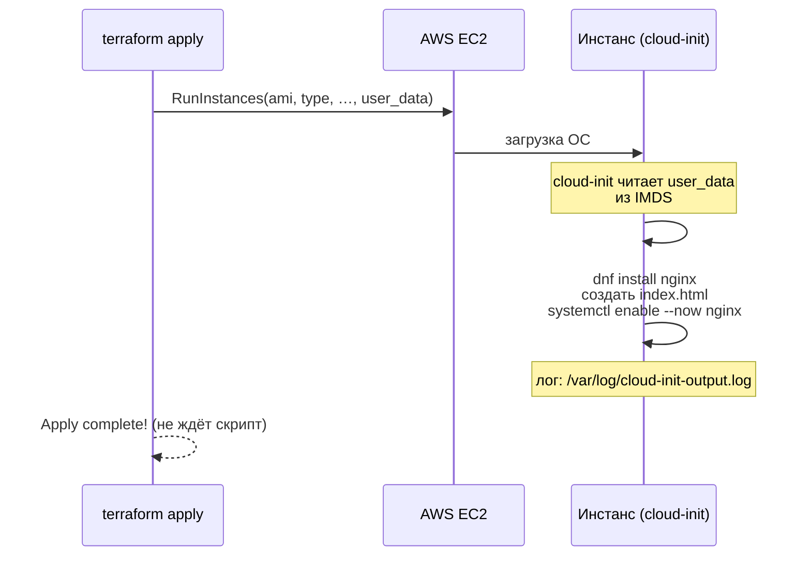
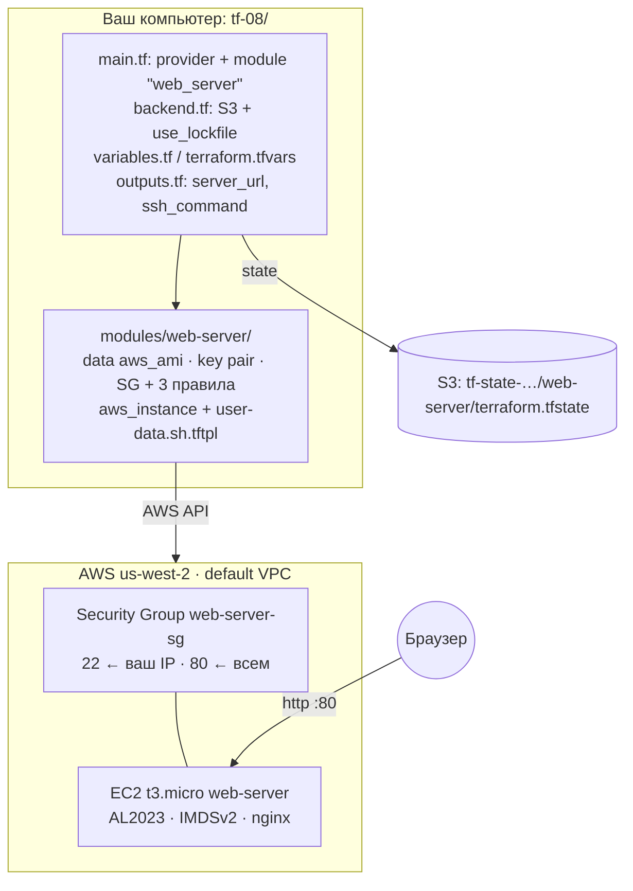

# 08 · Terraform: User Data и первый проект

!!! abstract "В этой главе"
    **Что вы узнаете:** как сервер настраивает себя сам при первом запуске (User Data и cloud-init), как передать значения из Terraform в скрипт через `templatefile()`, почему изменение User Data должно пересоздавать сервер, как отлаживать скрипт запуска. Итог главы — законченный проект: веб-сервер с nginx одной командой `terraform apply`.

    **Что нужно до начала:**

    - [Глава 07](../07-terraform-state-modules/README.md): бакет `tf-state-<account-id>`, политика `terraform-state-access`, модуль `modules/ec2`.
    - Задание второго уровня из [главы 02](../02-aws-vpc-ec2/exercises.md) — если делали, сравните, сколько ручных шагов исчезнет.

    **Эталон:** готовый код этой главы лежит в репозитории пособия в [`project/terraform/`](https://github.com/psyhod-github/devops-handbook/tree/main/project/terraform).

    **Стоимость:** EC2 `t3.micro` на время практики — центы. В конце — `terraform destroy`.

## Зачем это нужно

После главы 07 Terraform создаёт сервер одной командой, но сервер **пустой**. Чтобы на нём появился сайт, вы бы сделали то же, что в главе 02:

```text
terraform apply  →  ssh  →  sudo dnf install nginx  →  sudo systemctl enable --now nginx
                 →  sudo vi /usr/share/nginx/html/index.html  →  exit
```

И повторяли бы это после каждого пересоздания сервера. Так появляются «снежинки» — серверы, настроенные руками, уникальные и невоспроизводимые.

**User Data** — скрипт, который AWS передаёт инстансу при создании, а инстанс выполняет сам при первой загрузке. Сервер рождается уже настроенным.

## Концепция

### Как работает User Data



Ключевые факты:

- Скрипт выполняет **cloud-init** — стандартный инструмент первичной настройки облачных серверов. Он есть в Amazon Linux, Ubuntu и других облачных образах.
- Скрипт выполняется **от root**, `sudo` не нужен.
- Выполняется **один раз**, при первой загрузке инстанса. При `reboot` и `stop/start` — не выполняется.
- `terraform apply` завершается, когда инстанс **запущен**, а не когда скрипт **отработал**. Между «Apply complete» и рабочим сайтом проходит 1–2 минуты.
- Размер User Data ограничен 16 КБ. Для сложной настройки используют Ansible (главы 13–14) или готовые образы.

### Шаблон: значения из Terraform в скрипт

Скрипт удобно держать в отдельном файле и подставлять в него значения функцией `templatefile()`:

```hcl
user_data = templatefile("${path.module}/user-data.sh.tftpl", {
  name    = var.name
  message = var.page_message
})
```

В файле шаблона `${name}` и `${message}` заменит Terraform. Если bash-переменная записана с фигурными скобками (`${VAR}`), её нужно экранировать: `$${VAR}`. Без скобок (`$VAR`, `$(cmd)`) Terraform её не трогает.

`path.module` — путь к папке текущего модуля. Без него `templatefile` искал бы файл относительно папки, где запущен Terraform.

### Изменили скрипт — что с сервером?

Скрипт выполняется только при первой загрузке. Если поменять User Data у работающего сервера, новый скрипт **не выполнится**: AWS просто сохранит новое значение до следующего первого запуска, которого не будет. Сервер останется со старой настройкой, а код будет говорить другое. Это скрытый drift.

!!! example "Плохо / Хорошо"

    === "❌ Плохо"

        ```hcl
        resource "aws_instance" "this" {
          user_data = templatefile(...)
          # изменили шаблон → plan: ~ update in-place (через stop/start)
          # → скрипт НЕ выполнится, на сервере старая страница
        }
        ```

    === "✅ Хорошо"

        ```hcl
        resource "aws_instance" "this" {
          user_data                   = templatefile(...)
          user_data_replace_on_change = true
          # изменили шаблон → plan: -/+ replace
          # → новый сервер, скрипт выполнился с нуля
        }
        ```
        Сервер **неизменяемый**: любое изменение настройки = новый сервер из кода. Состояния, которое живёт только на диске, нет.

### Проект целиком



## Практика

### Шаг 1. Подготовить проект

Скопируйте проект главы 07 и переименуйте модуль:

=== "bash"

    ```bash
    cp -r tf-07 tf-08 && cd tf-08
    rm -rf .terraform moved.tf
    mv modules/ec2 modules/web-server
    export AWS_PROFILE=devops-course
    ```

=== "PowerShell"

    ```powershell
    Copy-Item -Recurse tf-07 tf-08; cd tf-08
    Remove-Item -Recurse -Force .terraform, moved.tf -ErrorAction SilentlyContinue
    Rename-Item modules/ec2 web-server
    $env:AWS_PROFILE = "devops-course"
    ```

В `backend.tf` поменяйте `key` — у нового проекта свой state:

```hcl
    key          = "web-server/terraform.tfstate"
```

### Шаг 2. Шаблон User Data

Создайте `modules/web-server/user-data.sh.tftpl`:

```bash
#!/bin/bash
# Выполняется один раз, при первом запуске инстанса, от root.
# Лог: /var/log/cloud-init-output.log
set -euxo pipefail

dnf install -y nginx

TOKEN=$(curl -s -X PUT http://169.254.169.254/latest/api/token -H "X-aws-ec2-metadata-token-ttl-seconds: 300")
INSTANCE_ID=$(curl -s -H "X-aws-ec2-metadata-token: $TOKEN" http://169.254.169.254/latest/meta-data/instance-id)

cat > /usr/share/nginx/html/index.html <<HTML
<!doctype html>
<html lang="en">
<head><meta charset="utf-8"><title>${name}</title></head>
<body style="font-family: monospace; background: #0d1117; color: #c9d1d9; padding: 2rem;">
  <h1>${message}</h1>
  <p>instance: $INSTANCE_ID</p>
  <p>deployed by Terraform + User Data at $(date -u +%FT%TZ)</p>
</body>
</html>
HTML

systemctl enable --now nginx
```

| Строка | Зачем |
|--------|-------|
| `set -euxo pipefail` | Остановиться на первой ошибке (`-e`), ошибка на неопределённой переменной (`-u`), печатать каждую команду в лог (`-x`), учитывать ошибки в конвейерах (`pipefail`) |
| `dnf install -y nginx` | Установить nginx без вопросов |
| `TOKEN=…`, `INSTANCE_ID=…` | Узнать ID инстанса через IMDSv2 (глава 05) |
| `${name}`, `${message}` | Подставит Terraform |
| `$INSTANCE_ID`, `$(date …)` | Подставит bash на сервере |
| `systemctl enable --now` | Запустить сейчас и включить автозапуск |

### Шаг 3. Модуль: HTTP и User Data

В `modules/web-server/variables.tf` добавьте переменную:

```hcl
variable "page_message" {
  description = "Text for the nginx index page"
  type        = string
  default     = "Hello from Terraform!"
}
```

В `modules/web-server/main.tf`:

1. Описание Security Group: `description = "SSH from admin IP, HTTP from anywhere"`.
2. Новое правило для HTTP рядом с правилом SSH:

    ```hcl
    resource "aws_vpc_security_group_ingress_rule" "http" {
      security_group_id = aws_security_group.this.id
      description       = "HTTP from anywhere"
      cidr_ipv4         = "0.0.0.0/0"
      ip_protocol       = "tcp"
      from_port         = 80
      to_port           = 80
    }
    ```

3. В `aws_instance.this` — User Data, а тег `Name` без суффикса `-web`:

    ```hcl
    resource "aws_instance" "this" {
      ami                    = data.aws_ami.al2023.id
      instance_type          = var.instance_type
      key_name               = aws_key_pair.this.key_name
      vpc_security_group_ids = [aws_security_group.this.id]

      user_data = templatefile("${path.module}/user-data.sh.tftpl", {
        name    = var.name
        message = var.page_message
      })
      user_data_replace_on_change = true

      metadata_options {
        http_tokens   = "required"
        http_endpoint = "enabled"
      }

      tags = {
        Name = var.name
      }
    }
    ```

В `modules/web-server/outputs.tf` добавьте `security_group_id` (пригодится для отладки):

```hcl
output "security_group_id" {
  description = "ID of the created security group"
  value       = aws_security_group.this.id
}
```

### Шаг 4. Корневой модуль

`main.tf` — один вызов модуля (второй `web2` из главы 07 уберите):

```hcl
module "web_server" {
  source = "./modules/web-server"

  name            = var.name
  instance_type   = var.instance_type
  public_key_path = var.public_key_path
  ssh_cidr        = var.ssh_cidr
  page_message    = var.page_message
}
```

В `variables.tf` добавьте переменные `name`, `public_key_path` и `page_message`, а у `instance_type` — проверку допустимых типов:

```hcl
variable "name" {
  description = "Name prefix for all resources"
  type        = string
  default     = "web-server"
}

variable "instance_type" {
  description = "EC2 instance type"
  type        = string
  default     = "t3.micro"

  validation {
    condition     = contains(["t3.micro", "t3.small"], var.instance_type)
    error_message = "Use t3.micro or t3.small for the course."
  }
}

variable "public_key_path" {
  description = "Path to your SSH public key (ssh-keygen -t ed25519)"
  type        = string
  default     = "~/.ssh/id_ed25519.pub"
}

variable "page_message" {
  description = "Text shown on the web page"
  type        = string
  default     = "Hello from Terraform!"
}
```

`outputs.tf`:

```hcl
output "server_url" {
  description = "Open in browser (nginx needs 1-2 minutes after apply)"
  value       = "http://${module.web_server.public_ip}"
}

output "ssh_command" {
  description = "Connect via SSH"
  value       = "ssh -i ${trimsuffix(var.public_key_path, ".pub")} ec2-user@${module.web_server.public_ip}"
}

output "instance_id" {
  description = "EC2 instance ID"
  value       = module.web_server.instance_id
}
```

Сверьтесь с эталоном в `project/terraform/`: структура и содержимое должны совпасть (кроме ваших значений в `backend.tf` и `terraform.tfvars`). В эталоне есть ещё переменная `install_nginx` и output `public_ip`: они понадобятся в главах 13–14, когда сервер будет настраивать Ansible.

### Шаг 5. Запуск

```bash
terraform init
terraform fmt -recursive
terraform validate
terraform plan
```

!!! success "✅ Проверь себя"
    `Plan: 6 to add, 0 to change, 0 to destroy.` — Key Pair, Security Group, три правила (SSH, HTTP, egress) и инстанс. У `aws_instance` в плане видны `user_data` и `user_data_replace_on_change = true`.

```bash
terraform apply
```

```text
Apply complete! Resources: 6 added, 0 changed, 0 destroyed.

Outputs:

instance_id = "i-0abc123def4567890"
server_url = "http://54.x.x.x"
ssh_command = "ssh -i ~/.ssh/id_ed25519 ec2-user@54.x.x.x"
```

Подождите 1–2 минуты: инстанс загружается и выполняет скрипт.

=== "macOS / Linux"

    ```bash
    curl -s $(terraform output -raw server_url) | grep -E "h1|instance"
    ```

=== "Windows (PowerShell)"

    ```powershell
    curl.exe -s (terraform output -raw server_url) | Select-String "h1|instance"
    ```

Или откройте `server_url` в браузере.

!!! success "✅ Проверь себя"
    Страница с заголовком `Hello from Terraform!` и строкой `instance: i-0abc...` — тем же ID, что в output `instance_id`. Ни одной команды на сервере вы не выполняли.

    `Connection refused` — скрипт ещё работает, подождите. Таймаут — проверьте правило HTTP в Security Group.

### Шаг 6. Посмотреть, как отработал скрипт

```bash
terraform output -raw ssh_command     # ← скопируйте и выполните выведенную команду
```

На сервере:

```bash
cloud-init status --long          # → status: done
sudo tail -20 /var/log/cloud-init-output.log   # ← вывод вашего скрипта, каждая команда с "+" (set -x)
systemctl is-active nginx         # → active
systemctl is-enabled nginx        # → enabled
exit
```

!!! success "✅ Проверь себя"
    `cloud-init status` → `done` (не `error`). В логе видны строки `+ dnf install -y nginx` и `+ systemctl enable --now nginx`. Если что-то пошло не так, ответ почти всегда в этом логе.

Скрипт можно увидеть и в консоли: **EC2 → инстанс → Actions → Instance settings → Edit user data**.

### Шаг 7. Изменить страницу — новый сервер

Добавьте в `terraform.tfvars`:

```hcl
page_message = "Version 2: immutable server"
```

```bash
terraform plan
```

```text
  # module.web_server.aws_instance.this must be replaced
-/+ resource "aws_instance" "this" {
      ~ id               = "i-0abc123def4567890" -> (known after apply)
      ~ public_ip        = "54.x.x.x" -> (known after apply)
      ~ user_data        = "…" -> "…" # forces replacement
        ...
Plan: 1 to add, 0 to change, 1 to destroy.
```

`# forces replacement` рядом с `user_data` — это работа `user_data_replace_on_change`. Примените, подождите пару минут и откройте **новый** `server_url`.

!!! success "✅ Проверь себя"
    Новый IP, новый `instance:` на странице и текст `Version 2: immutable server`. Key Pair и Security Group остались прежними — пересоздан только инстанс.

!!! quote "Реальный кейс"
    На одном проекте User Data «на всякий случай» начинался с `dnf upgrade -y` без фиксации версий. Однажды обновление пакета изменило конфигурацию по умолчанию, и новые серверы при автомасштабировании поднимались с неработающим приложением, а старые продолжали работать. Ошибку искали полдня: «код же не менялся». Выводы: всё, что попадает на сервер, должно быть версионировано (пакеты, образы, конфиги), а User Data — короткий и предсказуемый. Для серьёзной настройки используют готовые образы (Packer, Docker) или Ansible, к которому вы придёте в главе 13.

### Шаг 8. Уборка

!!! success "✅ Проверь себя перед удалением"
    ```bash
    aws sts get-caller-identity --query Arn --output text
    terraform plan -destroy | tail -1      # → Plan: 0 to add, 0 to change, 6 to destroy.
    ```

```bash
terraform destroy
```

!!! success "✅ Проверь себя"
    ```bash
    terraform state list          # → пусто
    curl -m 5 $(terraform output -raw server_url 2>/dev/null) || echo "server is gone"
    aws ec2 describe-instances --filters "Name=tag:Name,Values=web-server" \
      --query 'Reservations[].Instances[].State.Name' --output text   # → terminated
    ```

!!! info "Если вы заканчиваете работу с AWS совсем"
    Бакет `tf-state-...` можно удалить, когда все проекты, чей state в нём лежит, уничтожены. Из-за versioning в бакете остаются старые версии файлов, поэтому `aws s3 rb --force` его не удалит. Проще в консоли: **S3 → бакет → Empty** (удаляет все версии) → **Delete**. Политику `terraform-state-access` удалите в IAM. Если пойдёте дальше по пособию — оставьте и то и другое.

## Вопросы для самопроверки

<details markdown="1">
<summary>1. Выполнится ли User Data при <code>reboot</code>? При <code>stop</code> + <code>start</code>? При <code>terraform apply -replace</code>?</summary>

При `reboot` и `stop/start` — нет: cloud-init запоминает, что для этого инстанса скрипт уже выполнен. При `-replace` — да: это новый инстанс с новым ID, для него это первая загрузка.
</details>

<details markdown="1">
<summary>2. <code>terraform apply</code> вернул «Apply complete», а сайт не открывается. Что проверить и в каком порядке?</summary>

1. Подождать 1–2 минуты: apply не ждёт выполнения скрипта.
2. `curl -m 5 http://<IP>`: `Connection refused` — nginx ещё не запущен или скрипт упал; таймаут — сеть (правило HTTP в SG, публичный IP).
3. По SSH: `cloud-init status --long`, затем `/var/log/cloud-init-output.log` — там видно, на какой команде скрипт остановился.
4. `systemctl status nginx`.

Именно для такой отладки в скрипте стоит `set -x`: каждая выполненная команда попадает в лог.
</details>

<details markdown="1">
<summary>3. Что сломается, если в шаблоне написать <code>echo ${HOME}</code>?</summary>

Terraform попытается подставить переменную шаблона `HOME`, которой нет в `templatefile(..., {name, message})`, и упадёт с ошибкой `vars map does not contain key "HOME"`. Нужно экранировать: `$${HOME}`, или писать без фигурных скобок: `$HOME`.
</details>

<details markdown="1">
<summary>4. Зачем <code>user_data_replace_on_change = true</code>, если без него план показывает безопасное <code>~ update in-place</code>?</summary>

Безопасным это изменение только выглядит. User Data у существующего инстанса меняется, но скрипт не выполняется повторно, поэтому сервер остаётся со старой настройкой, а код описывает новую. Пересоздание делает поведение честным: что в коде, то и на сервере.
</details>

<details markdown="1">
<summary>5. Почему для настройки сервера User Data подходит не всегда? Когда нужен другой инструмент?</summary>

- Скрипт выполняется только при создании: поменять настройку **работающего** сервера через него нельзя.
- Ограничение размера 16 КБ.
- Bash-скрипт не идемпотентен: повторный запуск может сломать то, что уже сделано.
- Нет удобного способа применить изменения к десяткам серверов сразу.

Для настройки работающих серверов используют **Ansible** (главы 13–14). Для неизменяемой инфраструктуры — готовые образы (Packer, AMI) или контейнеры (Docker, глава 09) с коротким User Data, который только запускает контейнер.
</details>

## Итоги

- [x] User Data выполняется cloud-init один раз, при первой загрузке, от root
- [x] `apply` не ждёт скрипт; лог — `/var/log/cloud-init-output.log`, статус — `cloud-init status`
- [x] `templatefile()` передаёт значения в скрипт; `$${...}` — экранирование bash-переменных
- [x] `user_data_replace_on_change = true` делает сервер неизменяемым
- [x] Собран проект: модуль + remote state + User Data → веб-сервер одной командой

**Что дальше.** Сервер с nginx — хорошо, но настоящее приложение — это Node.js, Redis, зависимости определённых версий. Ставить всё это скриптом на каждый сервер хрупко. В [главе 09](../09-docker/README.md) вы упакуете приложение в Docker-образ, который одинаково запускается где угодно.

- 📋 [Шпаргалка](commands.md)
- 🏋️ [Задания к главе](exercises.md)
