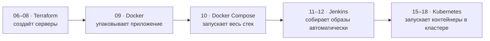
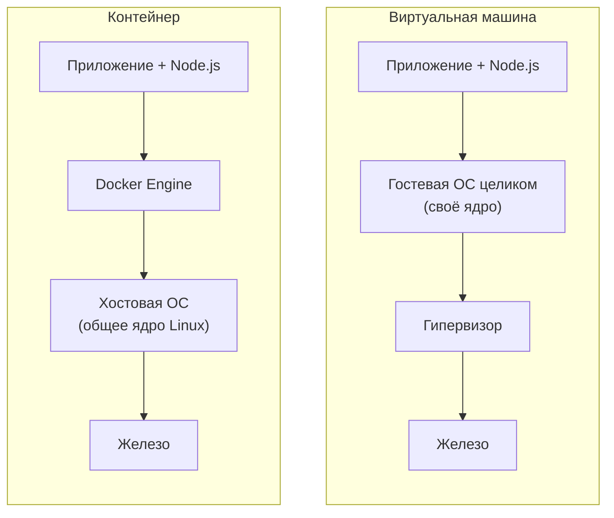
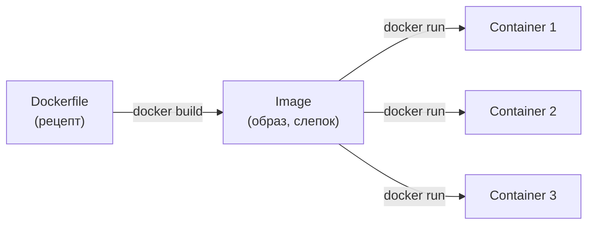
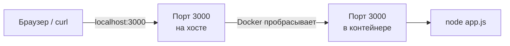
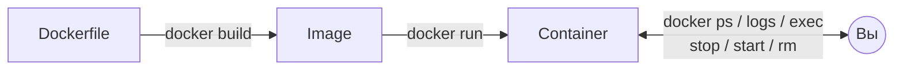

# 09 · Docker: контейнеры с нуля

!!! abstract "В этой главе"
    **Что вы узнаете:** чем контейнер отличается от виртуальной машины, что такое образ, контейнер и слой, как читать Dockerfile, как собрать образ и запустить из него приложение.

    **Что нужно до начала:**

    - [Глава 08](../08-terraform-userdata/README.md): вы видели, как сервер настраивает себя скриптом User Data. Эта глава отвечает на вопрос «а можно проще?».
    - Установлен Docker Desktop (Windows / macOS) или Docker Engine (Linux). Как установить, см. [главу 00](../00-setup/README.md) или [docs.docker.com/get-docker](https://docs.docker.com/get-docker/).
    - AWS в этой главе **не нужен**, всё работает на вашем компьютере.

    **Проверено на:** Docker Engine 29.4, базовый образ `node:22-alpine`.

## Зачем это нужно

В главе 08 Terraform создал EC2, а скрипт User Data установил на нём nginx. Это работает, но только на том сервере, под который написан скрипт:

| Где запускаем | Команда | Результат |
|---------------|---------|-----------|
| EC2 с Amazon Linux | `dnf install nginx` | ✅ работает |
| Ваш ноутбук с macOS | `dnf install nginx` | ❌ `command not found` |
| Сервер с Ubuntu | `dnf install nginx` | ❌ там `apt`, а не `dnf` |

С приложениями ещё хуже. На ноутбуке разработчика стоит Node.js 22, на сервере Node.js 18, у тестировщика Windows. Получается классическое **«у меня работает»**: код один и тот же, а окружения разные.

**Docker** решает эту проблему. Приложение упаковывается **вместе со всем, что ему нужно**: нужной версией Node.js, зависимостями, настройками. Такая упаковка, **образ**, запускается одинаково на ноутбуке, на сервере в AWS и в Kubernetes.

Где эта глава в общей картине:



## Концепция

### Виртуальная машина и контейнер



| | Виртуальная машина | Контейнер |
|---|---|---|
| Что внутри | Полная ОС со своим ядром | Только приложение и его зависимости |
| Размер | Гигабайты | Десятки–сотни мегабайт |
| Запуск | Десятки секунд (загрузка ОС) | Около секунды (запуск процесса) |
| Изоляция | Сильная, на уровне железа | На уровне процессов ядра Linux |

Главная мысль: **контейнер — это обычный процесс на хостовой машине**, которому Docker показывает собственную файловую систему, сеть и список процессов. Своего ядра у контейнера нет, он использует ядро хоста. Поэтому контейнер лёгкий и запускается почти мгновенно.

!!! info "А как же Windows и macOS?"
    Контейнерам с Linux-приложениями нужно ядро Linux. Docker Desktop на Windows и macOS незаметно запускает небольшую Linux-VM (на Windows через WSL 2), и контейнеры работают внутри неё. Для вас это прозрачно: команды везде одинаковые.

### Образ и контейнер



- **Dockerfile** — текстовый рецепт: из чего собирать и что выполнить.
- **Image (образ)** — готовый неизменяемый слепок: файлы приложения, зависимости, команда запуска.
- **Container (контейнер)** — запущенный экземпляр образа.

**Аналогия:** образ — это рецепт пиццы, контейнер — конкретная пицца, испечённая по нему. По одному рецепту можно испечь сколько угодно пицц. Из одного образа можно запустить сколько угодно контейнеров.

Если вы программировали: образ — это **класс**, контейнер — **объект** (экземпляр класса).

### Слои и кеш

Образ собирается из **слоёв**. Каждая инструкция Dockerfile, которая меняет файлы (`RUN`, `COPY`, `ADD`), добавляет новый слой поверх предыдущего:

```dockerfile
FROM node:22-alpine       # слой(и) базового образа: Alpine Linux + Node.js
WORKDIR /app              # рабочая папка
COPY package*.json ./     # файлы со списком зависимостей
RUN npm install --omit=dev   # установленные зависимости (node_modules)
COPY . .                  # код приложения
```

Docker **кеширует** слои. При повторной сборке он проверяет каждый шаг: если ни инструкция, ни файлы, которые она копирует, не изменились, слой берётся из кеша. Как только какой-то шаг изменился, **этот шаг и все шаги после него** собираются заново.

Отсюда главное правило порядка инструкций: **то, что меняется редко, ставим выше; то, что меняется часто, — ниже.**

Зависимости (`package.json`) меняются редко, а код (`app.js`) — постоянно. Поэтому сначала копируем только `package*.json` и ставим зависимости, а код копируем последним. Поменяли `app.js` → пересобирается только последний шаг, а долгий `npm install` берётся из кеша.

!!! example "Плохо / Хорошо"

    === "❌ Плохо"

        ```dockerfile
        FROM node:22           # полный образ Debian + Node.js: больше 1 ГБ
        WORKDIR /app
        COPY . .               # любое изменение кода сбрасывает кеш...
        RUN npm install        # ...и npm install выполняется каждый раз заново
        CMD ["node", "app.js"]
        ```

    === "✅ Хорошо"

        ```dockerfile
        FROM node:22-alpine    # Alpine — минимальный Linux, образ в разы меньше
        WORKDIR /app
        COPY package*.json ./  # сначала только список зависимостей
        RUN npm install --omit=dev   # кешируется, пока package.json не изменился
        COPY . .               # код — последним
        EXPOSE 3000
        CMD ["node", "app.js"]
        ```

!!! quote "Реальный кейс"
    На одном проекте CI собирал образ с `COPY . .` в самом начале Dockerfile. Каждый коммит, даже правка одной строки в README, запускал `npm install` с нуля: 4 минуты на сборку. Две инструкции поменяли местами, зависимости стали браться из кеша, и сборка ускорилась до 40 секунд. При 20–30 сборках в день команда экономила больше часа ожидания ежедневно.

## Практика

Дальше вы соберёте образ backend-а учебного проекта и запустите его. Команды одинаковые для всех систем. Отличается только `curl` в Windows, для него есть отдельные вкладки.

### Шаг 0. Проверить Docker

```bash
docker --version
docker run hello-world
```

!!! success "✅ Проверь себя"
    - `docker --version` → `Docker version 2x.x.x` или новее.
    - `docker run hello-world` → в выводе есть строка `Hello from Docker!`.

    Ошибка `Cannot connect to the Docker daemon` или `failed to connect to the docker API` означает, что Docker Desktop не запущен. Откройте его и дождитесь статуса *Engine running*.

### Шаг 1. Перейти в папку backend-а

Если репозиторий пособия ещё не скачан:

```bash
git clone https://github.com/<your-github-user>/devops-handbook.git
cd devops-handbook
```

Перейдите в папку backend-а и посмотрите, что там лежит:

```bash
cd app/backend
ls -a
```

```text
.  ..  .dockerignore  app.js  Dockerfile  package.json
```

- `app.js` — код приложения на Node.js (Express). Его вы не меняете.
- `package.json` — список зависимостей.
- `Dockerfile` и `.dockerignore` — инфраструктура. С ними и работаем.

### Шаг 2. Прочитать Dockerfile

```bash
cat Dockerfile
```

| Инструкция | Что делает |
|------------|------------|
| `FROM node:22-alpine` | Базовый образ: Alpine Linux с установленным Node.js 22 (LTS) |
| `WORKDIR /app` | Рабочая папка внутри образа. Все следующие команды выполняются в ней |
| `COPY package*.json ./` | Копирует **только** файлы зависимостей, чтобы следующий шаг кешировался |
| `RUN npm install --omit=dev` | Ставит зависимости, но без dev-зависимостей (тесты, линтеры): в продакшене они не нужны |
| `COPY . .` | Копирует остальной код. Стоит **после** `npm install` |
| `EXPOSE 3000` | **Документирует**, что приложение слушает порт 3000. Сам порт не открывает |
| `CMD ["node", "app.js"]` | Команда, которая выполняется при запуске контейнера |

`EXPOSE` и `CMD` не создают слоёв с файлами. Это метаданные образа.

Теперь `.dockerignore`:

```bash
cat .dockerignore
```

```text
node_modules
npm-debug.log*
.env
*.pem
```

Это аналог `.gitignore` для сборки. Без него `COPY . .` скопирует в образ локальную папку `node_modules` (сотни мегабайт, к тому же собранную под вашу ОС, а не под Linux). Хуже того, внутрь попадут секреты: `.env` и ключи `*.pem`. Всё, что попало в образ, может увидеть каждый, у кого есть этот образ.

### Шаг 3. Собрать образ

```bash
docker build -t devops-bootcamp-backend .
```

- `-t devops-bootcamp-backend` — имя (tag) образа. Без тега после двоеточия Docker подставит `:latest`.
- `.` в конце — **build context**, папка с файлами для сборки. Здесь это текущая папка.

Вывод (сокращённо):

```text
[+] Building 16.4s (10/10) FINISHED
 => [internal] load build definition from Dockerfile
 => [internal] load metadata for docker.io/library/node:22-alpine
 => [internal] load .dockerignore
 => [1/5] FROM docker.io/library/node:22-alpine@sha256:...   ← скачивается базовый образ
 => [2/5] WORKDIR /app
 => [3/5] COPY package*.json ./
 => [4/5] RUN npm install --omit=dev                          ← ставятся зависимости
 => [5/5] COPY . .
 => exporting to image
 => => naming to docker.io/library/devops-bootcamp-backend:latest
```

Шаги `[1/5]`–`[5/5]` соответствуют инструкциям Dockerfile, которые выполняют работу. Первая сборка дольше остальных, потому что скачивается базовый образ.

!!! note "Предупреждения npm"
    В выводе шага `[4/5]` могут быть строки `npm warn deprecated ...` или `New major version of npm available`. Это предупреждения, а не ошибки, и на сборку они не влияют.

!!! success "✅ Проверь себя"
    ```bash
    docker images devops-bootcamp-backend
    ```
    В списке есть образ `devops-bootcamp-backend` с тегом `latest`, размер около 200–300 МБ.

    Docker 29 показывает две колонки: `DISK USAGE` (сколько образ занимает на диске в распакованном виде) и `CONTENT SIZE` (сколько весит при скачивании). В старых версиях колонка одна, `SIZE`.

### Шаг 4. Увидеть кеш в действии

Запустите сборку ещё раз, ничего не меняя:

```bash
docker build -t devops-bootcamp-backend .
```

Сборка займёт пару секунд, а у всех шагов появится пометка `CACHED`.

Теперь «измените» код: допишите пустую строку в конец `app.js` и соберите снова.

=== "macOS / Linux"

    ```bash
    echo "" >> app.js
    docker build -t devops-bootcamp-backend .
    ```

=== "Windows (PowerShell)"

    ```powershell
    Add-Content app.js ""
    docker build -t devops-bootcamp-backend .
    ```

```text
 => CACHED [2/5] WORKDIR /app
 => CACHED [3/5] COPY package*.json ./
 => CACHED [4/5] RUN npm install --omit=dev     ← зависимости не переустанавливались
 => [5/5] COPY . .                              ← пересобран только этот шаг
```

Верните файл в исходное состояние:

```bash
git checkout -- app.js
```

### Шаг 5. Запустить контейнер

```bash
docker run -d -p 3000:3000 --name backend devops-bootcamp-backend
```

| Флаг | Что значит |
|------|------------|
| `-d` | *detached*: запустить в фоне и вернуть терминал |
| `-p 3000:3000` | Пробросить порт: `ПОРТ_НА_ХОСТЕ:ПОРТ_В_КОНТЕЙНЕРЕ` |
| `--name backend` | Дать контейнеру имя, чтобы не копировать длинный ID |

Docker выведет длинный ID контейнера, например `c0a4a51cbe87...`. Значит, контейнер запущен.

!!! success "✅ Проверь себя"
    ```bash
    docker ps
    ```
    ```text
    CONTAINER ID   IMAGE                     STATUS         PORTS                    NAMES
    c0a4a51cbe87   devops-bootcamp-backend   Up 5 seconds   0.0.0.0:3000->3000/tcp   backend
    ```
    `STATUS` = `Up ...`, в `PORTS` есть `3000->3000`.

Обратитесь к приложению:

=== "macOS / Linux"

    ```bash
    curl http://localhost:3000/health
    curl http://localhost:3000/info
    ```

=== "Windows (PowerShell)"

    ```powershell
    # В PowerShell curl — это алиас Invoke-WebRequest, поэтому пишем curl.exe
    curl.exe http://localhost:3000/health
    curl.exe http://localhost:3000/info
    ```

```json
{"status":"ok","uptime":12}
{"hostname":"c0a4a51cbe87","version":"1.0.0","node":"v22.23.4"}
```

Те же адреса можно открыть в браузере: `http://localhost:3000/health`.

Обратите внимание на `hostname` в ответе `/info`: он совпадает с `CONTAINER ID` из `docker ps`. У каждого контейнера свой hostname. В главе 18 вы запустите несколько копий backend-а и увидите, как этот hostname меняется от запроса к запросу: так выглядит балансировка нагрузки.

!!! warning "`/api/hits` пока не работает, и это нормально"
    Счётчик хранится в Redis, а Redis вы запустите только в главе 10. Без него запрос `curl http://localhost:3000/api/hits` **зависнет без ответа**: клиент Redis ждёт подключения. Прервите его через `Ctrl+C`.

    В логах контейнера при этом будут строки `Redis error: ...`. Это тоже ожидаемо: `/health` и `/info` без Redis работают.

### Как работает `-p 3000:3000`



Слева от двоеточия — порт **на вашем компьютере**, справа — порт **внутри контейнера**. Они не обязаны совпадать: с `-p 8080:3000` приложение будет доступно на `localhost:8080`, а внутри контейнера всё так же будет слушать 3000.

У каждого контейнера своя сеть, поэтому десять контейнеров могут слушать порт 3000 внутри себя. А вот **порт хоста** может занять только один из них.

### Шаг 6. Управлять контейнером

```bash
docker ps                 # запущенные контейнеры
docker ps -a              # все, включая остановленные

docker logs backend       # логи (то, что приложение пишет в stdout/stderr)
docker logs -f backend    # следить за логами в реальном времени; выход — Ctrl+C

docker stop backend       # остановить
docker start backend      # запустить снова (тот же контейнер, тот же ID)
```

Зайдите внутрь работающего контейнера:

```bash
docker exec -it backend sh
```

Теперь вы в shell **внутри** контейнера. Осмотритесь:

```sh
ls /app           # код приложения и node_modules
hostname          # совпадает с CONTAINER ID
node --version    # v22.x — та версия, что в образе, а не на вашем компьютере
exit              # выйти; контейнер продолжит работать
```

`-i` держит ввод открытым, `-t` выделяет терминал, а `sh` — это команда, которую надо выполнить. В образах на Alpine нет `bash`, только `sh`.

!!! example "Плохо / Хорошо"

    === "❌ Плохо"

        ```bash
        docker exec -it backend sh
        vi /app/app.js        # «быстро поправлю прямо в контейнере»
        ```
        Правка живёт только в этом контейнере. После `docker rm` или перезапуска из образа она исчезнет, а на других серверах её никогда и не было.

    === "✅ Хорошо"

        ```bash
        # меняем файл в репозитории → пересобираем образ → перезапускаем контейнер
        docker build -t devops-bootcamp-backend .
        docker rm -f backend
        docker run -d -p 3000:3000 --name backend devops-bootcamp-backend
        ```
        `docker exec` нужен для **диагностики**: посмотреть файлы, переменные окружения, проверить сеть. Чинить надо в Dockerfile или в коде.

Итоговая схема команд:



## Вопросы для самопроверки

Сначала ответьте сами, потом откройте ответ.

<details markdown="1">
<summary>1. Если контейнеры такие лёгкие, зачем вообще нужны виртуальные машины?</summary>

Контейнеры используют общее ядро хоста, поэтому:

- нельзя запустить Windows-приложение в контейнере на Linux-хосте и наоборот: нужна VM с другой ОС;
- изоляция слабее, чем у VM. Когда нужна жёсткая граница между клиентами (облачные провайдеры, недоверенный код), используют VM;
- сам Docker где-то должен работать. Ваш EC2 из главы 02 — это VM, и контейнеры в AWS чаще всего запускаются **внутри** VM.

VM и контейнеры не конкурируют, а дополняют друг друга.
</details>

<details markdown="1">
<summary>2. Можно ли запустить 5 контейнеров из одного образа?</summary>

Да. Образ неизменяемый, каждый контейнер получает свой тонкий слой для записи поверх него. Так работает горизонтальное масштабирование: запускают несколько одинаковых копий приложения. Kubernetes делает это автоматически (глава 18).
</details>

<details markdown="1">
<summary>3. Вы поменяли одну строку в <code>app.js</code>. Какие шаги сборки выполнятся заново?</summary>

Только `[5/5] COPY . .`. Изменился файл, который копирует этот шаг, поэтому его кеш сброшен. Шаги 1–4 берутся из кеша, `npm install` не запускается.

А если поменять `package.json`, заново выполнятся шаги 3, 4 и 5.
</details>

<details markdown="1">
<summary>4. В Dockerfile есть <code>EXPOSE 3000</code>. Почему без <code>-p 3000:3000</code> приложение недоступно на <code>localhost:3000</code>?</summary>

`EXPOSE` — только документация: «это приложение слушает 3000». Порт хоста она не открывает. Пробрасывает порт флаг `-p` при `docker run`. `EXPOSE` читают люди и инструменты (Docker Compose, Kubernetes), чтобы понять, какой порт ожидать.
</details>

<details markdown="1">
<summary>5. Почему <code>docker rm backend</code> не удаляет работающий контейнер?</summary>

Контейнер — это работающий процесс. Docker защищает от случайного удаления: сначала `docker stop` (процесс получает сигнал SIGTERM и корректно завершается), потом `docker rm`. Есть `docker rm -f`, но он убивает процесс без предупреждения, как `kill -9`. Используйте его осознанно.
</details>

<details markdown="1">
<summary>6. Вы записали файл внутри контейнера, а потом сделали <code>docker rm</code> и <code>docker run</code>. Где файл?</summary>

Пропал. Новый контейнер создаётся из образа, а образ не изменился. Всё, что контейнер записал «внутрь себя», живёт ровно столько, сколько сам контейнер.

Для приложения это хорошо: каждый запуск чистый и предсказуемый. А вот базе данных (например, Redis со счётчиком) так нельзя. Для данных, которые должны пережить контейнер, используют **volumes**. О них — в главе 10.
</details>

## Уборка

Локальные контейнеры денег не стоят, но занимают порты и место на диске. Привыкайте убирать за собой, это пригодится в AWS.

!!! success "✅ Проверь себя перед удалением"
    ```bash
    docker ps -a --filter name=backend
    docker images devops-bootcamp-backend
    ```
    Убедитесь, что удаляете **свой** контейнер `backend` и образ `devops-bootcamp-backend`, а не что-то чужое.

```bash
docker stop backend
docker rm backend
docker rmi devops-bootcamp-backend
```

!!! success "✅ Проверь себя"
    ```bash
    docker ps -a --filter name=backend      # → пустая таблица (только заголовок)
    docker images devops-bootcamp-backend   # → пустая таблица
    ```

!!! tip "Сколько места занимает Docker"
    `docker system df` показывает место под образы, контейнеры и кеш сборки. Команда `docker image prune` удаляет «висячие» образы без тегов. Перед любой командой `prune` прочитайте, что именно она удалит.

## Итоги

Что вы теперь умеете:

- [x] Объяснить разницу между VM и контейнером, между образом и контейнером
- [x] Читать Dockerfile и понимать, зачем инструкции стоят именно в таком порядке
- [x] Собирать образ (`docker build`) и пользоваться кешем слоёв
- [x] Запускать контейнер с пробросом порта (`docker run -d -p`)
- [x] Смотреть логи, заходить внутрь, останавливать и удалять контейнеры

**Что дальше.** Сейчас работает только backend: `/health` и `/info` отвечают, а счётчик `/api/hits` — нет, потому что не хватает Redis. В [главе 10](../10-docker-compose/README.md) вы опишете весь стек (nginx + backend + Redis) в одном файле `docker-compose.yml` и поднимете его одной командой.

- 📋 [Шпаргалка по командам](commands.md)
- 🏋️ [Задания к главе](exercises.md)
