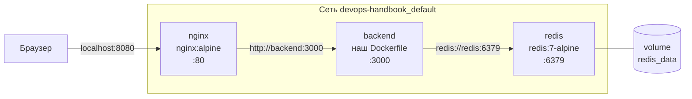

# 10 · Docker Compose: весь стек одной командой

!!! abstract "В этой главе"
    **Что вы узнаете:** как описать несколько связанных контейнеров в одном файле, как сервисы находят друг друга по имени, чем bind mount отличается от named volume, почему `depends_on` не означает «готов», как обновить один сервис, не трогая остальные, и как запустить несколько копий backend-а.

    **Что нужно до начала:**

    - [Глава 09](../09-docker/README.md): вы умеете собирать образ и запускать контейнер.
    - Docker Desktop или Docker Engine с плагином Compose.

    **Проверено на:** Docker Engine 29.9, Docker Compose v5.6.

    AWS не нужен — всё работает локально.

## Зачем это нужно

В главе 09 заработал только backend: `/api/hits` зависал, потому что не было Redis. Полный стек — это три контейнера. Запустить их вручную можно:

```bash
docker network create myapp
docker run -d --name redis   --network myapp -v redis_data:/data redis:7-alpine
docker run -d --name backend --network myapp -e REDIS_URL=redis://redis:6379 devops-bootcamp-backend
docker run -d --name nginx   --network myapp -p 8080:80 \
  -v ./app/frontend/index.html:/usr/share/nginx/html/index.html:ro \
  -v ./app/frontend/nginx.conf:/etc/nginx/conf.d/default.conf:ro \
  nginx:alpine
```

Четыре длинные команды, которые нужно помнить, выполнять в правильном порядке и объяснять каждому новому коллеге. А потом ещё четыре, чтобы всё удалить.

**Docker Compose** описывает тот же стек одним YAML-файлом и запускает его одной командой `docker compose up`. Это тот же декларативный подход, что в Terraform, только уровнем выше: Terraform создаёт серверы, Compose запускает приложения на сервере.

| | Terraform | Docker Compose |
|---|---|---|
| Что описывает | Облачную инфраструктуру: серверы, сети, права | Приложения: контейнеры, их сети и данные |
| Где работает | API облака | Docker Engine на одной машине |
| Файл | `*.tf` | `docker-compose.yml` (или `compose.yaml`) |
| Применить / удалить | `terraform apply` / `destroy` | `docker compose up` / `down` |

## Концепция

### Архитектура стека



Наружу открыт **только** порт nginx (`8080`). Backend и Redis доступны лишь внутри сети стека: к ним ходит nginx, а не браузер. Меньше открытых портов — меньше поверхность атаки.

### Файл `docker-compose.yml`

Файл лежит в `project/docker-compose.yml`:

```yaml
name: devops-handbook   # имя проекта: префикс контейнеров, сети и volume

services:

  backend:
    build: ../app/backend            # ← собрать образ из Dockerfile (глава 09)
    environment:
      - REDIS_URL=redis://redis:6379 # ← адрес Redis по имени сервиса
      - APP_VERSION=1.0.0
    depends_on:
      - redis                        # ← запускать после redis

  nginx:
    image: nginx:alpine              # ← готовый образ с Docker Hub
    ports:
      - "8080:80"                    # ← единственный порт наружу
    volumes:
      - ../app/frontend/index.html:/usr/share/nginx/html/index.html:ro   # ← bind mount
      - ../app/frontend/nginx.conf:/etc/nginx/conf.d/default.conf:ro
    depends_on:
      - backend

  redis:
    image: redis:7-alpine
    volumes:
      - redis_data:/data             # ← named volume: данные переживают контейнер

volumes:
  redis_data:                        # ← объявление named volume
```

| Ключ | Что делает |
|------|-----------|
| `services` | Список сервисов. Имя сервиса — одновременно DNS-имя в сети |
| `build` | Собрать образ из папки с Dockerfile |
| `image` | Взять готовый образ |
| `environment` | Переменные окружения контейнера |
| `ports` | Проброс `ХОСТ:КОНТЕЙНЕР`, как `-p` в `docker run` |
| `volumes` | Монтирование файлов или volume |
| `depends_on` | Порядок запуска |
| `name` | Имя проекта. Без него берётся имя папки (`project`) |

Пути в `build` и bind mount — относительно файла `docker-compose.yml`. Поэтому `../app/...`: файл лежит в `project/`, а код в `app/`.

### Сеть и имена сервисов

`docker compose up` автоматически создаёт сеть `<имя проекта>_default` и подключает к ней все сервисы. Внутри сети работает DNS Docker: имя сервиса `redis` превращается в IP контейнера Redis.

!!! warning "`localhost` внутри контейнера — это сам контейнер"
    В `nginx.conf` написано `proxy_pass http://backend:3000`, а не `http://localhost:3000`. Для nginx `localhost` — это его собственный контейнер, а backend живёт в соседнем. Единственный надёжный способ достучаться до соседа — имя сервиса.

!!! example "Плохо / Хорошо: адрес зависимости"

    === "❌ Плохо"

        ```javascript
        // IP контейнера в коде
        const client = redis.createClient({ url: 'redis://172.19.0.3:6379' });
        ```
        IP выдаётся при создании контейнера и меняется после пересоздания.

    === "✅ Хорошо"

        ```yaml
        environment:
          - REDIS_URL=redis://redis:6379     # имя сервиса + переменная окружения
        ```
        ```javascript
        const client = redis.createClient({ url: process.env.REDIS_URL });
        ```
        Код не знает, где Redis. Адрес задаёт окружение: локально — Compose, в Kubernetes — Service (глава 16).

!!! quote "Реальный кейс"
    На одном проекте IP базы данных был прописан прямо в конфиге приложения. После планового перезапуска хоста контейнер базы получил другой адрес, и в три часа ночи все сервисы потеряли базу. Исправление заняло минуту, поиск причины — два часа. С тех пор правило: только DNS-имена и переменные окружения.

### Bind mount и named volume

| | Bind mount | Named volume |
|---|---|---|
| Запись | `./путь/на/хосте:/путь/в/контейнере` | `имя_volume:/путь/в/контейнере` |
| Где лежат данные | В вашей папке на хосте | В хранилище Docker (путь скрыт) |
| Для чего | Конфиги, код при разработке | Данные: базы, очереди, загрузки |
| Пример в стеке | `nginx.conf`, `index.html` для nginx | `redis_data` для Redis |
| `docker compose down` | Файлы на месте (это ваши файлы) | Volume **остаётся** |
| `docker compose down -v` | Файлы на месте | Volume **удаляется** |

Суффикс `:ro` — read-only: контейнер не может изменить файл на хосте.

Помните вопрос 6 из главы 09? Данные внутри контейнера живут, пока жив контейнер. Named volume выносит их наружу, и счётчик переживает пересоздание Redis.

### `depends_on` — это порядок, а не готовность

`depends_on: [redis]` значит «запустить контейнер redis раньше контейнера backend». Но «контейнер запущен» не равно «Redis готов принимать подключения». Есть два способа справиться с этим, и в реальных проектах используют оба:

- **Приложение переживает временную недоступность зависимостей.** Наш backend так и делает: клиент Redis переподключается сам.
- **Healthcheck** в Compose: Redis сообщает, что готов, и backend стартует только после этого (`depends_on` с `condition: service_healthy`). Это задание второго уровня.

## Практика

### Шаг 0. Проверить Compose

```bash
docker compose version
# → Docker Compose version v2.x или новее (на момент проверки — v5.6)
```

!!! info "`docker compose` или `docker-compose`?"
    `docker compose` (через пробел) — плагин, встроенный в Docker. `docker-compose` (через дефис) — старая отдельная утилита v1, она больше не поддерживается. Если в инструкции встречается дефис, просто пишите пробел.

### Шаг 1. Запустить стек

```bash
cd devops-handbook/project
docker compose config --quiet && echo "config OK"   # ← проверить синтаксис файла
docker compose up -d --build
```

```text
 ✔ Network devops-handbook_default        Created
 ✔ Volume "devops-handbook_redis_data"    Created
 ✔ Container devops-handbook-redis-1      Started
 ✔ Container devops-handbook-backend-1    Started
 ✔ Container devops-handbook-nginx-1      Started
```

Порядок: сеть и volume, потом redis, backend, nginx — по `depends_on`. Первый запуск дольше: скачиваются `redis:7-alpine` и `nginx:alpine`, собирается образ backend.

!!! success "✅ Проверь себя"
    ```bash
    docker compose ps
    ```
    ```text
    NAME                        SERVICE   STATUS         PORTS
    devops-handbook-backend-1   backend   Up 5 seconds   3000/tcp
    devops-handbook-nginx-1     nginx     Up 5 seconds   0.0.0.0:8080->80/tcp
    devops-handbook-redis-1     redis     Up 5 seconds   6379/tcp
    ```
    Все три — `Up`. Только у nginx порт проброшен на хост (`0.0.0.0:8080->`), у остальных `3000/tcp` и `6379/tcp` — только внутри сети.

Откройте `http://localhost:8080` и нажмите **Hit me!** несколько раз. Или из терминала:

=== "macOS / Linux"

    ```bash
    curl http://localhost:8080/api/hits    # → {"hits":1}
    curl http://localhost:8080/api/hits    # → {"hits":2}
    curl http://localhost:8080/health      # → {"status":"ok","uptime":12}
    ```

=== "Windows (PowerShell)"

    ```powershell
    curl.exe http://localhost:8080/api/hits
    curl.exe http://localhost:8080/api/hits
    curl.exe http://localhost:8080/health
    ```

!!! success "✅ Проверь себя"
    Счётчик растёт с каждым запросом. Цепочка `браузер → nginx → backend → redis` работает целиком.

### Шаг 2. Заглянуть в сеть

```bash
docker compose exec nginx getent hosts backend    # → 172.19.0.4  backend
docker compose exec nginx getent hosts redis      # → 172.19.0.2  redis
docker compose exec backend sh -c 'env | grep REDIS'   # → REDIS_URL=redis://redis:6379
```

Имена сервисов превращаются в IP внутри сети. С вашего компьютера `curl localhost:3000` **не сработает**: порт backend не опубликован.

### Шаг 3. Логи и управление

```bash
docker compose logs                   # логи всех сервисов
docker compose logs -f backend        # один сервис, в реальном времени (Ctrl+C — выход)
docker compose logs --tail 20 nginx   # последние 20 строк
docker compose restart backend        # перезапустить один сервис
docker compose top                    # процессы во всех контейнерах
```

В логах nginx видна каждая строка доступа: `"GET /api/hits HTTP/1.1" 200`.

### Шаг 4. Данные переживают `down`

Запомните текущее значение счётчика и пересоздайте весь стек:

```bash
docker compose down
docker volume ls | grep redis_data       # → devops-handbook_redis_data — volume на месте
docker compose up -d
curl http://localhost:8080/api/hits      # → продолжает с того же места, а не с 1
```

Теперь удалите и данные:

```bash
docker compose down -v                   # -v (--volumes) удаляет named volumes
docker compose up -d
curl http://localhost:8080/api/hits      # → {"hits":1}
```

!!! success "✅ Проверь себя"
    После `down` + `up` счётчик продолжился, после `down -v` + `up` — начался с 1. Контейнеры одноразовые, данные — в volume.

### Шаг 5. Упал Redis — что с остальными?

```bash
docker compose stop redis
curl -m 5 http://localhost:8080/health          # → {"status":"ok", ...} — backend жив
curl -m 5 http://localhost:8080/api/hits        # → через 5 с: Operation timed out
docker compose start redis
```

Backend не упал: `/health` и `/info` работают. А `/api/hits` **зависает**: клиент Redis держит запрос в очереди и ждёт переподключения. Когда Redis вернётся, отложенный запрос выполнится, и счётчик увеличится на один «лишний» раз.

Для пользователя зависший запрос хуже быстрой ошибки: страница просто «висит». В реальном сервисе на запрос к зависимости ставят таймаут и возвращают понятную ошибку (`503`). Это задача кода приложения, но DevOps-инженер должен знать, как сервис ведёт себя при отказе зависимостей.

### Шаг 6. Обновить только backend

Пересоберите и перезапустите один сервис, не трогая Redis и nginx:

```bash
docker compose up -d --build backend
```

Если код не менялся, Compose соберёт образ из кеша, увидит, что он тот же, и ничего не пересоздаст: все контейнеры останутся `Running`. Compose сравнивает желаемое с текущим, как Terraform.

Поменяйте конфигурацию: в `docker-compose.yml` замените `APP_VERSION=1.0.0` на `APP_VERSION=1.1.0` и выполните:

```bash
docker compose up -d
```

```text
 ✔ Container devops-handbook-redis-1     Running
 ✔ Container devops-handbook-backend-1   Recreated
 ✔ Container devops-handbook-nginx-1     Running
```

Пересоздан **только** backend, потому что изменился только он. Redis и nginx не тронуты: так обновляют приложение, не перезапуская базу.

```bash
curl http://localhost:8080/info     # → "version":"1.1.0"
```

!!! note "502 Bad Gateway сразу после обновления"
    Пару секунд после пересоздания backend ещё запускается, и nginx отвечает `502`. Повторите запрос. Если `502` не проходит, проверьте `docker compose logs backend`, а затем перезапустите nginx: он узнаёт IP backend только при старте, и если новый контейнер получил другой адрес, nginx продолжит стучаться по старому. Подробнее — в шаге 7.

Верните `APP_VERSION=1.0.0` и снова `docker compose up -d`.

### Шаг 7. Несколько копий backend

```bash
docker compose up -d --scale backend=3
docker compose ps backend          # → backend-1, backend-2, backend-3
```

Обратитесь к `/info` несколько раз:

```bash
for i in 1 2 3 4 5 6; do curl -s http://localhost:8080/info; echo; done
```

`hostname` не меняется! Nginx узнаёт IP сервиса `backend` один раз, при запуске, когда копия была одна. Перезапустите nginx:

```bash
docker compose restart nginx
for i in 1 2 3 4 5 6; do curl -s http://localhost:8080/info; echo; done
```

!!! success "✅ Проверь себя"
    Теперь `hostname` чередуется между тремя значениями: nginx получил три адреса и распределяет запросы по кругу (round-robin). Счётчик при этом общий: все копии пишут в один Redis.

    Это предпросмотр главы 18: Kubernetes делает то же самое автоматически, без перезапусков балансировщика.

Верните одну копию: `docker compose up -d --scale backend=1`.

### Шаг 8. Уборка

!!! success "✅ Проверь себя перед удалением"
    ```bash
    docker compose ls          # ← проект devops-handbook и путь к файлу
    docker compose ps
    ```

```bash
docker compose down -v                        # контейнеры, сеть и volume
docker image rm devops-handbook-backend       # образ, собранный Compose
```

!!! success "✅ Проверь себя"
    ```bash
    docker compose ps                                  # → пусто
    docker volume ls | grep devops-handbook            # → пусто
    docker network ls | grep devops-handbook           # → пусто
    ```

Скачанные `nginx:alpine` и `redis:7-alpine` можно оставить: они пригодятся дальше.

## Вопросы для самопроверки

<details markdown="1">
<summary>1. Почему у nginx есть <code>ports</code>, а у backend и Redis нет?</summary>

Снаружи нужен только вход для браузера, это nginx. Backend и Redis используются внутри сети стека, и публиковать их порты на хост незачем. Каждый опубликованный порт — потенциальная точка атаки (открытый Redis без пароля — классика утечек данных).
</details>

<details markdown="1">
<summary>2. Почему в <code>nginx.conf</code> адрес <code>backend:3000</code>, а не <code>localhost:3000</code>?</summary>

Nginx работает в своём контейнере, и `localhost` для него — это он сам. Backend — в другом контейнере, со своим сетевым стеком. Найти его можно только по имени сервиса, которое DNS Docker превращает в IP контейнера.
</details>

<details markdown="1">
<summary>3. Что произойдёт со счётчиком после <code>docker compose restart backend</code>? После <code>docker compose down</code>? После <code>docker compose down -v</code>?</summary>

- `restart backend` — ничего: счётчик хранится в Redis, а backend состояния не хранит (stateless).
- `down` — счётчик сохранится: контейнер Redis удалён, но volume `redis_data` остался, новый контейнер подключит его.
- `down -v` — счётчик обнулится: volume удалён вместе с данными.
</details>

<details markdown="1">
<summary>4. <code>depends_on: [redis]</code> стоит, а в логах backend всё равно бывает <code>Redis error</code> при старте. Почему?</summary>

`depends_on` гарантирует только, что контейнер Redis **запущен** раньше. Процессу Redis внутри нужно ещё мгновение, чтобы начать принимать подключения. Решения: приложение умеет переподключаться (наш backend умеет), и/или `healthcheck` у Redis плюс `depends_on: { redis: { condition: service_healthy } }`.
</details>

<details markdown="1">
<summary>5. Можно ли запускать продакшен на Docker Compose?</summary>

Небольшие проекты так и делают: один сервер, Compose, `restart: unless-stopped`. Ограничения: всё на одной машине — упал сервер, упало всё; нет автоматического распределения по нескольким серверам, автомасштабирования и обновлений без простоя. Когда это становится важно, переходят на оркестратор — Kubernetes (главы 15–18). Compose при этом остаётся удобным инструментом для локальной разработки.
</details>

## Итоги

- [x] Один `docker-compose.yml` описывает весь стек, `docker compose up -d` запускает его
- [x] Сервисы находят друг друга по имени в общей сети; `localhost` в контейнере — сам контейнер
- [x] Наружу публикуется только то, что нужно пользователю
- [x] Bind mount — для конфигов, named volume — для данных; `down -v` удаляет volume
- [x] `depends_on` — порядок запуска, не готовность
- [x] `up -d --build backend` обновляет один сервис; `--scale` запускает копии

**Что дальше.** Сейчас вы собираете образ и запускаете стек руками. В [главе 11](../11-jenkins/README.md) появится Jenkins — сервер, который будет делать сборку и проверку автоматически при каждом изменении кода.

- 📋 [Шпаргалка](commands.md)
- 🏋️ [Задания к главе](exercises.md)
