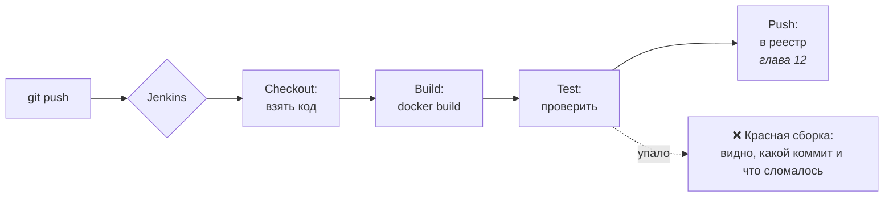
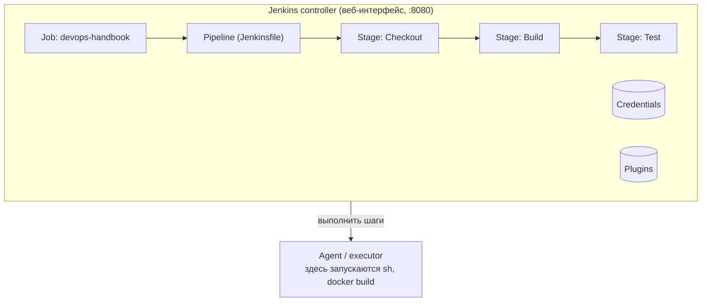
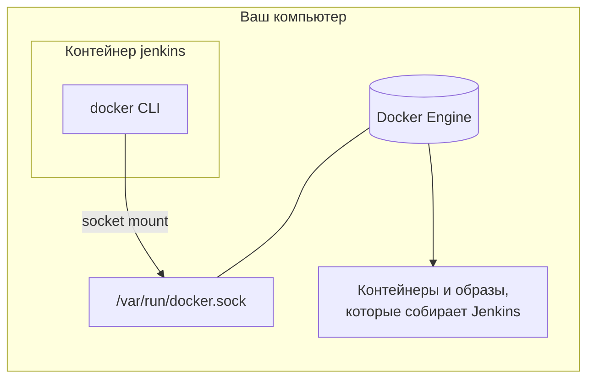

# 11 · Jenkins: первый pipeline

!!! abstract "В этой главе"
    **Что вы узнаете:** что такое CI на практике, из чего состоит Jenkins (controller, agent, job, pipeline, stage, step), как устроен декларативный `Jenkinsfile`, как Jenkins внутри контейнера получает доступ к Docker и почему это небезопасно, как Jenkins решает, что сборка упала.

    **Что нужно до начала:**

    - [Глава 10](../10-docker-compose/README.md): Docker Compose, named volumes.
    - Свободный порт `9090` и 2–4 ГБ памяти для Jenkins.

    **Проверено на:** Jenkins LTS 2.580 (JDK 21), Docker Engine 29.9.

    AWS не нужен — всё работает локально.

## Зачем это нужно

Сейчас путь изменения от кода до образа выглядит так:

```text
разработчик меняет код → вспоминает собрать образ → docker build → проверяет руками (или забывает) → …
```

В команде из пяти человек это превращается в хаос: кто-то забыл собрать, кто-то собрал из незакоммиченного кода, кто-то сломал сборку и узнал об этом через день.

**CI (Continuous Integration)** — каждое изменение автоматически собирается и проверяется одинаковым образом. **Jenkins** — один из самых распространённых CI-серверов: бесплатный, с открытым кодом, с тысячами плагинов. Вы встретите его во многих компаниях, а принципы переносятся на GitHub Actions, GitLab CI и другие системы.



## Концепция

### Анатомия Jenkins



| Термин | Что это |
|--------|---------|
| **Controller** | Главный сервер Jenkins: веб-интерфейс, настройки, история сборок, credentials |
| **Agent** | Машина (или контейнер), где выполняются шаги. В учебной установке controller сам себе агент |
| **Executor** | «Слот» на агенте для одной сборки. Сколько executor-ов, столько сборок одновременно |
| **Job** | Задача в Jenkins: «собирать этот репозиторий таким pipeline» |
| **Build** | Один запуск job, с номером `#1`, `#2`… и логом |
| **Pipeline** | Описание процесса сборки, обычно в файле `Jenkinsfile` |
| **Stage** | Логический этап pipeline: Build, Test, Push. В интерфейсе — колонка |
| **Step** | Конкретное действие внутри stage: `sh 'docker build ...'`, `echo`, `checkout` |
| **Plugin** | Расширение. Почти всё в Jenkins — плагины: Git, Pipeline, Credentials |

### Декларативный Jenkinsfile

```groovy
pipeline {
    agent any                         // 1. где выполнять (обязательно)

    environment {                     // 2. переменные для всех stages (необязательно)
        IMAGE_NAME = 'devops-bootcamp-backend'
    }

    stages {                          // 3. этапы (обязательно), строго сверху вниз
        stage('Build') {
            steps {
                sh 'docker build -t "$IMAGE_NAME:$BUILD_NUMBER" ./app/backend'
            }
        }
        stage('Test') {
            steps {
                sh 'echo "tests..."'
            }
        }
    }

    post {                            // 4. что сделать после всех stages (необязательно)
        always  { echo 'Выполнится всегда' }
        success { echo 'Только при успехе' }
        failure { echo 'Только при падении' }
    }
}
```

Правила:

- `agent` и `stages` обязательны, `environment`, `options`, `post` — нет.
- Stages выполняются **по порядку**. Если stage упал, следующие **не запускаются**: сборка красная.
- `post` выполняется **после** stages при любом исходе, а `always` / `success` / `failure` уточняют, когда именно. Это место для уборки и уведомлений.

Есть и **scripted**-синтаксис: `node { stage('Build') { ... } }` — по сути Groovy-скрипт с полной свободой. Вы встретите его в старых проектах. Новые pipeline пишут декларативно: строгая структура, понятные ошибки, проверка до запуска.

### Успех — это код возврата, а не текст в логе

Jenkins считает шаг `sh` успешным, если команда завершилась с **кодом 0**. Текст `ERROR` в выводе ничего не значит, если код 0. И наоборот.

```bash
docker info | head -5      # docker info упал (код 1), но head вернул 0 → шаг «успешен»
npm test                   # тест упал → код 1 → шаг упал → сборка красная
cleanup-cmd || true        # «если упало — всё равно считать успехом»
```

Поэтому зелёная сборка гарантирует только то, что все команды вернули 0. Если тестов нет, зелёный цвет ничего не доказывает.

!!! quote "Реальный кейс"
    В небольшом стартапе CI был, но stage `Test` выполнял `echo "OK"` — заглушку «потом допишем». Однажды разработчик сломал импорт модуля. Сборка прошла зелёной, образ уехал в продакшен, сервис падал при старте. Узнали от пользователей через 20 минут. Минимальный smoke-тест «контейнер стартует и отвечает на `/health`» поймал бы ошибку за 10 секунд. В главе 12 такой тест появится в вашем pipeline.

### Jenkins в контейнере и Docker

Jenkins будет запущен в контейнере, а ему нужно выполнять `docker build`. Внутри контейнера своего Docker нет. Есть два подхода:



| | Socket mount (пособие) | Docker-in-Docker (официальное руководство Jenkins) |
|---|---|---|
| Как | В контейнер Jenkins монтируется `/var/run/docker.sock` хоста, внутри стоит только Docker CLI | Отдельный privileged-контейнер `docker:dind` со своим Docker Engine, Jenkins подключается по TLS |
| Где живут образы | В Docker хоста (видны в `docker images`) | Внутри DinD, отдельно от хоста |
| Плюсы | Просто, быстро, общий кеш слоёв | Изоляция от Docker хоста |
| Минусы | **Доступ к сокету = root на хосте** | Нужен `--privileged`, сложнее настройка |

!!! danger "Доступ к `docker.sock` — это доступ root к машине"
    Кто может отправлять команды в Docker-сокет, тот может запустить контейнер с примонтированным `/` хоста и делать что угодно. Значит, любой, кто может изменить pipeline (например, Jenkinsfile в репозитории), получает root на агенте. Для учебного Jenkins на своём ноутбуке это допустимо. В компаниях сборки запускают на отдельных одноразовых агентах (эфемерные агенты в Kubernetes, отдельные VM), а не на controller.

Как Jenkins получит право на сокет? Сокет принадлежит группе (на Docker Desktop — группа с GID 0, на Linux — группа `docker`). Пользователя `jenkins` в контейнере добавляют в эту группу через `group_add`. Встречающийся в инструкциях `chmod 666 /var/run/docker.sock` открывает сокет **всем** пользователям и процессам — так делать не надо.

## Практика

### Шаг 1. Запустить Jenkins

Готовые файлы лежат в `project/jenkins/`.

`Dockerfile` — официальный образ Jenkins плюс Docker CLI:

```dockerfile
FROM jenkins/jenkins:lts-jdk21

USER root

RUN apt-get update \
 && apt-get install -y --no-install-recommends ca-certificates curl \
 && install -m 0755 -d /etc/apt/keyrings \
 && curl -fsSL https://download.docker.com/linux/debian/gpg -o /etc/apt/keyrings/docker.asc \
 && chmod a+r /etc/apt/keyrings/docker.asc \
 && echo "deb [arch=$(dpkg --print-architecture) signed-by=/etc/apt/keyrings/docker.asc] https://download.docker.com/linux/debian $(. /etc/os-release && echo "$VERSION_CODENAME") stable" \
      > /etc/apt/sources.list.d/docker.list \
 && apt-get update \
 && apt-get install -y --no-install-recommends docker-ce-cli docker-buildx-plugin \
 && apt-get clean \
 && rm -rf /var/lib/apt/lists/*

USER jenkins
```

Ставится только **клиент** (`docker-ce-cli`) и плагин сборки `buildx`. Сам Docker Engine внутри не нужен: команды уходят Docker хоста через сокет. Пакет `docker.io`, который советуют некоторые статьи, тянет за собой целый движок — лишние сотни мегабайт.

`docker-compose.yml`:

```yaml
name: jenkins

services:
  jenkins:
    build: .
    image: jenkins-docker:lts
    restart: unless-stopped
    ports:
      - "9090:8080"     # веб-интерфейс
    volumes:
      - jenkins_home:/var/jenkins_home                  # jobs, плагины, credentials
      - /var/run/docker.sock:/var/run/docker.sock       # Docker хоста
    group_add:
      - "${DOCKER_GID:-0}"

volumes:
  jenkins_home:
```

- Порт **9090**, потому что 8080 занят стеком из главы 10. Внутри контейнера Jenkins по-прежнему слушает 8080.
- `jenkins_home` — named volume: всё состояние Jenkins (jobs, история, плагины, секреты). Контейнер можно пересоздать без потерь.

Запустите:

=== "Windows / macOS (Docker Desktop)"

    ```bash
    cd devops-handbook/project/jenkins
    docker compose up -d --build
    ```

=== "Linux"

    ```bash
    cd devops-handbook/project/jenkins
    export DOCKER_GID=$(getent group docker | cut -d: -f3)    # GID группы docker на хосте
    docker compose up -d --build
    ```

Сборка образа займёт несколько минут.

!!! success "✅ Проверь себя"
    ```bash
    docker compose ps                                   # → jenkins   Up   0.0.0.0:9090->8080/tcp
    docker compose exec jenkins id                      # → uid=1000(jenkins) ... groups=...,0(root)  (Linux: группа docker)
    docker compose exec jenkins docker ps               # → таблица контейнеров хоста, в ней сам jenkins
    ```
    Если последняя команда отвечает `permission denied while trying to connect to the docker API`, у пользователя `jenkins` нет группы сокета: на Linux проверьте `DOCKER_GID` и пересоздайте контейнер `docker compose up -d --force-recreate`.

### Шаг 2. Первичная настройка

```bash
docker compose exec jenkins cat /var/jenkins_home/secrets/initialAdminPassword
```

1. Откройте `http://localhost:9090`, вставьте пароль → **Continue**.
2. **Install suggested plugins** — 2–5 минут.
3. Создайте администратора: имя, пароль, email.
4. *Jenkins URL*: `http://localhost:9090/` → **Save and Finish** → **Start using Jenkins**.
5. Поставьте плагин визуализации этапов: **Manage Jenkins → Plugins → Available plugins** → найдите **Pipeline: Stage View** → **Install**.

!!! success "✅ Проверь себя"
    Открывается главная страница Jenkins с надписью *Welcome to Jenkins!*. В **Manage Jenkins → Plugins → Installed plugins** есть *Pipeline*, *Git*, *Credentials Binding*, *Pipeline: Stage View*.

### Шаг 3. Первый pipeline

**New Item** → имя `hello-pipeline` → **Pipeline** → **OK**. Внизу страницы, в разделе **Pipeline**, оставьте *Definition: Pipeline script* и вставьте:

```groovy
pipeline {
    agent any

    stages {
        stage('Info') {
            steps {
                echo "Build #${env.BUILD_NUMBER} of ${env.JOB_NAME}"
                sh '''
                    echo "Workspace: $WORKSPACE"
                    echo "Node:      $NODE_NAME"
                    pwd
                '''
            }
        }

        stage('Docker') {
            steps {
                sh 'docker version --format "client {{.Client.Version}}, server {{.Server.Version}}"'
                sh 'docker run --rm alpine:3.20 echo "Hello from a container started by Jenkins"'
            }
        }

        stage('Done') {
            steps {
                echo 'All stages passed'
            }
        }
    }

    post {
        always {
            echo "Finished with status: ${currentBuild.currentResult}"
        }
    }
}
```

**Save** → **Build Now**.

!!! success "✅ Проверь себя"
    - На странице job появилась таблица **Stage View** с тремя зелёными колонками.
    - **#1 → Console Output** заканчивается строкой `Finished: SUCCESS`.
    - В выводе stage `Docker` есть версия сервера и строка `Hello from a container started by Jenkins`.

    Обратите внимание: контейнер `alpine` запустил Docker **хоста**. Пока сборка идёт, `docker ps` на вашем компьютере его покажет.

!!! info "`${env.X}`, `$X` и кавычки"
    В Groovy-строках с двойными кавычками `"..."` Jenkins сам подставляет `${env.BUILD_NUMBER}`. Внутри `sh '''...'''` (одинарные кавычки) подстановку делает shell: `$WORKSPACE`. Для переменных Jenkins оба способа дают одно и то же, а для **секретов** разница принципиальна (глава 12). Все переменные: `http://localhost:9090/env-vars.html`.

### Шаг 4. Сломать сборку

**Configure** → в stage `Docker` добавьте первой строкой:

```groovy
                sh 'exit 1'
```

**Save** → **Build Now**.

!!! success "✅ Проверь себя"
    - Сборка `#2` красная. В Stage View `Info` зелёный, `Docker` красный, `Done` — **не выполнялся**.
    - В Console Output: `ERROR: script returned exit code 1`, затем `Finished with status: FAILURE` — блок `post { always }` выполнился, несмотря на падение.

Уберите `sh 'exit 1'` и запустите снова. Сборка `#3` должна быть зелёной.

### Шаг 5. Replay — отладка без правки job

Откройте сборку `#3` → **Replay**. Jenkins покажет скрипт этой сборки в редакторе. Добавьте в `Done` строку `sh 'date'` → **Run**. Новая сборка выполнится с изменённым скриптом, а настройки job не изменятся.

Replay удобен для экспериментов. Но изменения, сделанные через Replay или в окне *Pipeline script*, **нигде не сохраняются в git**. Это главный недостаток такого способа, и в главе 12 pipeline переедет в репозиторий.

### Шаг 6. Остановить Jenkins до следующей главы

```bash
docker compose stop        # контейнер остановлен, всё состояние в volume jenkins_home
```

В главе 12 вы продолжите с того же места: `docker compose start`.

!!! success "✅ Проверь себя"
    `docker compose ps -a` → `jenkins   Exited`. `docker volume ls | grep jenkins_home` → volume на месте.

Полностью удалить Jenkins со всеми настройками (когда он больше не нужен):

```bash
docker compose down -v
docker image rm jenkins-docker:lts
```

## Вопросы для самопроверки

<details markdown="1">
<summary>1. Jenkins в контейнере пишет <code>docker: not found</code>, хотя Docker Desktop установлен. Почему?</summary>

У контейнера своя файловая система. Docker установлен на хосте, но не внутри контейнера Jenkins. Нужны две вещи: Docker CLI внутри образа Jenkins (`docker-ce-cli`) и доступ к Docker Engine хоста через примонтированный `/var/run/docker.sock`. И ещё права: пользователь `jenkins` должен состоять в группе-владельце сокета.
</details>

<details markdown="1">
<summary>2. Stage <code>Build</code> упал. Выполнятся ли следующие stages? А <code>post</code>?</summary>

Следующие stages — нет: pipeline останавливается на упавшем stage. `post { always { ... } }` и `post { failure { ... } }` — да, они выполняются после stages при любом исходе. Поэтому уборку (удаление временных контейнеров, образов) кладут в `post { always }`.
</details>

<details markdown="1">
<summary>3. В Console Output есть строка <code>ERROR: permission denied</code>, а сборка зелёная. Как так?</summary>

Jenkins смотрит на код возврата шага, а не на текст. Скорее всего, ошибка случилась в начале конвейера (`cmd | head`) или в команде с `|| true`, и итоговый код шага — 0. Если шаг должен падать при ошибке любой части конвейера, используйте `set -o pipefail` в начале `sh`-скрипта (в `sh '''` Jenkins запускает `/bin/sh`, а `pipefail` есть в bash и современных dash).
</details>

<details markdown="1">
<summary>4. Почему монтировать <code>docker.sock</code> в контейнер — вопрос безопасности, а не только удобства?</summary>

Доступ к сокету позволяет запускать любые контейнеры на хосте, в том числе с примонтированной корневой файловой системой и `--privileged`. Это равносильно root-доступу к машине. Значит, любой, кто может запустить сборку с изменённым Jenkinsfile, получает root на агенте. В продакшене сборки выполняют на изолированных одноразовых агентах, а доступ к изменению pipeline ограничивают.
</details>

<details markdown="1">
<summary>5. Почему <code>chmod 666 /var/run/docker.sock</code> — плохое решение проблемы прав?</summary>

Он открывает сокет **всем** пользователям и процессам на машине (или в контейнере), а не только Jenkins. Любой процесс получает root-доступ через Docker. Правильно — добавить конкретного пользователя в группу-владельца сокета (`group_add` в Compose, `usermod -aG docker` на Linux).
</details>

## Итоги

- [x] CI: каждое изменение автоматически собирается и проверяется
- [x] Controller, agent, executor, job, build, pipeline, stage, step
- [x] Декларативный Jenkinsfile: `agent` + `stages` обязательны, `post` — необязательный, но полезный
- [x] Успех шага — код возврата 0; зелёная сборка без тестов ничего не доказывает
- [x] Jenkins в контейнере работает с Docker хоста через сокет и группу, а не через `chmod 666`
- [x] Доступ к `docker.sock` = root на хосте

**Что дальше.** Pipeline сейчас живёт в настройках Jenkins, а не в git, и ничего не публикует. В [главе 12](../12-jenkins-docker/README.md) Jenkins будет брать `Jenkinsfile` из репозитория, собирать образ backend, проверять его smoke-тестом и публиковать на Docker Hub.

- 📋 [Шпаргалка](commands.md)
- 🏋️ [Задания к главе](exercises.md)
