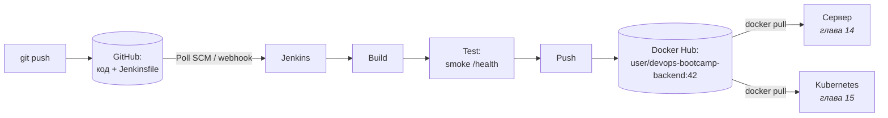

# 12 · Jenkins + Docker: сборка и публикация образа

!!! abstract "В этой главе"
    **Что вы узнаете:** как Jenkins берёт `Jenkinsfile` из git (*Pipeline script from SCM*), что такое реестр образов и как именуются образы, зачем тегировать образ номером сборки, как хранить секреты в Jenkins и почему внутри `withCredentials` нужны одинарные кавычки, чем Poll SCM отличается от webhook.

    **Что нужно до начала:**

    - [Глава 11](../11-jenkins/README.md): Jenkins из `project/jenkins/` (остановлен, но не удалён).
    - Ваш fork репозитория пособия на GitHub ([глава 00](../00-setup/README.md)).
    - Аккаунт на [Docker Hub](https://hub.docker.com) (бесплатный).

    **Стоимость:** $0. AWS не нужен.

## Зачем это нужно

После главы 11 Jenkins умеет выполнять шаги, но:

- pipeline хранится в настройках Jenkins, а не в git;
- собранный образ остаётся на машине Jenkins, и серверу или Kubernetes его не достать.

Результат CI — **артефакт**, который можно развернуть где угодно. Для Docker это образ в **реестре** (registry). Цепочка этой главы:



## Концепция

### Pipeline как код

| Pipeline script (глава 11) | Pipeline script from SCM (эта глава) |
|---|---|
| Код в настройках job | `Jenkinsfile` в репозитории рядом с кодом |
| Нет истории и ревью | Изменение pipeline — обычный коммит и pull request |
| Потеряли Jenkins — потеряли pipeline | Jenkins можно поднять заново за минуты |
| Версия pipeline не связана с версией кода | Ветка с новой фичей может нести и изменённую сборку |

Принцип тот же, что с Terraform: **всё, что важно для проекта, — в git**. Код, инфраструктура, конфигурация и процесс сборки.

### Реестр и имя образа

**Registry** — хранилище образов. Docker Hub — публичный реестр по умолчанию. В компаниях используют приватные: Amazon ECR, GitHub Container Registry, GitLab Registry, Harbor.

```text
docker.io/alexdev/devops-bootcamp-backend:42
│         │       │                       │
│         │       │                       └── тег (версия)
│         │       └── репозиторий (имя образа)
│         └── namespace: пользователь или организация
└── реестр (docker.io можно не писать)
```

| Команда | Что происходит |
|---------|----------------|
| `docker build -t app:42 .` | Образ появился **локально** |
| `docker tag app:42 alexdev/app:42` | Второе **имя** того же образа (копирования нет) |
| `docker push alexdev/app:42` | Копия ушла в реестр |
| `docker rmi app:42` | Удалён **локально**, в реестре остался |
| `docker pull alexdev/app:42` | Скачан на другую машину |

### Теги: номер сборки и `latest`

Pipeline ставит образу два тега:

- **`:42`** (`BUILD_NUMBER`) — неизменяемая версия. Через месяц можно точно сказать, что развёрнуто, и откатиться на `:41`.
- **`:latest`** — подвижный указатель на последнюю сборку. Удобно для экспериментов, но **в продакшене не используется**: `latest` сегодня и `latest` завтра — разные образы.

!!! example "Плохо / Хорошо: какую версию развернуть"

    === "❌ Плохо"

        ```yaml
        image: alexdev/devops-bootcamp-backend:latest
        ```
        Что сейчас работает на сервере? Неизвестно. Откатиться? На что? Два сервера, запущенных в разное время, могут работать на разных версиях.

    === "✅ Хорошо"

        ```yaml
        image: alexdev/devops-bootcamp-backend:42
        ```
        Версия явная, совпадает с номером сборки в Jenkins, а через неё — с коммитом. Откат — смена числа на `41`. Ещё точнее — тег из хеша коммита (`:a1b2c3d`).

### Секреты в Jenkins

Пароль Docker Hub нельзя писать в Jenkinsfile: файл лежит в git, а репозиторий публичный. Для этого есть **Credentials** — хранилище секретов Jenkins (зашифровано на диске controller). Jenkinsfile ссылается на секрет по **ID**:

```groovy
withCredentials([usernamePassword(
    credentialsId: 'docker-hub-creds',    // ← ID записи в Jenkins
    usernameVariable: 'DOCKER_USER',      // ← в эти переменные окружения
    passwordVariable: 'DOCKER_PASS'       //   Jenkins положит значения
)]) {
    sh '''
        echo "$DOCKER_PASS" | docker login -u "$DOCKER_USER" --password-stdin
    '''
}
```

- Переменные существуют **только внутри блока** `withCredentials`.
- В Console Output значение маскируется: `****`.
- `--password-stdin`: пароль передаётся через стандартный ввод, а не аргументом `-p`. Аргументы командной строки видны любому процессу на машине через `ps`.

Вместо пароля Docker Hub используйте **Personal Access Token**: его можно ограничить по правам и отозвать, не меняя пароль аккаунта.

### Одинарные и двойные кавычки

В Groovy строка в двойных кавычках подставляет `${...}` **до** того, как команда попадёт в shell:

!!! example "Плохо / Хорошо"

    === "❌ Плохо"

        ```groovy
        sh """
            echo ${DOCKER_PASS} | docker login -u ${DOCKER_USER} --password-stdin
        """
        ```
        Groovy вставит пароль прямо в текст скрипта. Он окажется в аргументах процесса `sh`, во временном файле скрипта и может утечь в лог. Jenkins предупредит: `A secret was passed to "sh" using Groovy String interpolation, which is insecure`.

    === "✅ Хорошо"

        ```groovy
        sh '''
            echo "$DOCKER_PASS" | docker login -u "$DOCKER_USER" --password-stdin
        '''
        ```
        Скрипт попадает в shell как есть, а `$DOCKER_PASS` shell берёт из переменной окружения, которую выставил `withCredentials`.

Правило: в `sh` используйте `'''` и `$VAR`. Двойные кавычки — только если нужна подстановка значения **Groovy**, и никогда для секретов.

!!! quote "Реальный кейс"
    Разработчик в пятницу вечером торопился и вписал пароль Docker Hub прямо в Jenkinsfile, «временно». Через 10 минут после push пришло письмо от GitHub secret scanning: найден секрет в публичном репозитории. Пароль сменили, но выходные ушли на ротацию токенов во всех системах и проверку логов Docker Hub: кто успел скачать или подменить образы. С тех пор правило: секреты — только через credentials store, без исключений.

### Триггеры

| Триггер | Как работает | Когда использовать |
|---------|--------------|--------------------|
| Вручную | **Build Now** | Отладка |
| **Poll SCM** | Jenkins раз в N минут спрашивает git: «есть новый коммит?» | Jenkins недоступен из интернета (как наш localhost) |
| **Webhook** | GitHub сам сообщает Jenkins о push | Jenkins с публичным адресом. Мгновенно, без лишних запросов |
| По расписанию (cron) | Сборка в заданное время независимо от коммитов | Ночные сборки, периодические проверки |

Расписание в Jenkins записывается в формате cron: `H/5 * * * *` — каждые 5 минут. `H` (hash) означает, что Jenkins сам выберет минуту для этого job, чтобы сотни job не стартовали одновременно в `:00`.

## Практика

### Шаг 1. Токен Docker Hub

1. [hub.docker.com](https://hub.docker.com) → аватар → **Account settings** → **Personal access tokens** → **Generate new token**.
2. *Description*: `jenkins-local`; *Access permissions*: **Read & Write**.
3. **Generate**, скопируйте токен (показывается один раз).

### Шаг 2. Подготовить Jenkinsfile в своём fork

Pipeline уже лежит в репозитории: `project/Jenkinsfile`. Откройте его и замените плейсхолдер на свой логин Docker Hub:

```groovy
    environment {
        IMAGE_NAME      = 'devops-bootcamp-backend'
        DOCKER_HUB_REPO = 'alexdev/devops-bootcamp-backend'     // ← ваш логин
    }
```

```bash
git add project/Jenkinsfile
git commit -m "ci: set Docker Hub repository"
git push
```

Разберите файл целиком:

| Stage | Что делает |
|-------|-----------|
| `options` | Таймаут 15 минут, хранить 20 последних сборок, не запускать две сборки одновременно |
| `Checkout` | `checkout scm` — взять код из репозитория, указанного в настройках job; показать последний коммит |
| `Build` | `docker build` с тегами `:$BUILD_NUMBER` и `:latest` |
| `Test` | Smoke test: запустить контейнер, до 10 раз попробовать `wget /health` внутри него. `post { always }` удаляет тестовый контейнер даже при падении |
| `Push` | `withCredentials` → `docker login --password-stdin` → `tag` → `push` двух тегов → `logout` |
| `post { always }` | Удалить образы с агента при любом исходе, чтобы диск не переполнялся |

`checkout scm` берёт адрес репозитория из настроек job, поэтому один и тот же Jenkinsfile работает в любом fork без правок.

### Шаг 3. Credentials в Jenkins

```bash
cd devops-handbook/project/jenkins
docker compose start
```

`http://localhost:9090` → **Manage Jenkins** → **Credentials** → **System** → **Global credentials (unrestricted)** → **Add Credentials**:

| Поле | Значение |
|------|----------|
| *Kind* | Username with password |
| *Username* | ваш логин Docker Hub |
| *Password* | токен из шага 1 |
| *ID* | `docker-hub-creds` — **ровно так**, на этот ID ссылается Jenkinsfile |
| *Description* | Docker Hub token for CI |

!!! success "✅ Проверь себя"
    В списке Global credentials есть `docker-hub-creds`. Пароль в интерфейсе не виден, его можно только заменить.

### Шаг 4. Job из репозитория

**New Item** → имя `devops-handbook` → **Pipeline** → **OK**. Раздел **Pipeline**:

| Поле | Значение |
|------|----------|
| *Definition* | **Pipeline script from SCM** |
| *SCM* | Git |
| *Repository URL* | `https://github.com/<your-github-user>/devops-handbook.git` |
| *Credentials* | — none — (fork публичный) |
| *Branch Specifier* | `*/main` |
| *Script Path* | `project/Jenkinsfile` |

**Save** → **Build Now**.

!!! success "✅ Проверь себя"
    - Stage View: `Checkout`, `Build`, `Test`, `Push` — зелёные.
    - Console Output:
        - `Checking out git https://github.com/.../devops-handbook.git`;
        - в `Test` — `{"status":"ok","uptime":…}` и `Smoke test passed`;
        - в `Push` — `docker login -u **** --password-stdin`, `Login Succeeded`, затем `pushed` / digest;
        - `Finished: SUCCESS`.
    - На [hub.docker.com](https://hub.docker.com) → *Repositories* → `devops-bootcamp-backend` → *Tags*: `1` и `latest`.

Первый `Test` может напечатать `wget: can't connect to remote host: Connection refused`: backend ещё стартует. Цикл повторит попытку через секунду, это нормально.

### Шаг 5. Образ работает где угодно

На своём компьютере, не на Jenkins:

```bash
docker pull <your-dockerhub-user>/devops-bootcamp-backend:1
docker run --rm -d -p 3000:3000 --name from-registry <your-dockerhub-user>/devops-bootcamp-backend:1
curl http://localhost:3000/health              # Windows: curl.exe ...
docker stop from-registry
```

!!! success "✅ Проверь себя"
    `/health` отвечает. Вы запустили образ, который собрал Jenkins и опубликовал реестр, — ровно так его будут скачивать сервер в главе 14 и Kubernetes в главе 15.

### Шаг 6. Сборка по коммиту

Включите Poll SCM: **devops-handbook → Configure → Triggers** → ✅ **Poll SCM** → *Schedule*: `H/5 * * * *` → **Save**.

Сделайте любой коммит в fork. Код приложения менять не нужно, подойдёт строка в `README.md`:

```bash
echo "" >> README.md
git commit -am "docs: trigger CI"
git push
```

В течение 5 минут появится сборка `#2`. Её причина — на странице сборки: *Started by an SCM change*. Что Jenkins увидел при опросе, показывает **Polling Log** в меню job.

!!! success "✅ Проверь себя"
    Сборка `#2` запустилась сама, на Docker Hub появился тег `2`, а `latest` теперь указывает на него (одинаковый digest у `2` и `latest`).

!!! tip "Триггер в самом Jenkinsfile"
    Расписание можно описать в коде, а не в настройках job: `triggers { pollSCM('H/5 * * * *') }` внутри `pipeline { }`. Тогда оно тоже версионируется. Jenkins применит его после первой сборки с таким Jenkinsfile.

!!! note "`[skip ci]` в сообщении коммита"
    Во многих CI-системах коммит с `[skip ci]` не запускает сборку. В Jenkins это **не работает из коробки**: нужен плагин (например, *SCM Skip*) или собственная проверка в pipeline. В GitHub Actions и GitLab CI это встроено.

### Шаг 7. Откат на предыдущую версию

Представьте, что сборка `#2` сломала приложение. Предыдущая версия по-прежнему в реестре:

```bash
docker run --rm -d -p 3000:3000 --name rollback <your-dockerhub-user>/devops-bootcamp-backend:1
curl http://localhost:3000/health
docker stop rollback
```

Именно для этого нужны неизменяемые теги: откат — это запуск конкретного предыдущего тега, а не пересборка.

### Шаг 8. Уборка

```bash
docker image rm <your-dockerhub-user>/devops-bootcamp-backend:1 <your-dockerhub-user>/devops-bootcamp-backend:2 2>/dev/null
cd devops-handbook/project/jenkins
docker compose stop
```

Отключите Poll SCM (**Configure → Triggers**), если Jenkins будет запущен, а сборки не нужны.

Образы на Docker Hub **оставьте**: они понадобятся в главах 14–15. Токен `jenkins-local` можно отозвать на Docker Hub, когда Jenkins больше не нужен.

!!! success "✅ Проверь себя"
    `docker compose ps -a` → `jenkins Exited`. На Docker Hub теги `1`, `2`, `latest` на месте.

## Вопросы для самопроверки

<details markdown="1">
<summary>1. Зачем два тега — <code>:BUILD_NUMBER</code> и <code>:latest</code>? Что будет, если оставить только <code>latest</code>?</summary>

`latest` перезаписывается каждой сборкой. Только с ним нельзя понять, какая версия где развёрнута, и нельзя откатиться: предыдущего образа под понятным именем больше нет. Номер сборки — неизменяемая версия, которую можно найти в Jenkins, связать с коммитом и развернуть снова.
</details>

<details markdown="1">
<summary>2. Stage <code>Cleanup</code> (или <code>post { always }</code>) удалил образ. Удалён ли он с Docker Hub?</summary>

Нет. `docker rmi` удаляет образ только с машины, где выполняется команда, то есть с агента Jenkins. В реестре копия остаётся. Удаляют локально, чтобы агент не забил диск: образ backend весит сотни мегабайт, а сборок десятки в день.
</details>

<details markdown="1">
<summary>3. Почему внутри <code>withCredentials</code> пишут <code>sh '''...$DOCKER_PASS...'''</code>, а не <code>sh """...${DOCKER_PASS}..."""</code>?</summary>

С `"""` Groovy подставит пароль в текст скрипта до запуска shell. Пароль попадёт в аргументы процесса и во временный файл скрипта, может утечь в лог. С `'''` скрипт передаётся как есть, а значение shell берёт из переменной окружения, которую Jenkins выставляет только на время блока и маскирует в выводе.
</details>

<details markdown="1">
<summary>4. Почему для локального Jenkins работает Poll SCM, но не работает webhook?</summary>

Webhook — это HTTP-запрос **от GitHub к Jenkins**. Jenkins на `localhost` недоступен из интернета, GitHub до него не достучится. Poll SCM работает наоборот: Jenkins сам ходит в GitHub, а исходящие запросы с вашего компьютера разрешены. Для webhook нужен Jenkins с публичным адресом (или туннель).
</details>

<details markdown="1">
<summary>5. Почему токен Docker Hub лучше пароля от аккаунта?</summary>

Токен можно ограничить по правам (только чтение, чтение и запись), выдать отдельно для каждой системы, отозвать, не меняя пароль и не ломая остальные интеграции. В логах Docker Hub видно, каким токеном пользовались. Пароль даёт полный доступ к аккаунту, включая настройки и удаление репозиториев.
</details>

## Итоги

- [x] `Jenkinsfile` живёт в репозитории, job читает его через *Pipeline script from SCM*
- [x] Образ публикуется в реестр с тегами `:BUILD_NUMBER` и `:latest`; в продакшене — только неизменяемые теги
- [x] Секреты — в Jenkins Credentials, в pipeline — через `withCredentials` и `sh '''`
- [x] `--password-stdin` вместо `-p`, токен вместо пароля
- [x] Smoke test проверяет, что контейнер реально отвечает
- [x] Poll SCM для локального Jenkins, webhook — для публичного

**Что дальше.** Образ лежит в реестре и ждёт, когда его развернут. В [главе 13](../13-ansible-basics/README.md) появится Ansible — инструмент, который настраивает серверы по описанию, а в главе 14 он развернёт этот образ на EC2.

- 📋 [Шпаргалка](commands.md)
- 🏋️ [Задания к главе](exercises.md)
