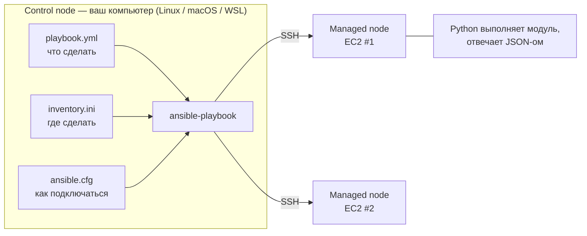

# 13 · Ansible: настройка серверов кодом

!!! abstract "В этой главе"
    **Что вы узнаете:** что такое управление конфигурацией и чем Ansible отличается от Terraform, как устроены inventory, модули, задачи и плейбуки, что значат статусы `ok`/`changed`, что такое факты и `become`, как безопасно работать с ключами хостов, почему Ansible «не помнит», что делал раньше.

    **Что нужно до начала:**

    - [Глава 08](../08-terraform-userdata/README.md): проект `project/terraform/` с remote state.
    - SSH-ключ `~/.ssh/id_ed25519` (глава 06).
    - На Windows — WSL 2 с Ubuntu ([глава 00](../00-setup/README.md)).

    **Проверено на:** ansible 14.5 (ansible-core 2.21), Amazon Linux 2023.

    **Стоимость:** EC2 `t3.micro` на время практики — центы. В конце — `terraform destroy`.

## Зачем это нужно

Terraform создал сервер. Docker упаковал приложение. Но кто-то должен **настроить** сервер: поставить пакеты, разложить конфиги, запустить сервисы. Пока что вы знаете два способа, и оба плохи:

- **Руками по SSH.** На одном сервере терпимо. На десяти — кто-то забудет шаг, и серверы станут разными. Через полгода никто не помнит, что на них менялось.
- **User Data (глава 08).** Работает только при первом запуске. Изменить настройку **работающего** сервера через него нельзя.

**Ansible** описывает желаемое состояние сервера в YAML-файле и приводит к нему сервер — сколько бы раз вы ни запускали, на скольких бы серверах ни запускали.

| | Terraform | Ansible |
|---|---|---|
| Что делает | Создаёт инфраструктуру: серверы, сети, права | Настраивает то, что внутри серверов: пакеты, файлы, сервисы |
| Как подключается | API облака | SSH к каждому серверу |
| State | Хранит state и знает, что создал | **Не хранит**: каждый раз проверяет сервер заново |
| Типичная фраза | «Создай мне сервер» | «Настрой мне этот сервер» |

В реальном проекте они работают вместе: Terraform создаёт EC2, Ansible его настраивает.

## Концепция

### Как работает Ansible



- **Без агентов.** На серверах не нужно ничего ставить, кроме SSH и Python, которые есть в любом современном Linux. Ansible по SSH копирует на сервер небольшую программу (модуль), запускает её и получает результат.
- **Push-модель.** Изменения запускаете вы (или CI), когда нужно, а не сервер по расписанию.
- **Control node** — только Linux или macOS. На Windows Ansible работает внутри WSL.

### Основные понятия

| Понятие | Что это | Пример |
|---------|---------|--------|
| **Inventory** | Список серверов, разбитых на группы | `[web]` → `203.0.113.10` |
| **Module** | Готовое действие с параметрами | `ansible.builtin.dnf`, `copy`, `service`, `template` |
| **Task** | Вызов модуля с конкретными параметрами и понятным именем | «Установить nginx» |
| **Play** | Набор задач для группы серверов | `hosts: web` + `tasks:` |
| **Playbook** | YAML-файл с одним или несколькими play | `playbook.yml` |
| **Facts** | Сведения о сервере, которые Ansible собирает в начале play | ОС, IP, память, имя хоста |
| **become** | Выполнять задачи от root (через `sudo`) | `become: true` |

Модули записываются полным именем (FQCN): `ansible.builtin.dnf`, а не просто `dnf`. Короткие имена тоже работают, но полные однозначны: модуль с таким же коротким именем может оказаться в другой установленной коллекции.

### Идемпотентность и статусы

Модуль сначала **проверяет**, в каком состоянии сервер, и меняет только то, что отличается:

```yaml
- name: Установить nginx
  ansible.builtin.dnf:
    name: nginx
    state: present        # «nginx должен быть установлен»
```

| Статус | Значение |
|--------|----------|
| `ok` | Сервер уже в нужном состоянии, ничего не менялось |
| `changed` | Ansible что-то изменил |
| `failed` | Ошибка; для этого сервера плейбук останавливается |
| `skipped` | Задача пропущена по условию (`when`) |
| `unreachable` | Не удалось подключиться по SSH |

Первый запуск на чистом сервере даёт `changed`, повторный — `ok`, если ничего не трогали. Поэтому плейбук безопасно запускать сколько угодно раз, хоть каждую ночь по расписанию: он только исправит то, что «уехало».

!!! example "Плохо / Хорошо"

    === "❌ Плохо"

        ```yaml
        - name: Install nginx
          ansible.builtin.shell: dnf install -y nginx
        ```
        `shell` не знает, установлен ли пакет. Задача всегда `changed`, сломанная установка не видна, и `--check` не может показать, что изменится.

    === "✅ Хорошо"

        ```yaml
        - name: Install nginx
          ansible.builtin.dnf:
            name: nginx
            state: present
        ```
        Модуль проверяет состояние, сообщает честный `ok` или `changed`, поддерживает `--check`. `command` и `shell` — крайний случай, когда подходящего модуля нет.

### Ansible не хранит state

Terraform помнит, что создал, и удаляет ресурс, если его убрали из кода. **Ansible так не умеет.** Если удалить из плейбука задачу «установить htop», htop останется на сервере: Ansible не знает, что когда-то его ставил. Чтобы удалить, нужно явно описать состояние: `state: absent`.

| `state:` | Значение |
|----------|----------|
| `present` | Должно существовать (установить, создать) |
| `absent` | Не должно существовать (удалить) |
| `latest` | Последняя версия пакета |
| `started` / `stopped` / `restarted` | Состояние сервиса |

### Ключи хостов: не отключайте проверку

При первом SSH-подключении сервер присылает свой ключ, и он запоминается в `~/.ssh/known_hosts`. Если в следующий раз ключ окажется другим, это может значить, что вас перехватили и вы говорите не с тем сервером (атака «человек посередине»).

!!! example "Плохо / Хорошо: `ansible.cfg`"

    === "❌ Плохо"

        ```ini
        [defaults]
        host_key_checking = False
        ```
        Встречается во многих инструкциях. Убирает надоедливый вопрос `Are you sure you want to continue connecting?`, но вместе с ним и защиту: Ansible подключится к **любому** серверу с этим IP.

    === "✅ Хорошо"

        ```ini
        [ssh_connection]
        ssh_args = -o ControlMaster=auto -o ControlPersist=60s -o StrictHostKeyChecking=accept-new
        ```
        Ключ **нового** сервера принимается автоматически, а **изменившийся** ключ знакомого сервера — по-прежнему ошибка. В облаке IP переиспользуются: если вы пересоздали сервер со старым IP, удалите старую запись командой `ssh-keygen -R <IP>`.

!!! quote "Реальный кейс"
    В команде из десяти разработчиков каждый настраивал свой тестовый сервер по инструкции в wiki. Инструкцию полгода не обновляли, у каждого получилось немного по-своему, и «у меня работает» стало ежедневной фразой. После перехода на Ansible инструкция превратилась в одну команду `ansible-playbook dev-setup.yml`: новый человек получал настроенный сервер за пять минут, точно такой же, как у остальных, а wiki-страницу удалили.

## Практика

### Шаг 0. Установить Ansible

=== "Windows (WSL)"

    Откройте **Ubuntu** из меню «Пуск» (или `wsl` в PowerShell). Все команды главы — в этом терминале.

    ```bash
    sudo apt update && sudo apt install -y pipx git
    pipx ensurepath && source ~/.bashrc
    pipx install --include-deps "ansible==14.5.0"
    ```

    Склонируйте пособие **внутрь** файловой системы WSL, а не в `/mnt/c/...`:

    ```bash
    cd ~ && git clone https://github.com/<your-github-user>/devops-handbook.git
    ```

    На дисках Windows (`/mnt/c`) все файлы выглядят доступными для записи всем, и Ansible из соображений безопасности **игнорирует** `ansible.cfg` в такой папке (предупреждение `world writable directory`). SSH тоже откажется работать с ключом, у которого такие права. Поэтому скопируйте ключ в WSL:

    ```bash
    mkdir -p ~/.ssh
    cp /mnt/c/Users/<имя-в-Windows>/.ssh/id_ed25519* ~/.ssh/
    chmod 600 ~/.ssh/id_ed25519
    ```

=== "macOS"

    ```bash
    brew install ansible
    ```

=== "Linux (Ubuntu)"

    ```bash
    sudo apt update && sudo apt install -y pipx
    pipx ensurepath && source ~/.bashrc
    pipx install --include-deps "ansible==14.5.0"
    ```

!!! success "✅ Проверь себя"
    ```bash
    ansible --version | head -1
    # → ansible [core 2.21.x]
    ```

    В `apt install ansible` из репозитория Ubuntu часто старая версия, поэтому ставим через `pipx` с явной версией. Номер версии важен: синтаксис и поведение модулей меняются между версиями.

### Шаг 1. Сервер без настройки

Создайте EC2 тем же проектом, что в главе 08, но **без** nginx в User Data: настраивать сервер будет Ansible. В эталонном `project/terraform/` для этого есть переменная `install_nginx`.

```bash
cd devops-handbook/project/terraform       # там, где вы работали в главе 08
terraform apply -var="install_nginx=false"
terraform output -raw public_ip            # → 54.x.x.x — запишите
```

Terraform можно запускать там же, где в главе 08 (например, в PowerShell), а Ansible — в WSL: им нужен только IP.

!!! success "✅ Проверь себя"
    `curl -m 5 http://<IP>` → `Connection refused`: на сервере пока ничего не слушает порт 80.

### Шаг 2. Inventory и конфигурация

Файлы проекта лежат в `project/ansible/`:

```bash
cd ~/devops-handbook/project/ansible
cp inventory.ini.example inventory.ini
```

Откройте `inventory.ini` и подставьте свой IP:

```ini
[web]
54.x.x.x

[web:vars]
ansible_ssh_private_key_file=~/.ssh/id_ed25519
```

- `[web]` — группа. Плейбуки обращаются к группам, а не к отдельным IP.
- `[web:vars]` — переменные для всех серверов группы. Здесь — ключ для SSH.
- `inventory.ini` в `.gitignore`: реальные IP в репозиторий не попадают, коммитится только `.example`.

`ansible.cfg` в той же папке подхватывается автоматически:

```ini
[defaults]
inventory = inventory.ini          # не писать -i inventory.ini в каждой команде
remote_user = ec2-user             # пользователь SSH на Amazon Linux
interpreter_python = auto_silent   # найти Python на сервере без предупреждений

[ssh_connection]
ssh_args = -o ControlMaster=auto -o ControlPersist=60s -o StrictHostKeyChecking=accept-new
```

`ControlMaster` / `ControlPersist` держат одно SSH-соединение открытым 60 секунд, и задачи выполняются быстрее.

### Шаг 3. Проверить связь

```bash
ansible-inventory --graph
```

```text
@all:
  |--@ungrouped:
  |--@web:
  |  |--54.x.x.x
```

```bash
ansible all -m ping
```

```text
54.x.x.x | SUCCESS => {
    "changed": false,
    "ping": "pong"
}
```

`ping` в Ansible — это не ICMP. Модуль подключается по SSH, запускает Python и отвечает `pong`. Если это сработало, работает всё остальное.

!!! success "✅ Проверь себя"
    `SUCCESS` и `pong`. Если `UNREACHABLE`, читайте сообщение: `Connection timed out` — Security Group или IP (глава 02); `Permission denied (publickey)` — ключ или пользователь; `Host key verification failed` — старая запись в `known_hosts` (`ssh-keygen -R <IP>`).

### Шаг 4. Ad-hoc команды

Разовые действия можно выполнять без плейбука:

```bash
ansible web -m ansible.builtin.command -a "uptime"
ansible web -m ansible.builtin.setup -a "filter=ansible_distribution*"   # факты
ansible web -m ansible.builtin.command -a "df -h /"
```

Факты — то, что Ansible знает о сервере. Ими можно пользоваться в плейбуках: `ansible_facts['distribution']` → `Amazon`, `ansible_facts['hostname']` → `ip-172-31-...`.

### Шаг 5. Первый плейбук

`playbook.yml`:

```yaml
---
- name: Настроить веб-сервер
  hosts: web
  become: true
  vars:
    app_name: "DevOps Handbook"
    server_env: "production"

  tasks:
    - name: Установить nginx
      ansible.builtin.dnf:
        name: nginx
        state: present

    - name: Создать страницу
      ansible.builtin.copy:
        content: |
          <!DOCTYPE html>
          <html lang="ru">
          <head><meta charset="UTF-8"><title>{{ app_name }}</title></head>
          <body style="font-family: monospace; background: #0d1117; color: #c9d1d9; padding: 2rem;">
            <h1>{{ app_name }}</h1>
            <p>Среда: {{ server_env }}</p>
            <p>Сервер: {{ ansible_facts['hostname'] }}</p>
            <p>ОС: {{ ansible_facts['distribution'] }} {{ ansible_facts['distribution_version'] }}</p>
            <p>Настроено через Ansible</p>
          </body>
          </html>
        dest: /usr/share/nginx/html/index.html
        owner: root
        group: root
        mode: "0644"

    - name: Запустить и включить nginx
      ansible.builtin.service:
        name: nginx
        state: started
        enabled: true
```

| Строка | Значение |
|--------|----------|
| `---` | Начало YAML-документа |
| `hosts: web` | На какой группе из inventory выполнять |
| `become: true` | Через `sudo`: ставить пакеты и писать в `/usr/share` может только root |
| `vars:` | Переменные play |
| `{{ app_name }}` | Подстановка переменной (язык шаблонов Jinja2) |
| `content: \|` | Многострочный текст файла прямо в задаче |
| `mode: "0644"` | Права на файл. В кавычках — иначе YAML прочитает число в восьмеричной системе неожиданным образом |
| `enabled: true` | Запускать nginx после перезагрузки сервера |

Сначала проверки, которые ничего не меняют:

```bash
ansible-playbook playbook.yml --syntax-check     # → playbook: playbook.yml
ansible-playbook playbook.yml --check            # что изменилось бы
```

`--check` — аналог `terraform plan`, но с оговоркой: задачи, которые зависят от результата предыдущих (сервис, которого ещё нет, потому что пакет «как бы» установлен), в этом режиме могут упасть.

Запуск:

```bash
ansible-playbook playbook.yml
```

```text
PLAY [Настроить веб-сервер] ****************************************************

TASK [Gathering Facts] *********************************************************
ok: [54.x.x.x]

TASK [Установить nginx] ********************************************************
changed: [54.x.x.x]

TASK [Создать страницу] ********************************************************
changed: [54.x.x.x]

TASK [Запустить и включить nginx] **********************************************
changed: [54.x.x.x]

PLAY RECAP *********************************************************************
54.x.x.x                   : ok=4    changed=3    unreachable=0    failed=0    skipped=0
```

!!! success "✅ Проверь себя"
    `failed=0`, `changed=3`. Откройте `http://<IP>`: страница с вашим hostname и `ОС: Amazon 2023`. Ни одной команды на сервере вручную.

### Шаг 6. Идемпотентность

```bash
ansible-playbook playbook.yml
```

```text
PLAY RECAP *********************************************************************
54.x.x.x                   : ok=4    changed=0    unreachable=0    failed=0    skipped=0
```

Все задачи `ok`: сервер уже в нужном состоянии.

Поменяйте переменную из командной строки:

```bash
ansible-playbook playbook.yml -e "server_env=staging"
```

!!! success "✅ Проверь себя"
    `changed=1` — изменилась только страница. Обновите браузер: `Среда: staging`. Переменная из `-e` перекрыла значение из `vars:`.

### Шаг 7. Ansible исправляет «уехавший» сервер

Сымитируйте ручное вмешательство: остановите nginx на сервере.

```bash
ansible web -b -m ansible.builtin.service -a "name=nginx state=stopped"
curl -m 5 http://<IP>                  # → Connection refused
ansible-playbook playbook.yml          # → changed=1 у задачи «Запустить и включить nginx»
curl -s http://<IP> | grep h1          # → снова работает
```

`-b` — то же, что `become: true`. Плейбук не знал, что произошло, — он просто привёл сервер к описанному состоянию.

### Шаг 8. Удалить можно только явно

Добавьте в конец `tasks` задачу и запустите плейбук:

```yaml
    - name: Установить htop
      ansible.builtin.dnf:
        name: htop
        state: present
```

```bash
ansible-playbook playbook.yml
ansible web -m ansible.builtin.command -a "htop --version"     # → htop 3.x
```

Теперь **удалите** эту задачу из плейбука и запустите снова:

```bash
ansible-playbook playbook.yml
ansible web -m ansible.builtin.command -a "htop --version"     # → htop всё ещё установлен
```

Чтобы удалить пакет, верните задачу с `state: absent`, запустите и только потом уберите задачу совсем:

```yaml
    - name: Удалить htop
      ansible.builtin.dnf:
        name: htop
        state: absent
```

!!! success "✅ Проверь себя"
    После `state: absent` команда `htop --version` падает с `No such file or directory`. Вывод: Ansible приводит сервер к **описанному** состоянию, а не к «тому, что в плейбуке сейчас». Удаление — тоже описание.

### Шаг 9. Уборка

!!! success "✅ Проверь себя перед удалением"
    ```bash
    cd devops-handbook/project/terraform
    terraform plan -destroy | tail -1        # → 6 to destroy, ресурсы web-server-*
    ```

```bash
terraform destroy
```

!!! success "✅ Проверь себя"
    `terraform state list` → пусто. В главе 14 вы создадите сервер заново, и Ansible развернёт на нём весь стек.

`inventory.ini` с IP удалённого сервера можно оставить: в главе 14 вы впишете новый адрес. Старый ключ хоста удалите: `ssh-keygen -R <старый IP>`.

## Вопросы для самопроверки

<details markdown="1">
<summary>1. Чем Ansible отличается от Terraform? Почему нельзя использовать только один из них?</summary>

Terraform создаёт и удаляет облачные ресурсы через API и хранит state. Ansible настраивает содержимое серверов по SSH и state не хранит. Terraform не умеет удобно управлять пакетами и файлами внутри работающего сервера, а Ansible плохо подходит для жизненного цикла облачных ресурсов: он не знает, что создавал, и не удалит лишнее. Поэтому их используют вместе: Terraform — фундамент, Ansible — настройка.
</details>

<details markdown="1">
<summary>2. Первый запуск плейбука дал <code>changed=3</code>, второй — <code>changed=0</code>. Что это говорит о сервере?</summary>

Что после первого запуска сервер оказался в описанном состоянии, и второй запуск ничего не нашёл для исправления. Если бы кто-то вручную что-то поменял (остановил nginx, изменил файл), следующий запуск показал бы `changed` у соответствующей задачи и вернул бы всё как было.
</details>

<details markdown="1">
<summary>3. Почему <code>ansible.builtin.dnf</code> лучше, чем <code>ansible.builtin.shell: dnf install -y nginx</code>?</summary>

Модуль проверяет текущее состояние и сообщает честный `ok` или `changed`, поддерживает `--check`, работает одинаково при повторных запусках. `shell` просто выполняет команду: всегда `changed`, не видно, было ли что-то сделано, нельзя заранее посмотреть, что изменится. `command`/`shell` — только когда для задачи нет модуля.
</details>

<details markdown="1">
<summary>4. Почему <code>host_key_checking = False</code> — плохая идея, и чем лучше <code>StrictHostKeyChecking=accept-new</code>?</summary>

С отключённой проверкой Ansible подключится к любому серверу, который ответит по этому IP, в том числе к подменённому, и отправит туда команды и, возможно, секреты. `accept-new` автоматически принимает ключ только **нового** хоста, а смену ключа у известного хоста по-прежнему считает ошибкой. Удобство то же, а защита от подмены сохраняется.
</details>

<details markdown="1">
<summary>5. Вы удалили из плейбука задачу установки пакета. Удалится ли пакет с сервера?</summary>

Нет. Ansible не хранит state и не знает, что ставил раньше. Каждый запуск проверяет только то, что описано **сейчас**. Чтобы удалить пакет, нужна задача с `state: absent`. В этом ключевое отличие от Terraform, где удаление ресурса из кода означает его удаление из облака.
</details>

## Итоги

- [x] Ansible приводит серверы к описанному состоянию по SSH, без агентов
- [x] Inventory — где, playbook — что, `ansible.cfg` — как
- [x] Модули с полными именами (`ansible.builtin.*`) вместо `shell`; статусы `ok` / `changed` / `failed`
- [x] Идемпотентность: повторный запуск безопасен и исправляет ручные изменения
- [x] Ansible не хранит state: удаление описывается через `state: absent`
- [x] Проверку ключей хостов не отключаем — используем `accept-new`

**Что дальше.** Один плейбук на 30 строк — это начало. В [главе 14](../14-ansible-roles-deploy/README.md) вы разложите настройку по ролям, научитесь шаблонам и handlers и развернёте на EC2 весь стек: nginx, backend из Docker Hub и Redis.

- 📋 [Шпаргалка](commands.md)
- 🏋️ [Задания к главе](exercises.md)
