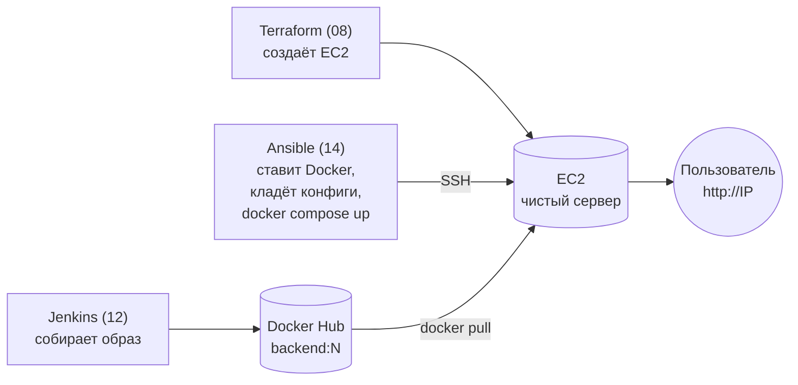

# 14 · Ansible: роли и деплой стека на EC2

!!! abstract "В этой главе"
    **Что вы узнаете:** как разложить настройку по ролям, как работают шаблоны Jinja2, handlers и теги, откуда Ansible берёт значения переменных и какое побеждает, что такое коллекции и зачем фиксировать их версии. Итог главы — весь стек (nginx + backend из Docker Hub + Redis) на чистом EC2 одной командой, с обновлением и откатом версии.

    **Что нужно до начала:**

    - [Глава 13](../13-ansible-basics/README.md): Ansible установлен, `inventory.ini` настроен.
    - [Глава 12](../12-jenkins-docker/README.md): образ `<your-dockerhub-user>/devops-bootcamp-backend` на Docker Hub, минимум два номерных тега (`1`, `2`).
    - [Глава 10](../10-docker-compose/README.md): вы понимаете `docker-compose.yml` стека.

    **Проверено на:** ansible 14.5 (ansible-core 2.21), community.docker 5.4, Amazon Linux 2023, Docker 25, Docker Compose v5.6.

    **Стоимость:** EC2 `t3.micro` на время практики — центы. В конце — `terraform destroy`.

## Зачем это нужно

Соберём вместе всё, что было в пособии:



Деплой руками — это десяток команд в правильном порядке на каждом сервере. Ansible превращает их в одну: `ansible-playbook site.yml`. И в одну же команду с другим номером превращается **откат**.

## Концепция

### Роли

Плейбук из главы 13 занимал 30 строк. Реальная настройка сервера — сотни строк: Docker, приложение, мониторинг, firewall, пользователи. В одном файле это не читается и не переиспользуется. **Роль** — самостоятельный блок настройки со стандартной структурой папок:

```text
roles/
└── app/
    ├── tasks/main.yml        ← задачи (точка входа, обязательно)
    ├── handlers/main.yml     ← обработчики событий
    ├── templates/*.j2        ← шаблоны Jinja2
    ├── files/                ← статические файлы
    ├── defaults/main.yml     ← значения по умолчанию (легко перекрыть)
    ├── vars/main.yml         ← внутренние константы роли (перекрыть трудно)
    └── meta/main.yml         ← зависимости, описание (для Galaxy)
```

Ansible сам находит файлы по этим путям: `template: src: docker-compose.yml.j2` ищется в `templates/`, `copy: src: x` — в `files/`. Обязательна только `tasks/main.yml`.

Главный плейбук превращается в «дирижёра»:

```yaml
- name: Деплой devops-handbook на EC2
  hosts: web
  become: true
  roles:
    - docker   # сначала Docker
    - app      # потом приложение — порядок важен
```

Роли переиспользуются: роль `docker` подойдёт любому серверу, где нужен Docker. Готовые роли сообщества лежат в [Ansible Galaxy](https://galaxy.ansible.com).

### Шаблоны Jinja2

`template` работает как `copy`, но перед копированием подставляет переменные. Это тот же `docker-compose.yml` из главы 10, только образ берётся из реестра, а версия — из переменной:

```yaml
# roles/app/templates/docker-compose.yml.j2
services:
  backend:
    image: {{ docker_hub_user }}/devops-bootcamp-backend:{{ app_version }}
```

На сервер попадает готовый файл: `image: alexdev/devops-bootcamp-backend:42`. Один шаблон — разные результаты для разных пользователей, версий и окружений.

### Handlers

**Handler** — задача, которая выполняется, только если её **уведомили** (`notify`) и только если уведомившая задача вернула `changed`. Выполняется **один раз в конце play**, сколько бы задач её ни вызвали.

```yaml
# tasks/main.yml
- name: Скопировать nginx.conf и index.html
  ansible.builtin.copy: ...
  notify: Restart nginx       # «если файл изменился — перезапусти nginx»

# handlers/main.yml
- name: Restart nginx
  community.docker.docker_compose_v2:
    project_src: /opt/devops-handbook
    services: [nginx]
    state: restarted
```

Конфиг не менялся — перезапуска нет, пользователи ничего не замечают. Изменился — один перезапуск в конце.

!!! info "Почему nginx вообще нужно перезапускать"
    Файлы смонтированы в контейнер как bind mount отдельных файлов (`./index.html:/usr/share/nginx/html/index.html:ro`). Модуль `copy` не перезаписывает файл на месте, а кладёт новый и переименовывает — у файла меняется inode. Bind mount одиночного файла привязан к **старому** inode, и контейнер продолжает видеть старое содержимое, пока его не перезапустят. Классическая ловушка, на которой теряют часы: «файл на сервере новый, а nginx отдаёт старый».

### Модуль вместо `command: docker compose up`

| | `command: docker-compose up -d` | `community.docker.docker_compose_v2` |
|---|---|---|
| Статус | Всегда `changed` | `changed`, только если контейнеры действительно пересозданы |
| `--check` | Не поддерживается | Показывает, что изменится |
| Обновление | Нужен handler с `--force-recreate` | Сам пересоздаёт сервисы, у которых изменилась конфигурация |
| Утилита | Устаревший `docker-compose` v1 (отдельный бинарник) | Плагин `docker compose` v2 |

Модуль лежит в **коллекции** `community.docker`. Коллекции — пакеты с модулями, ролями и плагинами, распространяются через Galaxy. Версии фиксируются в `requirements.yml`, как версии провайдеров в Terraform:

```yaml
collections:
  - name: community.docker
    version: "5.4.0"
```

### Откуда берутся значения переменных

Одна и та же переменная может быть задана в нескольких местах. Упрощённый порядок, от слабого к сильному:

```text
1. roles/*/defaults/main.yml      ← значения по умолчанию (слабее всех)
2. group_vars/all.yml
3. group_vars/<группа>.yml
4. host_vars/<хост>.yml
5. vars: в плейбуке (play vars)
6. roles/*/vars/main.yml
7. -e / --extra-vars              ← командная строка (сильнее всех)
```

Полный список — более 20 уровней, но этих хватает для 95% случаев. Практические правила:

- **`defaults/`** — то, что пользователь роли может захотеть поменять (`app_dir`, `app_version`).
- **`group_vars/`** — значения для окружения или группы серверов (`docker_hub_user`).
- **`-e`** — разовые значения при запуске, например версия при деплое: `-e "app_version=42"`.

### Теги

Задачи помечаются тегами, и можно выполнять только часть плейбука:

```bash
ansible-playbook site.yml --tags deploy        # только деплой: Docker уже установлен
ansible-playbook site.yml --skip-tags install
ansible-playbook site.yml --list-tags
```

В проекте: `install` — установка Docker (долго, нужно один раз), `deploy` — раскладка файлов и запуск стека (быстро, при каждом релизе). `always` — задача выполняется при любом наборе тегов (проверка в `pre_tasks`).

!!! quote "Реальный кейс"
    Команда деплоила по инструкции из 12 шагов на двух страницах Confluence. Однажды ночью дежурный пропустил шаг 7 — `docker compose pull` — и запустил старый образ с новой конфигурацией. Несовместимость, прод лежал полтора часа. После перехода на Ansible инструкция стала одной строкой: `ansible-playbook site.yml -e "app_version=42"`. Порядок шагов зашит в код, пропустить шаг невозможно, а откат — та же команда с другим номером.

## Практика

### Шаг 0. Подготовка

Убедитесь, что образ есть в реестре (с любого компьютера с Docker):

```bash
docker manifest inspect <your-dockerhub-user>/devops-bootcamp-backend:1 > /dev/null && echo "tag 1 OK"
docker manifest inspect <your-dockerhub-user>/devops-bootcamp-backend:2 > /dev/null && echo "tag 2 OK"
```

Если тега `2` нет, запустите сборку в Jenkins ещё раз (глава 12).

### Шаг 1. Сервер

```bash
cd devops-handbook/project/terraform
terraform apply -var="install_nginx=false"
terraform output -raw public_ip
```

В WSL (или там, где у вас Ansible) впишите новый IP в `project/ansible/inventory.ini` и удалите старый ключ хоста, если IP совпал с прошлым:

```bash
cd ~/devops-handbook/project/ansible
ssh-keygen -R <IP> 2>/dev/null
ansible all -m ping          # → SUCCESS
```

### Шаг 2. Коллекции и переменные

```bash
ansible-galaxy collection install -r requirements.yml
ansible-galaxy collection list community.docker      # → community.docker 5.4.0 в ~/.ansible/collections
```

Укажите свой логин Docker Hub в `group_vars/web.yml`:

```yaml
---
docker_hub_user: "alexdev"      # ← ваш логин
app_version: "latest"
```

Логин — не секрет, его можно коммитить. Пароль или токен Docker Hub здесь не нужен: образ публичный, сервер скачивает его анонимно.

### Шаг 3. Разобрать проект

```text
project/ansible/
├── ansible.cfg
├── inventory.ini
├── requirements.yml          ← community.docker 5.4.0
├── playbook.yml              ← глава 13
├── site.yml                  ← глава 14: assert + роли docker, app
├── group_vars/
│   └── web.yml               ← docker_hub_user, app_version
└── roles/
    ├── docker/
    │   ├── defaults/main.yml ← версия плагина Compose, пользователи группы docker
    │   └── tasks/main.yml    ← dnf docker, плагин Compose, service, группа
    └── app/
        ├── defaults/main.yml ← app_dir, app_version, путь к app/frontend
        ├── tasks/main.yml    ← папка, файлы, шаблон, compose up, проверка /health
        ├── handlers/main.yml ← Restart nginx
        └── templates/
            └── docker-compose.yml.j2
```

**`site.yml`** — точка входа. В `pre_tasks` стоит проверка: если вы забыли указать логин Docker Hub, плейбук остановится с понятным сообщением, а не упадёт посреди деплоя на `invalid reference format`.

**`roles/docker/tasks/main.yml`** (сокращённо, полный файл — в репозитории):

```yaml
- name: Установить Docker
  ansible.builtin.dnf:
    name: docker
    state: present
  tags: install

- name: Создать папку для CLI-плагинов Docker
  ansible.builtin.file:
    path: /usr/local/lib/docker/cli-plugins
    state: directory
    mode: "0755"
  tags: install

- name: Установить плагин Docker Compose {{ docker_compose_version }}
  ansible.builtin.get_url:
    url: "{{ docker_compose_url }}"
    checksum: "sha256:{{ docker_compose_url }}.sha256"   # проверка контрольной суммы из релиза
    dest: /usr/local/lib/docker/cli-plugins/docker-compose
    mode: "0755"
  tags: install

- name: Запустить и включить Docker
  ansible.builtin.service:
    name: docker
    state: started
    enabled: true
  tags: install

- name: Добавить пользователей в группу docker
  ansible.builtin.user:
    name: "{{ item }}"
    groups: docker
    append: true          # ← добавить к существующим группам, а не заменить их
  loop: "{{ docker_users }}"
  tags: install
```

- Docker есть в стандартном репозитории Amazon Linux 2023, а плагина Compose там нет. Его скачивают из релизов на GitHub — фиксированной версии и **с проверкой контрольной суммы**: если файл подменят или он скачается битым, задача упадёт, а не установит неизвестно что.
- `append: true` критичен: без него у `ec2-user` останется **только** группа `docker`, и он потеряет `wheel` (право на `sudo`).

**`roles/app/tasks/main.yml`** (сокращённо):

```yaml
- name: Создать директорию приложения
  ansible.builtin.file:
    path: "{{ app_dir }}"
    state: directory
    mode: "0755"
  tags: deploy

- name: Скопировать nginx.conf и index.html
  ansible.builtin.copy:
    src: "{{ app_frontend_dir }}/{{ item }}"
    dest: "{{ app_dir }}/{{ item }}"
    mode: "0644"
  loop:
    - nginx.conf
    - index.html
  notify: Restart nginx
  tags: deploy

- name: Сгенерировать docker-compose.yml из шаблона
  ansible.builtin.template:
    src: docker-compose.yml.j2
    dest: "{{ app_dir }}/docker-compose.yml"
    mode: "0644"
  tags: deploy

- name: Запустить стек (docker compose up -d)
  community.docker.docker_compose_v2:
    project_src: "{{ app_dir }}"
    state: present
    pull: missing
  tags: deploy

- name: Проверить, что приложение отвечает
  ansible.builtin.uri:
    url: http://localhost/health
    status_code: 200
  register: app_health
  retries: 10
  delay: 3
  until: app_health.status == 200
  tags: deploy
```

- Файлы фронтенда берутся прямо из `app/frontend` репозитория (`app_frontend_dir` в `defaults`). Одна копия на весь проект: Compose в главе 10 и Ansible здесь используют одни и те же файлы.
- `pull: missing` — скачать образ, если его нет локально. Для неизменяемых тегов (`:42`) этого достаточно. С `latest` новая сборка не скачается — ещё одна причина деплоить номерами.
- Последняя задача — **проверка результата**: деплой считается успешным, только если приложение ответило. До 10 попыток с паузой 3 секунды.

### Шаг 4. Деплой

```bash
ansible-playbook site.yml --syntax-check
ansible-playbook site.yml -e "app_version=1"
```

```text
TASK [Проверить, что задан логин Docker Hub] ***********************************
ok: [54.x.x.x]
TASK [docker : Установить Docker] **********************************************
changed: [54.x.x.x]
TASK [docker : Установить плагин Docker Compose v5.6.1] ************************
changed: [54.x.x.x]
...
TASK [app : Запустить стек (docker compose up -d)] *****************************
changed: [54.x.x.x]
TASK [app : Проверить, что приложение отвечает] ********************************
ok: [54.x.x.x]

RUNNING HANDLER [app : Restart nginx] ******************************************
changed: [54.x.x.x]

PLAY RECAP *********************************************************************
54.x.x.x                   : ok=13   changed=10   unreachable=0    failed=0    skipped=0
```

Имена задач с префиксом `docker :` и `app :` показывают, из какой роли пришла задача. Handler сработал, потому что файлы nginx скопировались впервые.

!!! success "✅ Проверь себя"
    ```bash
    curl http://<IP>/health        # → {"status":"ok",...}
    curl http://<IP>/api/hits      # → {"hits":1}, {"hits":2}, ...
    curl http://<IP>/info          # → "version":"1"
    ```
    Откройте `http://<IP>` в браузере: фронтенд со счётчиком. Весь стек из главы 10 работает на EC2, а образ backend скачан из Docker Hub, куда его положил Jenkins.

### Шаг 5. Повторный запуск

```bash
ansible-playbook site.yml -e "app_version=1"
```

!!! success "✅ Проверь себя"
    `changed=0`, handler не запускался (`RUNNING HANDLER` в выводе нет). Контейнеры не перезапускались: проверьте, что `/api/hits` продолжает счёт, а не начинает с 1.

### Шаг 6. Обновление и откат

Jenkins собрал новую версию. Деплой:

```bash
ansible-playbook site.yml --tags deploy -e "app_version=2" --check --diff   # сначала посмотреть
```

```diff
--- before: /opt/devops-handbook/docker-compose.yml
+++ after: /opt/devops-handbook/docker-compose.yml
@@ ... @@
   backend:
-    image: alexdev/devops-bootcamp-backend:1
+    image: alexdev/devops-bootcamp-backend:2
     environment:
-      - APP_VERSION=1
+      - APP_VERSION=2
```

```bash
ansible-playbook site.yml --tags deploy -e "app_version=2"
curl http://<IP>/info          # → "version":"2"
curl http://<IP>/api/hits      # → счёт продолжается: Redis и его volume не трогали
```

Изменились шаблон и стек (`changed=2`): модуль Compose пересоздал **только** backend. Установочные задачи пропущены тегом, деплой занял секунды.

Откат — та же команда с предыдущим номером:

```bash
ansible-playbook site.yml --tags deploy -e "app_version=1"
curl http://<IP>/info          # → "version":"1"
```

!!! success "✅ Проверь себя"
    Версия в `/info` меняется `1 → 2 → 1`, счётчик при этом продолжает расти. Обновление и откат — одна команда, без SSH на сервер.

### Шаг 7. Посмотреть на сервер глазами Ansible

```bash
ansible web -b -m ansible.builtin.command -a "docker compose -f /opt/devops-handbook/docker-compose.yml ps"
ansible web -b -m ansible.builtin.command -a "docker compose -f /opt/devops-handbook/docker-compose.yml logs --tail 5 backend"
ansible web -m ansible.builtin.command -a "cat /opt/devops-handbook/docker-compose.yml"
```

### Шаг 8. Уборка

!!! success "✅ Проверь себя перед удалением"
    ```bash
    cd devops-handbook/project/terraform
    terraform plan -destroy | tail -1          # → 6 to destroy
    ```

```bash
terraform destroy
ssh-keygen -R <IP>
```

!!! success "✅ Проверь себя"
    `terraform state list` → пусто; `curl -m 5 http://<IP>` → таймаут. Образы на Docker Hub оставьте — они нужны в главе 15.

## Вопросы для самопроверки

<details markdown="1">
<summary>1. Зачем делить плейбук на роли, если всё и так работает в одном файле?</summary>

Читаемость (каждая роль — одна область ответственности), переиспользование (роль `docker` подходит любому серверу, где нужен Docker), независимое развитие (изменения в роли `app` не трогают установку Docker) и обмен с другими командами через Galaxy или git. `site.yml` остаётся коротким и показывает только порядок: что и куда применяется.
</details>

<details markdown="1">
<summary>2. При <code>-e "app_version=2"</code> какие задачи вернули <code>changed</code> и почему не сработал handler?</summary>

`template` (в `docker-compose.yml` поменялись образ и `APP_VERSION`) и `docker_compose_v2` (он увидел изменение конфигурации backend и пересоздал его контейнер). Handler `Restart nginx` уведомляет только задача копирования `nginx.conf` и `index.html`, а эти файлы не менялись — значит, и уведомления не было.
</details>

<details markdown="1">
<summary>3. <code>app_version</code> задан в <code>roles/app/defaults</code>, в <code>group_vars/web.yml</code> и через <code>-e</code>. Какое значение победит? А если убрать <code>-e</code>?</summary>

С `-e` — значение из командной строки: extra vars сильнее всего. Без `-e` — значение из `group_vars/web.yml`: оно сильнее `defaults` роли. Поэтому в `defaults` кладут разумные значения по умолчанию, а всё, что относится к окружению, — в `group_vars`.
</details>

<details markdown="1">
<summary>4. Почему <code>app_version: latest</code> — плохая идея для деплоя, даже с Ansible?</summary>

С `pull: missing` сервер не скачает новую сборку: образ `latest` уже есть локально. С `pull: always` разные серверы, обновлённые в разное время, окажутся на разных версиях под одним и тем же тегом. В обоих случаях нельзя сказать, что именно развёрнуто, и нельзя откатиться «на предыдущий `latest`». Номер сборки делает деплой воспроизводимым: на всех серверах одно и то же, откат — предыдущий номер.
</details>

<details markdown="1">
<summary>5. Почему в роли <code>docker</code> у <code>get_url</code> есть <code>checksum</code>?</summary>

Бинарный файл скачивается из интернета и затем выполняется от root. Контрольная сумма из релиза гарантирует, что скачано именно то, что опубликовали разработчики: не битый файл после обрыва связи и не подмена. Если сумма не совпала, задача падает и ничего не устанавливает. Дополнительно такая задача идемпотентна: файл с правильной суммой повторно не скачивается.
</details>

## Итоги

- [x] Роль — стандартная структура: `tasks`, `handlers`, `templates`, `files`, `defaults`, `vars`
- [x] `template` подставляет переменные Jinja2; один шаблон — разные результаты
- [x] Handler выполняется только при `changed` и один раз в конце play
- [x] `-e` сильнее всего, `defaults` слабее всего; окружение — в `group_vars`
- [x] Теги разделяют установку и деплой; коллекции фиксируются в `requirements.yml`
- [x] Модуль `docker_compose_v2` вместо `command: docker-compose`; проверка `/health` в конце деплоя
- [x] Обновление и откат — одна команда с номером сборки

**Что дальше.** Стек работает на одном сервере. Сервер упал — упало всё; нагрузка выросла — второй сервер придётся добавлять руками. В [главе 15](../15-k8s-pods-deployments/README.md) — Kubernetes: оркестратор, который сам запускает, перезапускает и масштабирует контейнеры на кластере машин.

- 📋 [Шпаргалка](commands.md)
- 🏋️ [Задания к главе](exercises.md)
