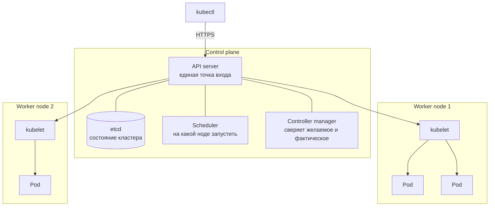
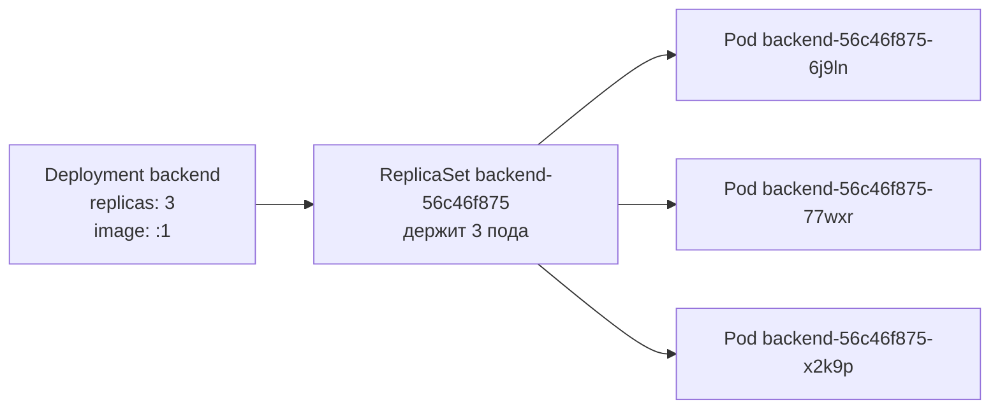

# 15 · Kubernetes: Pod, Deployment, Namespace

!!! abstract "В этой главе"
    **Что вы узнаете:** зачем нужен оркестратор, из чего состоит кластер Kubernetes, что такое Pod, Deployment, ReplicaSet, labels, selectors и namespace, как работает цикл «желаемое vs фактическое», что такое liveness и readiness probes и как диагностировать под, который не запускается.

    **Что нужно до начала:**

    - [Глава 10](../10-docker-compose/README.md): вы понимаете стек nginx + backend + Redis.
    - [Глава 12](../12-jenkins-docker/README.md): образ `<your-dockerhub-user>/devops-bootcamp-backend:1` на Docker Hub. Если главу пропустили — в шаге 3 есть вариант с локальной сборкой.
    - Установлены `kubectl` и `minikube` ([глава 00](../00-setup/README.md)), запущен Docker.

    **Проверено на:** minikube 1.38 (Kubernetes 1.35), kubectl 1.36, драйвер docker.

    AWS не нужен — кластер работает локально.

## Зачем это нужно

В главе 14 стек работает на одном EC2 под Docker Compose. Теперь вопросы:

- В три часа ночи backend упал из-за нехватки памяти. Кто его поднимет? `restart: unless-stopped` поможет, если упал **процесс**. Если упал **сервер** — никто.
- Нагрузка выросла, нужно пять копий backend. На каких серверах их запустить, как распределить запросы, кто следит, что все пять живы?
- Новая версия — как обновить пять копий без простоя и откатиться, если что-то пошло не так?

**Kubernetes (K8s)** — оркестратор контейнеров. Вы описываете **желаемое состояние** («пять копий backend из образа `:2`»), а Kubernetes постоянно сравнивает его с реальностью и исправляет расхождения: перезапускает упавшее, переносит с умерших серверов, распределяет нагрузку, обновляет без простоя.

Если Docker Compose — это водитель одной машины, то Kubernetes — диспетчер автопарка. Вы говорите «на маршруте нужно пять машин», а диспетчер сам следит, чтобы они там были, и отправляет замену вместо сломавшейся.

| Docker Compose | Kubernetes | Разница |
|---|---|---|
| `docker run` | **Pod** | Pod = контейнер(ы) + свой IP + жизненный цикл под контролем K8s |
| сервис в `docker-compose.yml` | **Deployment** | Следит, чтобы нужное число копий работало всегда |
| имя сервиса как DNS | **Service** | Стабильный адрес перед меняющимися подами (глава 16) |
| `ports: "8080:80"` | **Service / Ingress** | Вход снаружи (глава 16) |
| `environment:` | **ConfigMap / Secret** | Конфигурация отдельно от описания деплоя (глава 17) |
| `docker compose up -d` | `kubectl apply -f` | Декларативно и идемпотентно |
| `docker compose ps / logs / exec` | `kubectl get / logs / exec` | То же самое |
| одна машина | кластер машин | Главное отличие |

## Концепция

### Кластер



| Компонент | Что делает |
|-----------|-----------|
| **API server** | Принимает все запросы: от `kubectl`, CI, самих компонентов кластера |
| **etcd** | Хранит всё состояние кластера: какие объекты существуют и какими должны быть |
| **Scheduler** | Выбирает ноду для нового пода, учитывая свободные ресурсы |
| **Controller manager** | Набор контроллеров, каждый следит за своим типом объектов и исправляет расхождения |
| **kubelet** | Агент на каждой ноде: запускает контейнеры подов и докладывает их состояние |
| **Container runtime** | Тот, кто реально запускает контейнеры (containerd, Docker) |

В minikube всё это работает на одной «ноде» — контейнере Docker на вашем компьютере. В облаке (Amazon EKS, Google GKE, Azure AKS) control plane обслуживает провайдер, а worker nodes — обычные виртуальные машины.

### Главная идея: цикл согласования

```text
Вы:          «backend: 3 копии»                 (манифест → etcd)
Контроллер:  сколько сейчас?  2 → создать 1
Контроллер:  сколько сейчас?  3 → ничего не делать
... через час одна нода умерла, на ней был 1 под ...
Контроллер:  сколько сейчас?  2 → создать 1 на другой ноде
```

Этот цикл (**reconciliation loop**) крутится постоянно. Вы не говорите Kubernetes «запусти контейнер» — вы говорите «должно быть так», и он поддерживает это состояние сам. Это тот же декларативный подход, что в Terraform, только применяется не один раз при `apply`, а непрерывно.

### Pod

**Pod** — минимальная единица, которую запускает Kubernetes. Это обёртка вокруг одного (обычно) или нескольких контейнеров:

- у пода свой IP внутри кластера;
- контейнеры одного пода делят сеть (видят друг друга на `localhost`) и тома;
- под **смертен**: умер — исчезает навсегда, новый будет с другим именем и IP.

Несколько контейнеров в поде — для тесно связанных помощников (sidecar): например, сборщик логов рядом с приложением. В пособии в каждом поде один контейнер.

### Deployment и ReplicaSet

Под можно создать напрямую, но тогда за ним никто не следит.

!!! example "Плохо / Хорошо"

    === "❌ Плохо — голый Pod"

        ```yaml
        apiVersion: v1
        kind: Pod
        metadata:
          name: backend
        spec:
          containers:
            - name: backend
              image: alexdev/devops-bootcamp-backend:1
        ```
        Упал или нода умерла — пода больше нет. Никто его не пересоздаст.

    === "✅ Хорошо — Deployment"

        ```yaml
        apiVersion: apps/v1
        kind: Deployment
        metadata:
          name: backend
        spec:
          replicas: 1
          selector:
            matchLabels:
              app: backend
          template:
            metadata:
              labels:
                app: backend
            spec:
              containers:
                - name: backend
                  image: alexdev/devops-bootcamp-backend:1
        ```
        Deployment следит, чтобы подов с меткой `app: backend` было ровно `replicas`.



- **ReplicaSet** держит нужное число подов. Напрямую его не создают.
- **Deployment** управляет ReplicaSet-ами. При смене образа он создаёт **новый** ReplicaSet и постепенно переводит поды со старого на новый — это **rolling update** без простоя. Старый ReplicaSet остаётся для отката.

Отсюда имена подов: `backend` (Deployment) + `56c46f875` (хеш шаблона — ReplicaSet) + `6j9ln` (случайный суффикс пода).

### Labels и selectors

**Labels** — произвольные метки «ключ: значение» на объектах. **Selector** — фильтр по меткам. На этой связи держится весь Kubernetes:

- Deployment находит «свои» поды по `selector.matchLabels`;
- Service (глава 16) отправляет трафик подам по selector;
- `kubectl get pods -l app=backend` фильтрует по меткам.

`selector.matchLabels` в Deployment обязан совпадать с `template.metadata.labels`, иначе `kubectl apply` откажет.

### Namespace

**Namespace** — папка внутри кластера: разделяет ресурсы проектов, команд или окружений. Имена объектов уникальны только внутри namespace. Системные компоненты живут в `kube-system`, объекты без namespace попадают в `default`. Проект пособия — в `bootcamp`.

### Probes: жив и готов

```yaml
readinessProbe:          # готов принимать трафик?
  httpGet:
    path: /health
    port: 3000
livenessProbe:           # жив ли процесс?
  httpGet:
    path: /health
    port: 3000
  initialDelaySeconds: 10
```

| Probe | Если не отвечает | Зачем |
|-------|------------------|-------|
| **readiness** | Под убирают из балансировки, трафик на него не идёт | Под стартует, прогревается, временно перегружен |
| **liveness** | Контейнер **перезапускают** | Процесс завис и сам не восстановится |

В колонке `READY` у `kubectl get pods` значение `1/1` означает «readiness пройдена». Без проб Kubernetes считает под готовым, как только процесс запустился, — даже если приложение ещё не может отвечать.

### `kubectl apply` — декларативно

| | Императивно | Декларативно |
|---|---|---|
| Команда | `kubectl run`, `kubectl create`, `kubectl scale` | `kubectl apply -f file.yaml` |
| Повторный запуск | `create`: ошибка «уже существует» | Ничего не меняет или приводит к файлу |
| История | Нет, команда забыта | Файл в git |

Работайте через `apply` и файлы в git. Императивные команды — для экспериментов и диагностики.

!!! quote "Реальный кейс"
    Ночью backend в продакшене начал утекать по памяти и падать раз в несколько часов. На прошлой инфраструктуре (один сервер, сервис под systemd) каждое падение означало простой до утра, пока дежурный не проснётся. После переезда в Kubernetes Deployment с тремя репликами и liveness probe просто перезапускал упавший под, а два других продолжали отвечать. Пользователи ничего не заметили, команда спокойно нашла утечку за два дня. Kubernetes не исправил ошибку — он дал время её исправить.

## Практика

Создайте папку `k8s-lab/` (например, в своём репозитории `devops-homework`) — в ней будут манифесты глав 15–18. Финальная версия всех файлов лежит в `project/k8s/` пособия.

### Шаг 1. Запустить кластер

```bash
minikube start --driver=docker
```

Первый запуск скачивает образы и занимает несколько минут.

!!! success "✅ Проверь себя"
    ```bash
    kubectl get nodes
    # → NAME       STATUS   ROLES           AGE   VERSION
    # → minikube   Ready    control-plane   1m    v1.35.x
    kubectl config current-context    # → minikube
    ```
    `STATUS` = `Ready`. Если `NotReady` — подождите 30 секунд. `current-context` показывает, с каким кластером работает `kubectl`: прежде чем что-то удалять, всегда проверяйте, что это не рабочий кластер.

### Шаг 2. Namespace

`k8s-lab/namespace.yaml`:

```yaml
apiVersion: v1
kind: Namespace
metadata:
  name: bootcamp
```

```bash
kubectl apply -f k8s-lab/namespace.yaml
kubectl get namespaces
```

Каждый манифест начинается одинаково: `apiVersion` (версия API для этого типа объекта), `kind` (тип), `metadata` (имя, namespace, метки), затем `spec` — желаемое состояние.

### Шаг 3. Redis

`k8s-lab/redis.yaml` — два объекта в одном файле, через `---`:

```yaml
apiVersion: apps/v1
kind: Deployment
metadata:
  name: redis
  namespace: bootcamp
spec:
  replicas: 1
  selector:
    matchLabels:
      app: redis
  template:
    metadata:
      labels:
        app: redis
    spec:
      containers:
        - name: redis
          image: redis:7-alpine
          ports:
            - containerPort: 6379
---
apiVersion: v1
kind: Service
metadata:
  name: redis
  namespace: bootcamp
spec:
  selector:
    app: redis
  ports:
    - port: 6379
      targetPort: 6379
```

Service `redis` даёт поду стабильное DNS-имя `redis` внутри namespace — его backend использует в `REDIS_URL=redis://redis:6379`, как в Compose. Подробно о Service — в главе 16.

```bash
kubectl apply -f k8s-lab/redis.yaml
kubectl get pods -n bootcamp -w        # Ctrl+C, когда STATUS = Running
```

Статусы проходят цепочку `Pending → ContainerCreating → Running`.

### Шаг 4. Backend

Выберите источник образа:

=== "Образ с Docker Hub (глава 12)"

    Образ скачается из реестра. В манифесте ниже замените `<your-dockerhub-user>` на свой логин:

    ```yaml
              image: <your-dockerhub-user>/devops-bootcamp-backend:1
    ```

=== "Локальная сборка в minikube"

    Если образа на Docker Hub нет, соберите его прямо внутри кластера:

    ```bash
    minikube image build -t devops-bootcamp-backend:local devops-handbook/app/backend
    minikube image ls | grep bootcamp       # → docker.io/library/devops-bootcamp-backend:local
    ```

    И укажите в манифесте:

    ```yaml
              image: devops-bootcamp-backend:local
    ```

    Для тегов, отличных от `latest`, Kubernetes по умолчанию не скачивает образ, если он уже есть на ноде (`imagePullPolicy: IfNotPresent`), поэтому локальный образ подхватится.

`k8s-lab/backend.yaml`:

```yaml
apiVersion: apps/v1
kind: Deployment
metadata:
  name: backend
  namespace: bootcamp
spec:
  replicas: 1                     # желаемое число подов
  selector:
    matchLabels:
      app: backend                # Deployment управляет подами с этой меткой
  template:                       # шаблон пода
    metadata:
      labels:
        app: backend              # метка на каждом поде — совпадает с selector
    spec:
      containers:
        - name: backend
          image: <your-dockerhub-user>/devops-bootcamp-backend:1
          ports:
            - containerPort: 3000
          env:
            - name: REDIS_URL
              value: redis://redis:6379
          readinessProbe:
            httpGet:
              path: /health
              port: 3000
            periodSeconds: 5
          livenessProbe:
            httpGet:
              path: /health
              port: 3000
            initialDelaySeconds: 10
            periodSeconds: 10
```

```bash
kubectl apply -f k8s-lab/backend.yaml
kubectl get pods -n bootcamp
```

!!! success "✅ Проверь себя"
    ```text
    NAME                      READY   STATUS    RESTARTS   AGE
    backend-56c46f875-6j9ln   1/1     Running   0          20s
    redis-c46d5dffc-mmnpl     1/1     Running   0          1m
    ```
    Оба пода `Running`, `READY 1/1`. Если статус другой — шаг 7.

### Шаг 5. Проверить приложение

```bash
kubectl port-forward -n bootcamp deployment/backend 3000:3000
```

Команда держит туннель `localhost:3000 → под:3000`, пока работает. Во втором терминале:

```bash
curl http://localhost:3000/health     # → {"status":"ok","uptime":18}
curl http://localhost:3000/info       # → {"hostname":"backend-56c46f875-6j9ln","version":"1.0.0","node":"v22.23.4"}
curl http://localhost:3000/api/hits   # → {"hits":1}
curl http://localhost:3000/api/hits   # → {"hits":2}
```

(Windows PowerShell: `curl.exe`.)

!!! success "✅ Проверь себя"
    `hostname` в `/info` совпадает с именем пода из `kubectl get pods`. Счётчик растёт — backend нашёл Redis по имени Service.

`port-forward` — инструмент отладки: один пользователь, работает, пока открыт терминал. Как правильно открывать приложение наружу — в главе 16. Остановите туннель: `Ctrl+C`.

### Шаг 6. Self-healing

```bash
kubectl get pods -n bootcamp -l app=backend          # запомните имя пода
kubectl delete pod -n bootcamp -l app=backend --wait=false
kubectl get pods -n bootcamp -l app=backend
```

```text
NAME                      READY   STATUS              RESTARTS   AGE
backend-56c46f875-6j9ln   1/1     Terminating         0          21m
backend-56c46f875-77wxr   0/1     ContainerCreating   0          1s
```

!!! success "✅ Проверь себя"
    Через несколько секунд — один под `Running` с **другим** именем. Вы удалили под, ReplicaSet увидел «0 из 1» и создал замену. Это цикл согласования в действии.

Теперь то же с Redis:

```bash
kubectl exec -n bootcamp deploy/redis -- redis-cli get hits          # → "2"
kubectl delete pod -n bootcamp -l app=redis
kubectl exec -n bootcamp deploy/redis -- redis-cli get hits          # → (пусто)
```

Под Redis восстановился, а **счётчик пропал**: данные жили внутри контейнера. Kubernetes восстанавливает поды, но не их диски. Для баз данных нужен **PersistentVolume** — хранилище, которое переживает под (аналог named volume из главы 10; задание третьего уровня). А лучше в продакшене — управляемая база вне кластера (Amazon ElastiCache, RDS).

### Шаг 7. Диагностика

Сломайте образ, чтобы увидеть, как выглядит ошибка:

```bash
kubectl set image -n bootcamp deployment/backend backend=devops-bootcamp-backend:does-not-exist
kubectl get pods -n bootcamp -l app=backend
```

```text
NAME                       READY   STATUS             RESTARTS   AGE
backend-56c46f875-77wxr    1/1     Running            0          5m
backend-7c9d8b6f4d-q8xzt   0/1     ErrImagePull       0          10s
```

Обратите внимание: **старый под продолжает работать**. Rolling update не убирает старую версию, пока новая не стала готовой. Сломанный образ не уронил приложение.

```bash
kubectl describe pod -n bootcamp -l app=backend | tail -15     # секция Events внизу
kubectl get events -n bootcamp --sort-by=.lastTimestamp | tail -5
```

В `Events` — причина: `Failed to pull image ... not found`. Откатитесь:

```bash
kubectl rollout undo -n bootcamp deployment/backend
kubectl rollout status -n bootcamp deployment/backend    # → successfully rolled out
```

| Статус пода | Что значит | Где смотреть |
|-------------|-----------|--------------|
| `Pending` | Не нашлось ноды (не хватает ресурсов) или ждёт тома | `describe` → Events |
| `ContainerCreating` | Скачивается образ, монтируются тома | Подождать; долго — `describe` |
| `ErrImagePull` / `ImagePullBackOff` | Образ не скачивается: опечатка, нет тега, приватный реестр | `describe` → Events |
| `CrashLoopBackOff` | Контейнер стартует и падает, K8s перезапускает с растущей паузой | `kubectl logs <pod> --previous` |
| `Running`, но `READY 0/1` | Не проходит readiness probe | `describe` → Events, `logs` |
| `CreateContainerConfigError` | Нет ConfigMap или Secret, на которые ссылается под (глава 17) | `describe` → Events |

### Шаг 8. Масштабирование и логи

```bash
kubectl scale -n bootcamp deployment/backend --replicas=3
kubectl get pods -n bootcamp -l app=backend -o wide       # три пода, у каждого свой IP
kubectl logs -n bootcamp -l app=backend --prefix --tail=3 # логи всех трёх
kubectl exec -n bootcamp -it deploy/backend -- sh          # shell в одном из подов
```

Внутри пода:

```sh
env | grep REDIS                          # → REDIS_URL=redis://redis:6379
wget -qO- http://localhost:3000/health    # → {"status":"ok",...}
exit
```

`kubectl scale` — императивная команда: она не меняет файл. Следующий `kubectl apply -f k8s-lab/backend.yaml` вернёт `replicas: 1` из файла. Постоянное изменение — правка YAML и `apply`.

```bash
kubectl apply -f k8s-lab/backend.yaml     # → вернулось к 1 реплике
```

### Шаг 9. Остановить кластер

Объекты понадобятся в главе 16. Кластер можно просто остановить — всё сохранится:

```bash
minikube stop
```

!!! success "✅ Проверь себя"
    `minikube status` → `host: Stopped`. Следующий `minikube start` поднимет кластер со всеми объектами `bootcamp`.

Полностью удалить кластер (когда пособие пройдено): `minikube delete`.

## Вопросы для самопроверки

<details markdown="1">
<summary>1. Зачем Deployment, если можно создать Pod напрямую?</summary>

Голый Pod никто не пересоздаёт: упал процесс без рестарта, удалили под или умерла нода — пода больше нет. Deployment (через ReplicaSet) постоянно поддерживает нужное число подов, умеет обновлять их без простоя и откатываться. Голые поды используют только для разовых задач и отладки.
</details>

<details markdown="1">
<summary>2. Вы удалили под backend, и Deployment создал новый. Как остановить приложение совсем?</summary>

Удалять нужно не под, а то, что его поддерживает: `kubectl delete -f k8s-lab/backend.yaml` (удалит Deployment, а с ним ReplicaSet и поды) или поставить `replicas: 0`. Пока Deployment существует с `replicas: 1`, он будет создавать поды снова и снова.
</details>

<details markdown="1">
<summary>3. Чем readiness probe отличается от liveness probe? Что будет, если liveness слишком строгая?</summary>

Readiness решает, слать ли на под трафик: не прошла — под исключается из балансировки, но не перезапускается. Liveness решает, жив ли процесс: не прошла — контейнер перезапускают. Слишком строгая liveness (маленький таймаут, проверка внешних зависимостей) приведёт к лишним перезапускам под нагрузкой: перегруженный под не успел ответить, его убили, нагрузка легла на остальные, их тоже убили — каскадный отказ. Поэтому liveness проверяет только «жив ли сам процесс», без базы данных и других сервисов.
</details>

<details markdown="1">
<summary>4. Новая версия образа оказалась сломанной (<code>ErrImagePull</code> или <code>CrashLoopBackOff</code>). Почему приложение продолжает работать?</summary>

Rolling update создаёт поды новой версии рядом со старыми и удаляет старые, только когда новые стали готовыми (прошли readiness). Новые не стали готовыми — старые остаются и обслуживают трафик. `kubectl rollout undo` возвращает предыдущий ReplicaSet. Именно поэтому readiness probe — не формальность: без неё сломанная версия считалась бы готовой.
</details>

<details markdown="1">
<summary>5. Что будет с данными Redis при удалении его пода? Как это исправить?</summary>

Данные пропадут: они лежали в файловой системе контейнера. Нужен **PersistentVolumeClaim** — заявка на постоянный диск, который Kubernetes подключает к поду и сохраняет между перезапусками. Для серьёзных баз в продакшене часто используют управляемые сервисы облака вне кластера, а в Kubernetes оставляют приложения без состояния.
</details>

## Итоги

- [x] Kubernetes поддерживает желаемое состояние непрерывно: цикл согласования
- [x] Control plane (API server, etcd, scheduler, controllers) и worker nodes (kubelet)
- [x] Pod — единица запуска; Deployment → ReplicaSet → Pods; labels и selectors связывают объекты
- [x] Namespace разделяет ресурсы; `kubectl apply` — декларативно
- [x] Readiness — «готов к трафику», liveness — «жив ли»
- [x] Диагностика: `get`, `describe` (Events), `logs --previous`, `rollout undo`

**Что дальше.** Приложение работает, но добраться до него можно только через `port-forward`. В [главе 16](../16-k8s-services-ingress/README.md) — Service и Ingress: стабильный адрес и вход по имени `bootcamp.local`, как в настоящем продакшене.

- 📋 [Шпаргалка](commands.md)
- 🏋️ [Задания к главе](exercises.md)
