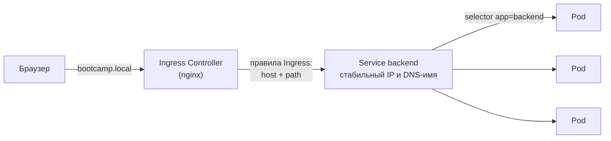

# 16 · Kubernetes: Service и Ingress

!!! abstract "В этой главе"
    **Что вы узнаете:** зачем подам стабильный адрес, как Service находит поды по меткам, чем отличаются ClusterIP, NodePort и LoadBalancer, что такое Ingress и Ingress Controller, как один вход обслуживает несколько сервисов по путям и доменам, что такое Gateway API.

    **Что нужно до начала:**

    - [Глава 15](../15-k8s-pods-deployments/README.md): кластер minikube, namespace `bootcamp`, Deployment `backend` и `redis`.

    **Проверено на:** minikube 1.38 (Kubernetes 1.35), addon ingress (ingress-nginx).

## Зачем это нужно

В главе 15 к backend вы ходили через `kubectl port-forward`: туннель с вашего ноутбука к **одному** поду, пока открыт терминал. Пользователям так не дашь доступ. Есть и вторая проблема — адреса подов:

```text
backend-…-6j9ln   IP 10.244.0.4    ← удалили под
backend-…-77wxr   IP 10.244.0.5    ← новый под, новый IP
```

Каждый новый под получает новый IP. Если бы backend искал Redis по IP, после каждого перезапуска пода Redis связь бы рвалась. При трёх репликах непонятно, на какой из трёх IP слать запрос.

Решения два, и они складываются в цепочку:



- **Service** — стабильный адрес и балансировка **внутри** кластера.
- **Ingress** — вход **снаружи** по HTTP: домен и путь → нужный Service.

## Концепция

### Service

**Service** — объект со стабильным виртуальным IP (ClusterIP) и DNS-именем. Он не знает подов по именам: он выбирает их **по меткам** и сам следит, какие поды сейчас существуют и готовы.

```yaml
apiVersion: v1
kind: Service
metadata:
  name: redis              # DNS-имя внутри кластера
  namespace: bootcamp
spec:
  selector:
    app: redis             # трафик → поды с этой меткой
  ports:
    - port: 6379           # порт Service
      targetPort: 6379     # порт контейнера
```

Отсюда работа `REDIS_URL=redis://redis:6379` из главы 15: имя `redis` — это Service. Под Redis пересоздан с новым IP — Service подхватил его по метке, backend ничего не заметил.

- Полное DNS-имя: `redis.bootcamp.svc.cluster.local`. Внутри того же namespace достаточно `redis`, из другого — `redis.bootcamp`.
- Под попадает в Service, только если проходит **readiness probe** (глава 15). Неготовые поды из балансировки исключаются автоматически.
- Список подов за Service называется **endpoints**: `kubectl get endpointslices -n bootcamp`.

### Три порта

```yaml
ports:
  - port: 3000          # порт Service: http://backend:3000 внутри кластера
    targetPort: 3000    # порт контейнера, куда Service отправляет трафик
    nodePort: 30080     # (только NodePort) порт на каждой ноде, снаружи
```

Цепочка: снаружи `<нода>:30080` → Service `:3000` → контейнер `:3000`. Числа не обязаны совпадать: Service может слушать `80` и отправлять в контейнер `3000`.

### Типы Service

| Тип | Доступен | Когда использовать |
|-----|----------|--------------------|
| **ClusterIP** (по умолчанию) | Только внутри кластера | Базы, кеши, внутренние API — всё, что не должно торчать наружу |
| **NodePort** | Снаружи на `<IP ноды>:30000–32767` на каждой ноде | Отладка, простые стенды |
| **LoadBalancer** | Снаружи через внешний балансировщик облака (в AWS — NLB/ELB) | Один сервис наружу в облаке |

!!! example "Плохо / Хорошо: база данных"

    === "❌ Плохо"

        ```yaml
        kind: Service
        metadata:
          name: redis
        spec:
          type: NodePort        # «чтобы удобно подключаться с ноутбука»
        ```
        Redis без пароля открыт на каждой ноде кластера. Боты находят такие порты за часы.

    === "✅ Хорошо"

        ```yaml
        kind: Service
        metadata:
          name: redis
        spec:                   # type не указан → ClusterIP
        ```
        Для отладки — изнутри кластера: `kubectl exec -it deploy/redis -n bootcamp -- redis-cli`, или временный `kubectl port-forward svc/redis 6379:6379`, который доступен только вам.

### Ingress и Ingress Controller

Если каждому сервису делать `LoadBalancer`, на каждый будет свой облачный балансировщик и свой счёт. **Ingress** решает это иначе: один вход, правила маршрутизации по домену и пути.

| | Что это |
|---|---|
| **Ingress** (объект) | YAML с правилами: «`bootcamp.local/` → Service `backend:3000`» |
| **Ingress Controller** | Программа в кластере (nginx, Traefik, AWS Load Balancer Controller), которая читает объекты Ingress и реально проксирует трафик |
| **IngressClass** | Какой контроллер обрабатывает конкретный Ingress (`ingressClassName: nginx`) |

Без контроллера объект Ingress — просто мёртвый YAML: он создастся, но трафик никуда не пойдёт. В minikube контроллер ставится аддоном `ingress` (ingress-nginx).

```yaml
apiVersion: networking.k8s.io/v1
kind: Ingress
metadata:
  name: bootcamp-ingress
  namespace: bootcamp
spec:
  ingressClassName: nginx
  rules:
    - host: bootcamp.local            # совпадение по HTTP-заголовку Host
      http:
        paths:
          - path: /
            pathType: Prefix          # всё, что начинается с /
            backend:
              service:
                name: backend
                port:
                  number: 3000
```

- `host` сравнивается с заголовком `Host` запроса. Запрос на тот же IP с другим именем (или без имени) под это правило не попадёт.
- `pathType: Prefix` — путь начинается с указанного (`/`, `/api/hits`, `/health`); `Exact` — точное совпадение.

!!! info "ingress-nginx и Gateway API"
    Проект **ingress-nginx** (именно его ставит аддон minikube) в 2026 году выведен из поддержки сообществом Kubernetes. Объект Ingress остаётся в Kubernetes, и другие контроллеры его поддерживают, но для новых установок рекомендуется **Gateway API** — следующее поколение: объекты `Gateway` и `HTTPRoute` с разделением ролей (платформа управляет шлюзом, команды — маршрутами). Понятия те же: вход, правила по хосту и пути, Service за ними. Принципы этой главы переносятся на Gateway API напрямую.

!!! quote "Реальный кейс"
    Стартап с 23 микросервисами начал с простого: каждому сервису `type: LoadBalancer`. Через месяц пришёл счёт: больше $400 только за облачные балансировщики, по одному на сервис, плюс 23 внешних адреса, которые нужно было отслеживать и защищать. Переход на один Ingress Controller с одним балансировщиком перед ним сократил эту строку счёта примерно в 20 раз, а маршрутизация по `api.example.com`, `admin.example.com`, `example.com/docs` стала описываться в нескольких YAML-файлах.

## Практика

```bash
minikube start            # если кластер остановлен — объекты из главы 15 на месте
kubectl get pods -n bootcamp
```

### Шаг 1. Service для backend

`k8s-lab/backend-service.yaml`:

```yaml
apiVersion: v1
kind: Service
metadata:
  name: backend
  namespace: bootcamp
spec:
  type: NodePort
  selector:
    app: backend
  ports:
    - port: 3000
      targetPort: 3000
      nodePort: 30080
```

```bash
kubectl apply -f k8s-lab/backend-service.yaml
kubectl get svc -n bootcamp
```

```text
NAME      TYPE        CLUSTER-IP      EXTERNAL-IP   PORT(S)          AGE
backend   NodePort    10.102.188.61   <none>        3000:30080/TCP   5s
redis     ClusterIP   10.101.0.237    <none>        6379/TCP         20m
```

!!! success "✅ Проверь себя"
    ```bash
    kubectl get endpointslices -n bootcamp -l kubernetes.io/service-name=backend \
      -o jsonpath='{.items[*].endpoints[*].addresses}'
    # → ["10.244.0.5"]  — IP пода backend
    kubectl get pods -n bootcamp -l app=backend -o wide   # тот же IP
    ```
    Service нашёл под по метке.

Проверьте NodePort:

=== "Windows / macOS (Docker Desktop)"

    С драйвером docker адрес ноды не доступен с хоста напрямую — minikube откроет туннель:

    ```bash
    minikube service backend -n bootcamp --url
    # → http://127.0.0.1:54321   (команда держит туннель, не закрывайте)
    ```

    Во втором терминале: `curl.exe http://127.0.0.1:54321/health`.

=== "Linux"

    ```bash
    curl http://$(minikube ip):30080/health
    ```

### Шаг 2. Балансировка между подами

```bash
kubectl scale deploy/backend --replicas=3 -n bootcamp
kubectl rollout status deploy/backend -n bootcamp
kubectl run probe -n bootcamp --rm -i --restart=Never --image=busybox:1.37 -- \
  sh -c 'for i in 1 2 3 4 5 6 7 8 9; do wget -qO- http://backend:3000/info; echo; done'
```

!!! success "✅ Проверь себя"
    В девяти ответах встречаются разные `hostname`: Service распределяет запросы между тремя подами. Распределение **случайное**, а не строго по кругу — так работает kube-proxy. Запрос шёл по имени `backend` изнутри кластера, как ходят друг к другу микросервисы.

!!! warning "Git Bash на Windows"
    Git Bash превращает `/bin/sh` и другие пути в аргументах в пути Windows, и под с командой падает с `ContainerCannotRun`. Используйте PowerShell или отключите конвертацию: `MSYS_NO_PATHCONV=1 kubectl run ...`.

Верните одну реплику: `kubectl apply -f k8s-lab/backend.yaml`.

### Шаг 3. Ingress Controller

```bash
minikube addons enable ingress
kubectl get pods -n ingress-nginx
```

```text
NAME                                        READY   STATUS      RESTARTS   AGE
ingress-nginx-admission-create-bk4lb        0/1     Completed   0          50s
ingress-nginx-admission-patch-xm6st         0/1     Completed   0          50s
ingress-nginx-controller-596f8778bc-ggz7z   1/1     Running     0          50s
```

!!! success "✅ Проверь себя"
    `ingress-nginx-controller` — `1/1 Running` (поды `admission-*` в `Completed` — это одноразовые задачи установки, так и должно быть). `kubectl get ingressclass` → класс `nginx`.

### Шаг 4. Ingress

`k8s-lab/ingress.yaml` — манифест из раздела «Концепция». Примените:

```bash
kubectl apply -f k8s-lab/ingress.yaml
kubectl get ingress -n bootcamp
```

```text
NAME               CLASS   HOSTS            ADDRESS        PORTS   AGE
bootcamp-ingress   nginx   bootcamp.local   192.168.49.2   80      40s
```

Колонка `ADDRESS` заполняется через 30–60 секунд.

### Шаг 5. Открыть `bootcamp.local`

Имя `bootcamp.local` не существует в DNS, поэтому укажите его в файле `hosts` вашего компьютера, а трафик доставьте до контроллера.

**Способ для всех ОС — port-forward к контроллеру:**

```bash
kubectl port-forward -n ingress-nginx svc/ingress-nginx-controller 8088:80
```

(команда держит туннель — не закрывайте терминал)

Добавьте в `hosts` строку `127.0.0.1 bootcamp.local`:

=== "Windows"

    Откройте Блокнот **от имени администратора** → файл `C:\Windows\System32\drivers\etc\hosts` → добавьте строку в конец:

    ```text
    127.0.0.1 bootcamp.local
    ```

=== "macOS / Linux"

    ```bash
    grep -q bootcamp.local /etc/hosts || echo "127.0.0.1 bootcamp.local" | sudo tee -a /etc/hosts
    ```

Во втором терминале:

```bash
curl http://bootcamp.local:8088/health      # → {"status":"ok",...}
curl http://bootcamp.local:8088/info        # → {"hostname":"backend-...",...}
curl http://bootcamp.local:8088/api/hits    # → {"hits":N}
curl -o /dev/null -w "%{http_code}\n" http://127.0.0.1:8088/health   # → 404
```

!!! success "✅ Проверь себя"
    По имени `bootcamp.local` приложение отвечает, а по `127.0.0.1` — `404`: контроллер не нашёл правила для такого `Host`. Это и есть маршрутизация по имени хоста. Откройте `http://bootcamp.local:8088/info` в браузере.

??? info "Другие способы доставить трафик до контроллера"
    - **`minikube tunnel`** (Windows/macOS с драйвером docker): в отдельном терминале с правами администратора, в `hosts` — `127.0.0.1 bootcamp.local`, адрес без порта: `http://bootcamp.local`. Туннелю нужны порты 80/443 на вашем компьютере.
    - **Linux** (или драйвер VirtualBox/Hyper-V): IP ноды доступен напрямую. В `hosts` — `$(minikube ip) bootcamp.local`, адрес `http://bootcamp.local`.
    - В облаке перед контроллером стоит облачный балансировщик (Service `type: LoadBalancer`), а вместо `hosts` — настоящая DNS-запись.

### Шаг 6. Второй сервис на том же входе

Разверните `whoami` (если делали задание главы 15, он уже есть) — `k8s-lab/whoami.yaml`:

```yaml
apiVersion: apps/v1
kind: Deployment
metadata:
  name: whoami
  namespace: bootcamp
spec:
  replicas: 1
  selector:
    matchLabels:
      app: whoami
  template:
    metadata:
      labels:
        app: whoami
    spec:
      containers:
        - name: whoami
          image: traefik/whoami:v1.11
          ports:
            - containerPort: 80
---
apiVersion: v1
kind: Service
metadata:
  name: whoami
  namespace: bootcamp
spec:
  selector:
    app: whoami
  ports:
    - port: 80
      targetPort: 80
```

В `ingress.yaml` добавьте путь **перед** `/`:

```yaml
        paths:
          - path: /whoami
            pathType: Prefix
            backend:
              service:
                name: whoami
                port:
                  number: 80
          - path: /
            pathType: Prefix
            backend:
              service:
                name: backend
                port:
                  number: 3000
```

```bash
kubectl apply -f k8s-lab/whoami.yaml -f k8s-lab/ingress.yaml
curl http://bootcamp.local:8088/whoami     # → Hostname: whoami-...
curl http://bootcamp.local:8088/info       # → по-прежнему backend
```

!!! success "✅ Проверь себя"
    Один вход, один адрес — два сервиса по разным путям. Service `whoami` без `type` — значит ClusterIP: снаружи он доступен **только** через Ingress.

### Шаг 7. Redis — только изнутри

```bash
kubectl exec -it -n bootcamp deploy/redis -- redis-cli
```

```text
127.0.0.1:6379> ping
PONG
127.0.0.1:6379> get hits
"5"
127.0.0.1:6379> exit
```

Отладка базы без единого открытого наружу порта.

### Шаг 8. Остановить

Остановите `port-forward` (`Ctrl+C`). Кластер — `minikube stop`, объекты понадобятся в главе 17. Строку `bootcamp.local` в `hosts` можно оставить до конца главы 18.

## Вопросы для самопроверки

<details markdown="1">
<summary>1. Под backend пересоздан и получил новый IP. Почему nginx-контроллер и другие поды продолжают его находить?</summary>

Все обращаются не к IP пода, а к Service `backend`. Service выбирает поды по метке `app: backend` и сам обновляет список endpoints, когда поды появляются, исчезают или меняют готовность. Ingress-контроллер тоже получает список endpoints из Service. IP подов — деталь, которую никто не должен знать.
</details>

<details markdown="1">
<summary>2. Почему Redis — ClusterIP, а не NodePort, даже для удобства отладки?</summary>

Redis в проекте без пароля. NodePort открывает порт на **каждой** ноде кластера, и если ноды доступны из интернета или из общей сети, базой может воспользоваться кто угодно. Для отладки есть `kubectl exec ... redis-cli` и временный `kubectl port-forward svc/redis`, доступные только тому, у кого есть права на кластер.
</details>

<details markdown="1">
<summary>3. Объект Ingress создан, <code>kubectl get ingress</code> его показывает, а запросы не проходят. Что проверить?</summary>

- Работает ли **Ingress Controller**: `kubectl get pods -n ingress-nginx`. Без него Ingress — просто данные.
- Совпадает ли `ingressClassName` с классом контроллера (`kubectl get ingressclass`).
- Доходит ли трафик до контроллера (port-forward, tunnel, IP ноды) и совпадает ли **Host** запроса с `host` в правиле. Ответ `404 Not Found` от nginx означает «до контроллера дошли, правило не подошло».
- Есть ли у Service endpoints: `kubectl get endpointslices -n bootcamp`. Пусто — selector не совпадает с метками подов, или поды не проходят readiness. Ответ `503` от контроллера — как раз этот случай.
</details>

<details markdown="1">
<summary>4. Когда достаточно Service <code>type: LoadBalancer</code>, а когда нужен Ingress?</summary>

LoadBalancer — один сервис наружу, любой протокол (TCP/UDP, не только HTTP): например, игровой сервер или брокер сообщений. Ingress — много HTTP(S)-сервисов за одним входом, маршрутизация по домену и пути, TLS-сертификаты в одном месте. На практике в кластере обычно один LoadBalancer — перед Ingress Controller (или Gateway), а все веб-сервисы — ClusterIP за ним.
</details>

## Итоги

- [x] Service — стабильный IP и DNS-имя перед меняющимися подами, выбор подов по меткам
- [x] Только готовые (readiness) поды получают трафик
- [x] ClusterIP — внутри, NodePort — порт на нодах, LoadBalancer — облачный балансировщик
- [x] Ingress — правила по host и path; Ingress Controller их исполняет
- [x] Базы — только ClusterIP; отладка через `exec` и `port-forward`
- [x] ingress-nginx выведен из поддержки, будущее — Gateway API

**Что дальше.** Адрес Redis сейчас записан прямо в манифесте Deployment. Для пароля так нельзя, а для разных окружений неудобно. В [главе 17](../17-k8s-config-secrets-rbac/README.md) — ConfigMap, Secret и права подов (RBAC).

- 📋 [Шпаргалка](commands.md)
- 🏋️ [Задания к главе](exercises.md)
