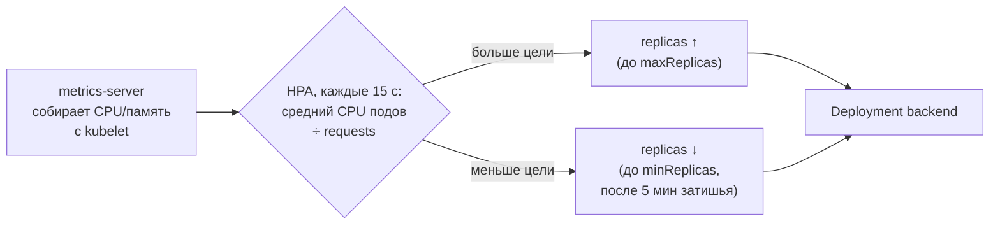

# 18 · Kubernetes: ресурсы и автомасштабирование (HPA)

!!! abstract "В этой главе"
    **Что вы узнаете:** что такое requests и limits и чем грозит их отсутствие, как Kubernetes решает, на какую ноду поставить под, что происходит при превышении лимитов (throttling и OOMKilled), как HorizontalPodAutoscaler считает нужное число реплик, почему масштабирование вверх быстрое, а вниз — медленное.

    **Что нужно до начала:**

    - [Глава 17](../17-k8s-config-secrets-rbac/README.md): backend с ConfigMap, Secret и `backend-sa`.
    - [Глава 16](../16-k8s-services-ingress/README.md): Ingress и `bootcamp.local`.

    **Проверено на:** minikube 1.38 (Kubernetes 1.35), metrics-server из аддона minikube.

## Зачем это нужно

В главе 15 вы масштабировали backend руками: `kubectl scale --replicas=3`. Теперь представьте, что пост о вашем сервисе попал в топ, и вместо сотни пользователей пришло десять тысяч. В три часа ночи. Кто запустит `kubectl scale`? А кто уберёт лишние поды утром, чтобы не платить за простаивающие машины?

**HorizontalPodAutoscaler (HPA)** — контроллер, который следит за нагрузкой подов и сам меняет `replicas` у Deployment: больше нагрузка — больше подов, меньше — меньше. Тот же цикл согласования, что в главе 15, только желаемое число реплик вычисляется из метрик.

Но чтобы считать нагрузку в процентах, Kubernetes должен знать, **сколько ресурсов поду положено**. С этого и начнём.

## Концепция

### Requests и limits

```yaml
resources:
  requests:
    cpu: "100m"        # гарантировано: 0,1 ядра
    memory: "128Mi"    # гарантировано: 128 МиБ
  limits:
    cpu: "500m"        # потолок: 0,5 ядра
    memory: "256Mi"    # потолок: 256 МиБ
```

| | requests | limits |
|---|---|---|
| Что значит | Сколько поду **гарантировано** | Сколько под **может взять максимум** |
| Кто использует | Scheduler: ставит под на ноду, где свободно не меньше requests | Ядро Linux на ноде (cgroups) |
| Превышение CPU | Можно, если на ноде есть свободное | **Throttling**: процесс замедляют, но не убивают |
| Превышение памяти | Можно, если есть свободная | **OOMKilled**: контейнер убивают и перезапускают |
| Для HPA | Проценты нагрузки считаются **от requests** | — |

Единицы:

- CPU: `1` = одно ядро = `1000m` (миллиядер). `100m` — десятая часть ядра.
- Память: `Mi` (мебибайт, 2²⁰ байт), `Gi`. `128Mi` ≈ 134 МБ.

!!! example "Плохо / Хорошо"

    === "❌ Плохо — без resources"

        ```yaml
        containers:
          - name: backend
            image: alexdev/devops-bootcamp-backend:1
        ```
        Scheduler не знает, сколько нужно поду, и может поставить на одну ноду больше, чем она вытянет. Один «прожорливый» под с утечкой памяти съест всю ноду и уронит соседей. HPA по CPU не сможет посчитать проценты.

    === "✅ Хорошо"

        ```yaml
        resources:
          requests: { cpu: "100m", memory: "128Mi" }
          limits:   { cpu: "500m", memory: "256Mi" }
        ```
        Requests — по реальному потреблению в обычном режиме (`kubectl top`), лимит памяти — с запасом на пики. Утечка памяти убьёт только сам контейнер, и Kubernetes его перезапустит.

### Как работает HPA



Формула:

```text
нужно реплик = ⌈ текущие реплики × текущая загрузка / целевая загрузка ⌉
```

Пример из проверки этой главы: 1 под, загрузка CPU **172%** от request, цель **50%**: ⌈1 × 172 / 50⌉ = ⌈3,44⌉ = **4** реплики. Под нагрузкой загрузка распределилась по четырём подам, упала до 85% — и HPA добавил пятый (максимум).

```yaml
apiVersion: autoscaling/v2
kind: HorizontalPodAutoscaler
metadata:
  name: backend-hpa
  namespace: bootcamp
spec:
  scaleTargetRef:
    apiVersion: apps/v1
    kind: Deployment
    name: backend              # кого масштабировать
  minReplicas: 1
  maxReplicas: 5
  metrics:
    - type: Resource
      resource:
        name: cpu
        target:
          type: Utilization
          averageUtilization: 50   # цель: 50% от requests.cpu
```

### Вверх быстро, вниз медленно

- **Вверх** — сразу, как только метрики показали превышение: лучше лишний под, чем потерянные запросы.
- **Вниз** — только если нагрузка держится низкой **5 минут** (окно стабилизации `stabilizationWindowSeconds: 300`). Иначе при волнообразном трафике поды постоянно создавались бы и удалялись («flapping»).

Оба поведения настраиваются в `spec.behavior`.

### Ограничения HPA

- Нужен **metrics-server** (в облачных кластерах обычно уже есть, в minikube — аддон).
- Без `requests.cpu` проценты не посчитать — HPA покажет `<unknown>`.
- HPA добавляет **поды**, а не машины. Закончилось место на нодах — новые поды повиснут в `Pending`. Машины добавляет **Cluster Autoscaler** или **Karpenter** (в облаке).
- `minReplicas: 0` HPA не умеет: масштабирование «с нуля по событию» — задача KEDA.
- Масштабирование по CPU подходит не всем: если приложение упирается в базу или внешний API, лишние поды не помогут. Тогда масштабируют по другим метрикам: длине очереди, RPS, задержке (custom/external metrics).

!!! quote "Реальный кейс"
    Интернет-магазин настроил HPA перед распродажей: `minReplicas: 2`, `maxReplicas: 50`. В час старта трафик вырос в 30 раз, HPA послушно запросил 50 подов — и 35 из них повисли в `Pending`: на нодах кончилось место, а автомасштабирования нод не было. Оставшиеся 15 подов не справлялись, магазин отвечал по 10 секунд. Выводы: HPA и масштабирование нод работают только в паре; `maxReplicas` должен соответствовать тому, что кластер реально может вместить; нагрузочный тест — до распродажи, а не во время.

## Практика

```bash
minikube start
kubectl get pods -n bootcamp                # backend, redis Running
```

### Шаг 1. metrics-server

```bash
minikube addons enable metrics-server
kubectl get pods -n kube-system -l k8s-app=metrics-server     # → 1/1 Running
```

Через минуту метрики появятся:

```bash
kubectl top nodes
kubectl top pods -n bootcamp
```

```text
NAME                      CPU(cores)   MEMORY(bytes)
backend-ddb6ff584-v2brl   4m           22Mi
redis-c46d5dffc-6f62z     4m           3Mi
```

!!! success "✅ Проверь себя"
    `kubectl top pods` показывает цифры. `error: Metrics API not available` — metrics-server ещё стартует, подождите минуту. В покое backend потребляет единицы миллиядер и десятки мегабайт — это и есть ориентир для requests.

### Шаг 2. Ресурсы в Deployment

Добавьте в контейнер backend (`k8s-lab/backend.yaml`):

```yaml
          resources:
            requests:
              cpu: "100m"
              memory: "128Mi"
            limits:
              cpu: "500m"
              memory: "256Mi"
```

```bash
kubectl apply -f k8s-lab/backend.yaml
kubectl describe pod -n bootcamp -l app=backend | grep -A4 -E "Limits|Requests"
kubectl describe node | grep -A6 "Allocated resources"    # сколько ресурсов ноды уже «обещано»
```

!!! success "✅ Проверь себя"
    В `describe pod` — ваши requests и limits. В `Allocated resources` у ноды учтены 100m CPU этого пода.

### Шаг 3. HPA

`k8s-lab/hpa.yaml` — манифест из раздела «Как работает HPA».

```bash
kubectl apply -f k8s-lab/hpa.yaml
kubectl get hpa -n bootcamp
```

```text
NAME          REFERENCE            TARGETS       MINPODS   MAXPODS   REPLICAS   AGE
backend-hpa   Deployment/backend   cpu: 4%/50%   1         5         1          1m
```

!!! success "✅ Проверь себя"
    В `TARGETS` — число, а не `<unknown>`: `4%/50%` значит «сейчас 4% от request, цель 50%». `<unknown>` в первую минуту нормален; если держится дольше — проверьте metrics-server и наличие `requests.cpu`.

### Шаг 4. Нагрузка

Откройте **три** терминала.

**Терминал 1** — наблюдать за HPA:

```bash
kubectl get hpa -n bootcamp -w
```

**Терминал 2** — наблюдать за подами:

```bash
kubectl get pods -n bootcamp -l app=backend -w
```

**Терминал 3** — генератор нагрузки. Нагрузку создаём **изнутри кластера**: четыре параллельных цикла запросов к Service `backend` из отдельного пода:

```bash
kubectl run load -n bootcamp --image=busybox:1.37 --restart=Never -- \
  sh -c 'for w in 1 2 3 4; do (while true; do wget -q -O /dev/null http://backend:3000/api/hits; done) & done; wait'
```

!!! info "Почему не `while true; do curl ...` с ноутбука"
    Один последовательный цикл `curl` через `port-forward` упирается в сам туннель и не создаёт заметной нагрузки на CPU пода. Под в кластере обращается к Service напрямую и может делать сотни запросов в секунду. Именно так нагрузку генерирует и официальное руководство Kubernetes по HPA.

Через 30–90 секунд:

```text
NAME          REFERENCE            TARGETS         MINPODS   MAXPODS   REPLICAS
backend-hpa   Deployment/backend   cpu: 172%/50%   1         5         1
backend-hpa   Deployment/backend   cpu: 172%/50%   1         5         4
backend-hpa   Deployment/backend   cpu: 85%/50%    1         5         4
backend-hpa   Deployment/backend   cpu: 56%/50%    1         5         5
```

!!! success "✅ Проверь себя"
    - Реплик стало больше одной, в терминале 2 появились новые поды `ContainerCreating → Running`.
    - `kubectl describe hpa backend-hpa -n bootcamp` → в Events: `New size: 4; reason: cpu resource utilization (percentage of request) above target`.
    - `kubectl top pods -n bootcamp -l app=backend` — нагрузка распределена между подами.

    Ваши цифры будут другими: они зависят от процессора компьютера.

### Шаг 5. Балансировка своими глазами

Пока работает нагрузка, запустите port-forward к Ingress Controller из главы 16 (если он не запущен) и спросите `/info` несколько раз:

=== "macOS / Linux / Git Bash"

    ```bash
    for i in $(seq 1 10); do curl -s http://bootcamp.local:8088/info; echo; done
    ```

=== "Windows (PowerShell)"

    ```powershell
    1..10 | ForEach-Object { curl.exe -s http://bootcamp.local:8088/info; "" }
    ```

```text
{"hostname":"backend-ddb6ff584-86g7g","version":"1.0.0","node":"v22.23.4"}
{"hostname":"backend-ddb6ff584-n776l","version":"1.0.0","node":"v22.23.4"}
{"hostname":"backend-ddb6ff584-v2brl","version":"1.0.0","node":"v22.23.4"}
{"hostname":"backend-ddb6ff584-bqm6d","version":"1.0.0","node":"v22.23.4"}
...
```

!!! success "✅ Проверь себя"
    `hostname` меняется: запросы распределяются между подами, которые Kubernetes создал сам, без вашего участия. Счётчик `/api/hits` при этом общий — все копии пишут в один Redis. Это и есть горизонтальное масштабирование приложения без состояния.

### Шаг 6. Нагрузка ушла

```bash
kubectl delete pod load -n bootcamp
```

Смотрите в терминал 1. Загрузка упадёт за минуту, а число реплик ещё **около 5 минут** останется прежним, затем вернётся к `minReplicas`:

```text
cpu: 48%/50%   … REPLICAS 5      # +1 мин
cpu: 3%/50%    … REPLICAS 5      # +2…6 мин — окно стабилизации
cpu: 3%/50%    … REPLICAS 1      # ~+7 мин
```

!!! success "✅ Проверь себя"
    Через 5–7 минут после остановки нагрузки — снова одна реплика. В `kubectl describe hpa` — событие `New size: 1; reason: All metrics below target`.

### Шаг 7. HPA и ручной scale

```bash
kubectl scale deploy/backend --replicas=3 -n bootcamp
kubectl get hpa -n bootcamp -w
```

HPA увидит три пода при нагрузке ниже цели и вернёт одну реплику — но по своим правилам, то есть после 5-минутного окна стабилизации. Пока HPA управляет Deployment, ручной `scale` работает только до следующего решения контроллера.

Отсюда правило: при использовании HPA поле `replicas` из манифеста Deployment **убирают**. Иначе каждый `kubectl apply` сбрасывал бы число реплик к значению из файла — например, с пяти подов под нагрузкой до одного, — и HPA пришлось бы набирать их заново. В `project/k8s/backend-deployment.yaml` поля `replicas` нет: при создании Deployment получает одну реплику по умолчанию, дальше числом управляет HPA.

### Шаг 8. Итоговый проект и уборка

Сравните свою папку `k8s-lab/` с эталоном `project/k8s/` пособия — это весь проект глав 15–18. Применить эталон целиком (подставив свой образ):

```bash
kubectl apply -f devops-handbook/project/k8s/
```

Когда закончите с Kubernetes:

!!! success "✅ Проверь себя перед удалением"
    ```bash
    kubectl config current-context        # → minikube, а не рабочий кластер
    kubectl get all -n bootcamp
    ```

```bash
kubectl delete namespace bootcamp         # удалит все объекты проекта
minikube stop                             # или minikube delete — удалить кластер целиком
```

Уберите строку `bootcamp.local` из файла `hosts`.

!!! success "✅ Проверь себя"
    `kubectl get ns bootcamp` → `NotFound`; `minikube status` → `Stopped` (или профиль не найден после `delete`).

## Вопросы для самопроверки

<details markdown="1">
<summary>1. Чем requests отличаются от limits? Что будет при превышении каждого для CPU и для памяти?</summary>

Requests — гарантированный минимум, по нему scheduler выбирает ноду и HPA считает проценты. Limits — жёсткий потолок. CPU сверх лимита не дадут — процесс замедлится (throttling), но продолжит работать. Память сверх лимита — контейнер убьют (`OOMKilled`) и перезапустят. Поэтому лимит памяти ставят с запасом, а частые OOMKilled — повод искать утечку или увеличивать лимит.
</details>

<details markdown="1">
<summary>2. HPA показывает <code>cpu: &lt;unknown&gt;/50%</code>. Почему?</summary>

Нет метрик: не запущен или ещё не прогрелся metrics-server (`kubectl top pods` выдаёт ошибку), либо у контейнера не задан `requests.cpu` — тогда процент не от чего считать. В первую минуту после создания HPA `<unknown>` — норма.
</details>

<details markdown="1">
<summary>3. Нагрузка выросла так, что и 5 реплик загружены на 100%. Что сделает HPA и что делать вам?</summary>

HPA остановится на `maxReplicas: 5` и будет показывать загрузку выше цели. Варианты: поднять `maxReplicas` (если на нодах есть место — иначе новые поды будут `Pending`, и нужен автоскейлер нод), увеличить ресурсы пода, оптимизировать приложение. И найти настоящее узкое место: если тормозит Redis или база, добавление подов backend нагрузку на них только увеличит.
</details>

<details markdown="1">
<summary>4. Почему HPA уменьшает число подов только через 5 минут после спада нагрузки?</summary>

Защита от «дребезга» (flapping): при волнообразном трафике быстрое удаление подов привело бы к тому, что на следующей волне их пришлось бы создавать снова, а новые поды отвечают не сразу. HPA выбирает максимальную рекомендацию за последние 5 минут. Окно можно сократить в `spec.behavior.scaleDown.stabilizationWindowSeconds`, если трафик ровный, а ресурсы дороги.
</details>

<details markdown="1">
<summary>5. Почему при использовании HPA из манифеста Deployment убирают <code>replicas</code>?</summary>

Иначе каждый `kubectl apply` (или деплой из CI/GitOps) будет возвращать число реплик к значению из файла, «перебивая» HPA. Под нагрузкой это значит внезапное падение с пяти подов до одного на время, пока HPA снова не наберёт реплики. Без поля `replicas` `apply` его не трогает, и числом реплик управляет только HPA.
</details>

## Итоги

- [x] Requests — гарантия и основа для scheduler и HPA; limits — потолок (CPU — throttling, память — OOMKilled)
- [x] HPA: ⌈реплики × текущая / целевая загрузка⌉, в пределах `minReplicas`–`maxReplicas`
- [x] Нужны metrics-server и `requests.cpu`; вверх — быстро, вниз — после 5 минут затишья
- [x] HPA добавляет поды, а не ноды; без автоскейлера нод поды повиснут в `Pending`
- [x] Сервис без состояния масштабируется горизонтально: `hostname` меняется, счётчик общий

**Что дальше.** Проект в `project/k8s/` — это 9 YAML-файлов, которые применяются по отдельности, а для другого окружения их пришлось бы копировать. Следующие шаги, которые выходят за рамки этого пособия: **Helm** (один параметризованный пакет вместо набора файлов), **GitOps с Argo CD** (кластер сам синхронизируется с git), **Prometheus и Grafana** (backend уже отдаёт метрики на `/metrics`). Загляните в [Типичные ошибки](../troubleshooting.md) и [Глоссарий](../glossary.md), если что-то из пройденного стоит повторить.

- 📋 [Шпаргалка](commands.md)
- 🏋️ [Задания к главе](exercises.md)
