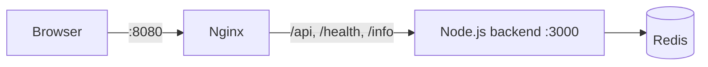

# DevOps с нуля

Пособие для самостоятельного изучения DevOps. Подходит тем, кто начинает с нуля.
Вы шаг за шагом обвешиваете одно небольшое веб-приложение инфраструктурой: облако AWS, Terraform, Docker, CI на Jenkins, Ansible, Kubernetes.

## Учебный проект

| Endpoint | Что возвращает |
|----------|----------------|
| `GET /` | Фронтенд (статика через Nginx) |
| `GET /api/hits` | Счётчик, каждый запрос увеличивает его в Redis |
| `GET /health` | Healthcheck backend-а |
| `GET /info` | Hostname контейнера и версия приложения |
| `GET /metrics` | Метрики в формате Prometheus |

Код приложения готов и лежит в папке `app/` репозитория. Ваша задача — инфраструктура вокруг него. Эталонные версии всех файлов лежат в `project/`.

## Как учиться

1. Начните с [главы 00](00-setup/README.md): установите инструменты и настройте защиту от лишних расходов в AWS.
2. Проходите главы по порядку. Каждая опирается на предыдущие.
3. В каждой главе три части: теория и практика, шпаргалка (`commands.md`), задания (`exercises.md`).
4. Не пропускайте блоки **✅ Проверь себя**. Если результат не совпал, загляните в [Типичные ошибки](troubleshooting.md).
5. После каждой главы, где вы работали в AWS, **удаляйте ресурсы**. Это правило, а не совет.

!!! tip "С чего начать прямо сейчас"
    Начните с [главы 00](00-setup/README.md). Главы 09–12 и 15–18 работают локально, без аккаунта AWS: если хочется сразу «потрогать» контейнеры, можно начать с [главы 09 — Docker](09-docker/README.md).

## Безопасность

- Никогда не коммитьте `*.pem`, `*.tfstate`, `.env`, `terraform.tfvars`, `inventory.ini`.
- Настройте AWS Budget Alert на $10 в месяц ещё до первого ресурса.
- В конце каждой сессии в AWS удаляйте ресурсы: `terraform destroy` или вручную.
